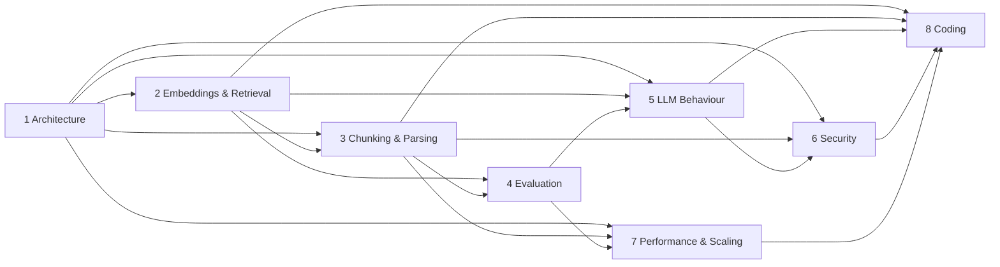

# AdvancedRAG: AI Engineer Interview Course (2026)

A self-contained study course built from the AdvancedRAG repository (commit `31bad7e`) and **updated on 2026-10-23 after an implementation-and-verification pass** (uncommitted working tree on top of `31bad7e`; see §7.5 and [docs/verification/](docs/verification/FEATURE_MATRIX.md)). It does not need an AI assistant or a subscription: every module has its own assessment and a separate answer key at the end of the file.

Written for: you, studying alone, to explain, debug, evaluate and defend AdvancedRAG in an AI-engineer interview.

---

## 1. How to use this course

1. Read the modules in order (dependencies are in §4). For each module: read, run the `# runnable` code, do the exercises, attempt the assessment **before** reading the answer key, then check yourself.
2. Keep the [question bank](ADVANCED_RAG_INTERVIEW_QUESTION_BANK_2026.md) for speaking practice (60–90 seconds per answer, out loud).
3. Use [coding practice](ADVANCED_RAG_CODING_PRACTICE.md) for hands-on drills and [quick revision](ADVANCED_RAG_QUICK_REVISION.md) the night before.
4. **Documentation completion is not mastery.** Nothing in this course is marked as passed on your behalf. Section 8 is a checklist that only you fill in.

## 2. How to read the evidence labels

Every statement about AdvancedRAG is tied to evidence. The five classes you asked for, and the tags used in the modules:

| Class | Meaning | Tag in modules |
|---|---|---|
| Implemented and verified | I read the code **and** a repository test for it passed when I ran the suites | *Code-read* + *Ran* / *tests* |
| Implemented, not verified end to end | Code exists; needs real services (Pinecone, PostgreSQL, Redis, LLM gateway) that I did not run | *Code-read*, *Documented* |
| Partially implemented | Some of the behaviour exists; gaps named | *Partial* |
| Planned or missing | Not in the code | *Missing* |
| Unknown | I could not determine it from the repository | *Unknown* |

Other tags: **[Documented]** a repository document states a result that I did **not** reproduce (all benchmark numbers); **[Illustrative]** arithmetic from stated assumptions, never a measurement; **[Ran]** I executed it in this session. I never claim to have run benchmarks, inspected production logs, or verified a deployment, because I did not.

## 3. Table of contents

| # | Module | File | Study time* | Depends on |
|---|---|---|---|---|
| 1 | System Architecture | [MODULE_1_SYSTEM_ARCHITECTURE.md](docs/course/MODULE_1_SYSTEM_ARCHITECTURE.md) | 3–4 h | – |
| 2 | Embeddings and Retrieval | [MODULE_2_EMBEDDINGS_AND_RETRIEVAL.md](docs/course/MODULE_2_EMBEDDINGS_AND_RETRIEVAL.md) | 5 h | 1 |
| 3 | Chunking and Document Parsing | [MODULE_3_CHUNKING_AND_DOCUMENT_PARSING.md](docs/course/MODULE_3_CHUNKING_AND_DOCUMENT_PARSING.md) | 5 h | 1, 2 |
| 4 | Evaluation and Benchmarking | [MODULE_4_EVALUATION_AND_BENCHMARKING.md](docs/course/MODULE_4_EVALUATION_AND_BENCHMARKING.md) | 5 h | 2, 3 |
| 5 | LLM Behavior and Generation | [MODULE_5_LLM_BEHAVIOR_AND_GENERATION.md](docs/course/MODULE_5_LLM_BEHAVIOR_AND_GENERATION.md) | 5 h | 1, 2, 4 |
| 6 | Security and Reliability | [MODULE_6_SECURITY_AND_RELIABILITY.md](docs/course/MODULE_6_SECURITY_AND_RELIABILITY.md) | 5 h | 1, 3, 5 |
| 7 | Performance and Scaling | [MODULE_7_PERFORMANCE_AND_SCALING.md](docs/course/MODULE_7_PERFORMANCE_AND_SCALING.md) | 4 h | 1, 3, 4 |
| 8 | Coding and Practical Interviews | [MODULE_8_CODING_AND_PRACTICAL_INTERVIEWS.md](docs/course/MODULE_8_CODING_AND_PRACTICAL_INTERVIEWS.md) | 10–12 h | all |
| – | Interview question bank (172 questions) | [ADVANCED_RAG_INTERVIEW_QUESTION_BANK_2026.md](ADVANCED_RAG_INTERVIEW_QUESTION_BANK_2026.md) | 8 h | all |
| – | Coding practice (levels 1–5) | [ADVANCED_RAG_CODING_PRACTICE.md](ADVANCED_RAG_CODING_PRACTICE.md) | 6 h | 8 |
| – | Quick revision | [ADVANCED_RAG_QUICK_REVISION.md](ADVANCED_RAG_QUICK_REVISION.md) | 1 h | all |

\*Study times are my estimates for a learner who knows basic Python and HTTP; they were not measured. Total ≈ 55–60 hours.

### What each module covers

**Module 1: System Architecture.**
*Objectives:* explain what AdvancedRAG does, draw the architecture, narrate ingestion and question flows with real functions, justify (and criticise) the four-service split, give 30-second/2-minute/5-minute explanations.
*Prerequisites:* HTTP, JSON, databases, environment variables.
*Contents:* diagrams (architecture, two sequence diagrams), responsibilities, sync vs async, failure boundaries, deployment and env vars, trade-offs, file-level request traces.

**Module 2: Embeddings and Retrieval.**
*Objectives:* compute similarity measures and retrieval metrics by hand, explain dense/sparse/hybrid retrieval, RRF and reranking, trace the real query path, debug retrieval.
*Prerequisites:* Module 1; dot product and logarithms.
*Key project facts:* bge-small-en-v1.5 (384-d) local; Pinecone for vectors; PostgreSQL full-text (**not BM25**); **pgvector not used**; model/dimension/metric integrity checks; a recorded retrieval comparison on a synthetic corpus.

**Module 3: Chunking and Document Parsing.**
*Objectives:* describe the full ingestion lifecycle, supported formats and libraries, chunking strategies and what is actually implemented, token limits, duplicates, updates and deletion, the 25 MB question, OCR/image uploads, durable storage (the retired base64 workaround), dedup and versions.
*Prerequisites:* Modules 1–2.

**Module 4: Evaluation and Benchmarking.**
*Objectives:* separate retrieval and answer evaluation, build labelled sets, avoid leakage, compute metrics with confidence intervals, evaluate abstention and latency, audit the historical claims, write a reproducible plan.
*Prerequisites:* Modules 2–3; basic statistics.

**Module 5: LLM Behavior and Generation.**
*Objectives:* transformer basics at interview depth, prompt assembly, temperature, hallucination and grounding, prompt injection, the multi-call workflow and its cost, provider failures.
*Prerequisites:* Modules 1, 2, 4.

**Module 6: Security and Reliability.**
*Objectives:* threat-model the system, read an evidence-based risk register (18 risks with threat, impact, mitigation, verification, safe test, fix, regression test), distinguish verified protections from open gaps.
*Prerequisites:* Modules 1, 3, 5.

**Module 7: Performance and Scaling.**
*Objectives:* locate bottlenecks, apply Little's Law, work the 25 MB and 100-concurrent scenarios with explicit assumptions, plan scaling in stages, know what a small app does not need.
*Prerequisites:* Modules 1, 3, 4.

**Module 8: Coding and Practical Interviews.**
*Objectives:* solve 30 exercises across Python, text processing, chunking, vectors, top-k, metrics, FastAPI, SQL, async, LLM clients with mocks, idempotent ingestion, evaluation and a complete RAG endpoint.
*Prerequisites:* Python; Modules 2–5 for domain context.

## 4. Module dependencies



## 5. Suggested study sequence (4 weeks, ~15 h/week)

| Week | Do |
|---|---|
| 1 | Modules 1–2; question bank categories 1–3; draw the architecture from memory daily |
| 2 | Modules 3–4; bank categories 4–7; reproduce the chunking demo and the metric calculations |
| 3 | Modules 5–7; bank categories 8–9, 14–15; rehearse the risk register aloud |
| 4 | Module 8 and coding practice; bank categories 10–13 and 16; mock interview using the one-page sheet in the quick revision |

Short on time? Read Module 1, the "Implementation" and "Common mistakes" sections of Modules 2–6, the risk summary in Module 6, the quick revision, and do 10 exercises.

## 6. Self-assessment instructions

1. Every module ends with an **Assessment** section (questions only) and, after it, a section labelled **ANSWER KEY (do not read until you have attempted the assessment)**.
2. Write your answers on paper or in a file. Do the arithmetic by hand first.
3. Open the answer key. For each question mark: *correct*, *partly*, *wrong*. Read the "misconception" notes even for correct answers.
4. Rule of thumb: ≥ 80% correct with correct reasoning = ready to move on; 60–79% = redo the weak sections and retry; < 60% = re-read the module.
5. Run every `# runnable` block (`python file.py` after pasting); each prints `ok` when its tests pass.
6. Speak the interview answers aloud; being able to *explain*, not recognise, is the target.

## 7. Evidence summary: what is true of the repository

### 7.1 Capability status (after the implementation pass)

Status classes are the five from §2. "Verified" here means the repository's tests and my recorded runs on a local machine (hermetic: local vector store or a Pinecone-emulating server, mock gateway, throw-away PostgreSQL). Nothing was run against production, real Pinecone, the real LLM gateway or a deployment. The full per-feature table is [FEATURE_MATRIX.md](docs/verification/FEATURE_MATRIX.md).

| Class | Capabilities |
|---|---|
| **Implemented and verified (hermetic)** | upload validation and content sniffing; hostile-input guards (zip bomb/ratio, pixel flood, malformed images); OCR for scanned/mixed PDFs and PNG/JPEG with real engine tests (**off by default**); partial-extraction report surfaced in API and UI; text clean-up; recursive (default), heading-aware and semantic chunking; CSV/DOCX table handling; durable per-document storage (`local`/`s3`/`db`) with sha256 check and explicit `FILE_MISSING`; temp-file streaming to RAG Core; durable resumable job queue (heartbeat, stale requeue, bounded retries); upload dedup (per user, race-safe on PostgreSQL); versions (replace/restore/purge); complete delete across versions, blobs and vectors; embedding model/dimension/metric integrity and reindex-from-chunks; RRF, rerank and fallbacks; citation validation plus a numeric-figure check; per-user stream cap; trace-id propagation and queue/job metrics; retrieval evaluation tooling with intervals; API-routing parity (frontend contract test) and 23 Playwright tests; JWT/refresh/rate-limit/IDOR tests |
| **Implemented, not verified end to end** | real Pinecone dense retrieval, hosted reranking and index metadata checks; a real S3/R2 bucket; Redis limiter (tests skipped without Redis); the real LLM gateway; `scripts/rag_benchmark.py` (fixed but **not run**); any deployment; backups of the managed database |
| **Partial** | OCR accuracy (unmeasured); performance (a size ladder and one embedding-throughput sample, no concurrent-load test); security (dependency audit and hostile-input tests, but no sandbox, no pentest, unpinned dependencies); observability (metrics and trace ids exist, no dashboards or alerts); retention (no policy; citation snippets of deleted documents persist); the stream cap is per process |
| **Missing / planned** | PDF table extraction; chunk-level dedup of retrieved evidence; pgvector; parser sandbox and pypdf timeout; global LLM limiter; load/soak tests; tracing spans/exporter; resumable per-batch checkpoints inside one ingestion attempt; native structured outputs/tools in Agent Core |
| **Unknown** | deployment state (my saved notes say FreeLLMAPI production hosting was not yet deployed); production storage backend in effect (`render.yaml` still sets `local`); Pinecone namespace limit for the plan; correctness of `TRUSTED_PROXY_HOPS` in production; production dependency versions; behaviour of the live model under injection; whether the SSE request's DB session is held for the whole stream; the identity of one backend test that failed once on SQLite and did not reproduce in seven later runs |

### 7.2 Findings that change how you present the project

Items 1-10 were findings at `31bad7e`; the status column says what happened to each.

| # | Finding at `31bad7e` | Status now |
|---|---|---|
| 1 | No existing interview guide was in the repository, so the course was built from code and project docs only | unchanged |
| 2 | Hybrid keyword search is PostgreSQL full-text (`ts_rank_cd`), not BM25; pgvector is not used | unchanged; now **measured to be weaker** than a BM25 reference on the synthetic corpus (hypothesis: no IDF; untested) |
| 3 | Agent Core is classify, rewrite, grade, bounded correction, generate, verify (typical 4 LLM calls, worst case 8) | unchanged |
| 4 | Retrieval scope is the user's whole Knowledge Base, not conversation attachments | unchanged |
| 5 | Local-storage uploads were base64-copied into `background_jobs.payload` (x4/3), kept 30 days, not cleared on delete | **fixed in code**: jobs reference durable objects; legacy payloads scrubbed. Production config still selects `local` |
| 6 | The binding document limit is 5,000 chunks (about 5 MB of text), not 25 MB of bytes | **confirmed by measurement** (5 MB+ text refused with `DOCUMENT_TOO_LARGE`) |
| 7 | A same-dimension embedding-model swap was not detected | **fixed**: model + dimension checked on read, `/ready` reports it, reindex repairs |
| 8 | The benchmark's refusal regex did not match the abstain sentence | **fixed in the script, not re-run** (needs live services) |
| 9 | All of RAG Core's trust in `user_id` rests on one shared internal token | unchanged |
| 10 | Deployment claims must be phrased "configured for", not "running on" | unchanged |
| 11 | (new) Cold-start refresh failure logged users out; frontend calls were never checked against backend routes | **fixed**; contract test added |
| 12 | (new) Pillow, pypdf and certifi in the dev environment had published advisories | **upgraded**, re-audit clean; floors raised in `rag-core/requirements.txt` |

### 7.3 Audit of the historical benchmark claims (full detail in Module 4 §6)

Source: `docs/rag-architecture.md` §3 (2026-10-08). **None reproduced by me**: the script needs a live stack with a real Pinecone key and LLM gateway, which would consume external quota; I was not authorised to run it.

| Claim in your brief | Repository says | Label |
|---|---|---|
| 69 vectors for 69 chunks | same, plus sampled-vector checks | Documented, not reproduced |
| Hit@1 19/20 | final stage 19/20 | Documented; arithmetic-consistent |
| Hit@6 20/20 | 20/20 at every stage | Documented |
| MRR 0.975 | 0.975 | Documented; consistent with exactly one question at rank 2 (checked by brute force) |
| Median latency 1.1 s | p50 1.1 s, **retrieval only** | Documented |
| Maximum latency 2.5 s | **2.3 s** | **Contradicted by the repository**; use 2.3 s |

What they do not prove: 20 author-written questions on a 69-chunk corpus, labels by phrase match, the questions were visible while the system was fixed (dev = test), one run, Wilson 95% interval for 19/20 is [0.76, 0.99].

### 7.4 Test runs I executed (2026-10-23, Windows, Python 3.13, working tree on top of `31bad7e`)

| Suite | SQLite (default) | Isolated local PostgreSQL 18 |
|---|---|---|
| `rag-core` | 196 passed, 5 skipped (PostgreSQL-only) | 201 passed |
| `agent-core` | 206 passed | - |
| `llm` | 92 passed | - |
| `backend` | 264 passed, 5 skipped (Redis x3, S3 gate, migration-on-SQLite) | 264 passed, 5 skipped |
| `tests/contract` | 52 passed | - |
| frontend lint / build | clean / succeeds | - |
| Playwright (isolated stack, mock gateway) | 23 passed | - |

Baseline before any change, for comparison: rag-core 87 passed/4 skipped, agent-core 199, backend 218 passed/4 skipped (SQLite). One backend SQLite run in this pass reported one failure that I did not capture and could not reproduce in seven later full runs; it is recorded as an unexplained intermittent failure.

Other recorded runs: retrieval evaluation (`docs/verification/RETRIEVAL_EVALUATION.md`), ingestion ladder and local dump/restore (`PERFORMANCE_AND_BACKUP.md`), `pip-audit` (`SECURITY_AUDIT.md`).

These show the code does what its tests say. They are not quality, security or performance evidence for production. I did **not** run: `scripts/rag_benchmark.py`, any concurrent-load test, any test against real Pinecone/Redis/S3/LLM services or a deployment, `ruff`/`mypy` (not configured in the project).

### 7.5 What changed in the implementation pass

Read first: [FEATURE_MATRIX](docs/verification/FEATURE_MATRIX.md) (every feature with status, evidence and limits), [RETRIEVAL_EVALUATION](docs/verification/RETRIEVAL_EVALUATION.md), [PERFORMANCE_AND_BACKUP](docs/verification/PERFORMANCE_AND_BACKUP.md), [SECURITY_AUDIT](docs/verification/SECURITY_AUDIT.md). Each module opens with an "Update after the implementation pass" note listing what changed for that module; sections that were wrong were corrected in place.

## 8. Progress checklist (yours to fill in)

Nothing is pre-ticked. Status values: Not started · Learning · Needs revision · Assessment passed (your own judgement after the self-assessment).

| Module | Read | Ran code | Attempted assessment | Checked key | Weak areas revisited | Status |
|---|---|---|---|---|---|---|
| 1 Architecture | ☐ | ☐ | ☐ | ☐ | ☐ | Not started |
| 2 Embeddings and Retrieval | ☐ | ☐ | ☐ | ☐ | ☐ | Not started |
| 3 Chunking and Parsing | ☐ | ☐ | ☐ | ☐ | ☐ | Not started |
| 4 Evaluation | ☐ | ☐ | ☐ | ☐ | ☐ | Not started |
| 5 LLM Behavior | ☐ | ☐ | ☐ | ☐ | ☐ | Not started |
| 6 Security | ☐ | ☐ | ☐ | ☐ | ☐ | Not started |
| 7 Scaling | ☐ | ☐ | ☐ | ☐ | ☐ | Not started |
| 8 Coding | ☐ | ☐ | ☐ | ☐ | ☐ | Not started |
| Question bank (172) | ☐ answered aloud | | | | | Not started |
| Coding practice | ☐ | ☐ | | | | Not started |

### Final readiness checklist (be honest)

- [ ] I can draw the architecture and both flows from memory.
- [ ] I can say, without notes, what is implemented, partial, missing and unknown, and which evidence is hermetic.
- [ ] I can compute Hit@K, Precision@K, Recall@K, MRR and nDCG by hand and explain the historical results and their limits.
- [ ] I can explain the 25 MB question, why the base64 workaround was retired, and what durable storage changes.
- [ ] I can explain the top risks and never call the system "secure" without qualification.
- [ ] I can solve the coding exercises without looking.

## 9. Validation report (this documentation)

Re-run on 2026-10-23 after the implementation-pass edits, by scripts kept outside the repository:

| Check | Result |
|---|---|
| All 8 module files + master + 3 companions exist | Yes (12 Markdown files) plus 4 verification documents in `docs/verification/` |
| Internal Markdown links and anchors | All resolve; the script's one hit (`](c)` in Module 8) is Python code inside a code block, a false positive |
| Placeholders / empty sections | None (the word "placeholder" appears only in technical senses, e.g. "assistant placeholder message") |
| Question bank | 172 questions, 172 unique ids, 17 categories (Q161-Q172 cover the implementation pass) |
| Module 8 | 30 exercises (E1–E30) + 3 drills (P1–P3) |
| Executable code blocks (`# runnable`) | 88 blocks executed again after the edits with the repository's Python 3.13 environment; 88 passed, 0 failed. These blocks are self-contained; they do not test the new implementation (its tests are in §7.4) |
| Numeric answer keys | Recomputed by script for Modules 2–5, 7, 8 (all match; two keys corrected during validation) |
| Real-function check | `agent_core.citations.strip_invalid_markers` called directly; result matches the Module 5 key |
| Secrets | Regex scan of the course files for common key shapes: none. Tracked repository files scanned the same way: none (only `.env.example` files are tracked) |
| Mermaid diagrams (7) | Rendered during PDF export; see §9.1 for the outcome |
| Official-documentation checks | Fetched on 2026-10-23: bge-small-en-v1.5 model card, Pinecone rerank docs, pgvector README, PostgreSQL text-search ranking docs, OWASP prompt injection and file-upload pages, FastAPI request-files. Not retrieved/parsed: the RRF paper PDF, Pinecone plan limits (so namespace limits are marked unknown) |

### 9.1 PDF export

`ADVANCED_RAG_2026_COURSE.pdf` (repository root) contains the master course, Modules 1–8, the question bank, the coding practice, the quick revision and the four `docs/verification/` documents in that order (regenerated 2026-10-23 after the implementation-pass edits; 219 pages by text extraction, with the new content and Q172 present and no Mermaid syntax-error text found). It was generated from the Markdown with pandoc (GitHub-flavoured Markdown to HTML with a table of contents) and printed with headless Google Chrome. The 7 Mermaid diagrams were rendered by Mermaid 10.9.1 loaded from cdnjs during export (a public CDN fetch; no course content was sent anywhere) and all 7 produced SVG with no syntax errors. Checked by text extraction (219 pages after the 2026-10-23 regeneration; code, tables, formulas, diagrams and answer keys present); I did **not** inspect the pages visually, so check wide tables and long code lines yourself. Links between files are not clickable across parts of the PDF; use the table of contents. Regenerate it after editing any Markdown file.

## 10. Known limitations of this course

- The implementation pass is uncommitted and its evidence is hermetic; see §7.1 for what is and is not verified. Claims in the modules about the new features were checked against the code and tests named beside them, but older line-number references from `31bad7e` were not all refreshed.

- No benchmark, load, security or deployment test was run against real services; all such numbers are labelled Documented or Illustrative.
- The existing interview guide mentioned in the original brief was not found in the repository, so nothing was reconciled with it.
- Some statements rely on general knowledge not re-fetched today (attention formula, "lost in the middle", Little's Law, RRF constant); each is marked in the sources list of its module.
- The repository changes over time. Re-verify any file/line reference with `git diff 31bad7e` before relying on it.
- Study-time estimates are mine, not measured.

## 11. Sources (accessed 2026-10-23)

1. BAAI/bge-small-en-v1.5 model card: https://huggingface.co/BAAI/bge-small-en-v1.5
2. Pinecone, "Rerank results": https://docs.pinecone.io/guides/search/rerank-results
3. pgvector: https://github.com/pgvector/pgvector
4. PostgreSQL, "Controlling Text Search": https://www.postgresql.org/docs/current/textsearch-controls.html
5. OWASP GenAI, LLM01 Prompt Injection: https://genai.owasp.org/llmrisk/llm01-prompt-injection/
6. OWASP, File Upload Cheat Sheet: https://cheatsheetseries.owasp.org/cheatsheets/File_Upload_Cheat_Sheet.html
7. FastAPI, Request Files: https://fastapi.tiangolo.com/tutorial/request-files/
8. Cormack, Clarke, Büttcher (SIGIR 2009), Reciprocal Rank Fusion: https://cormack.uwaterloo.ca/cormacksigir09-rrf.pdf (cited from knowledge; PDF not parsed)
9. Repository files cited inline in each module.

## 12. File inventory

```text
ADVANCED_RAG_2026_MASTER_COURSE.md
ADVANCED_RAG_INTERVIEW_QUESTION_BANK_2026.md
ADVANCED_RAG_CODING_PRACTICE.md
ADVANCED_RAG_QUICK_REVISION.md
ADVANCED_RAG_2026_COURSE.pdf
docs/course/MODULE_1_SYSTEM_ARCHITECTURE.md
docs/course/MODULE_2_EMBEDDINGS_AND_RETRIEVAL.md
docs/course/MODULE_3_CHUNKING_AND_DOCUMENT_PARSING.md
docs/course/MODULE_4_EVALUATION_AND_BENCHMARKING.md
docs/course/MODULE_5_LLM_BEHAVIOR_AND_GENERATION.md
docs/course/MODULE_6_SECURITY_AND_RELIABILITY.md
docs/course/MODULE_7_PERFORMANCE_AND_SCALING.md
docs/course/MODULE_8_CODING_AND_PRACTICAL_INTERVIEWS.md
docs/verification/FEATURE_MATRIX.md
docs/verification/RETRIEVAL_EVALUATION.md
docs/verification/PERFORMANCE_AND_BACKUP.md
docs/verification/SECURITY_AUDIT.md
```
