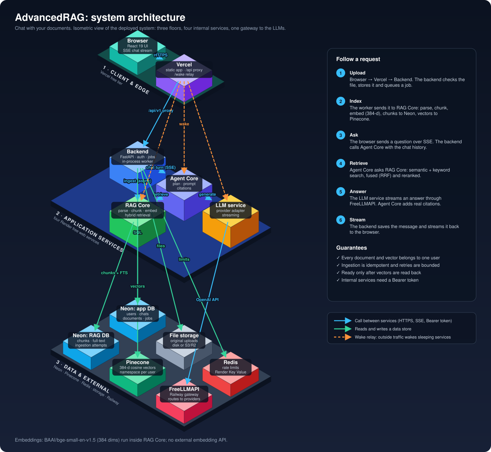
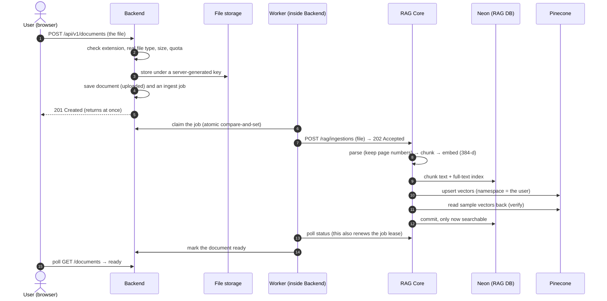
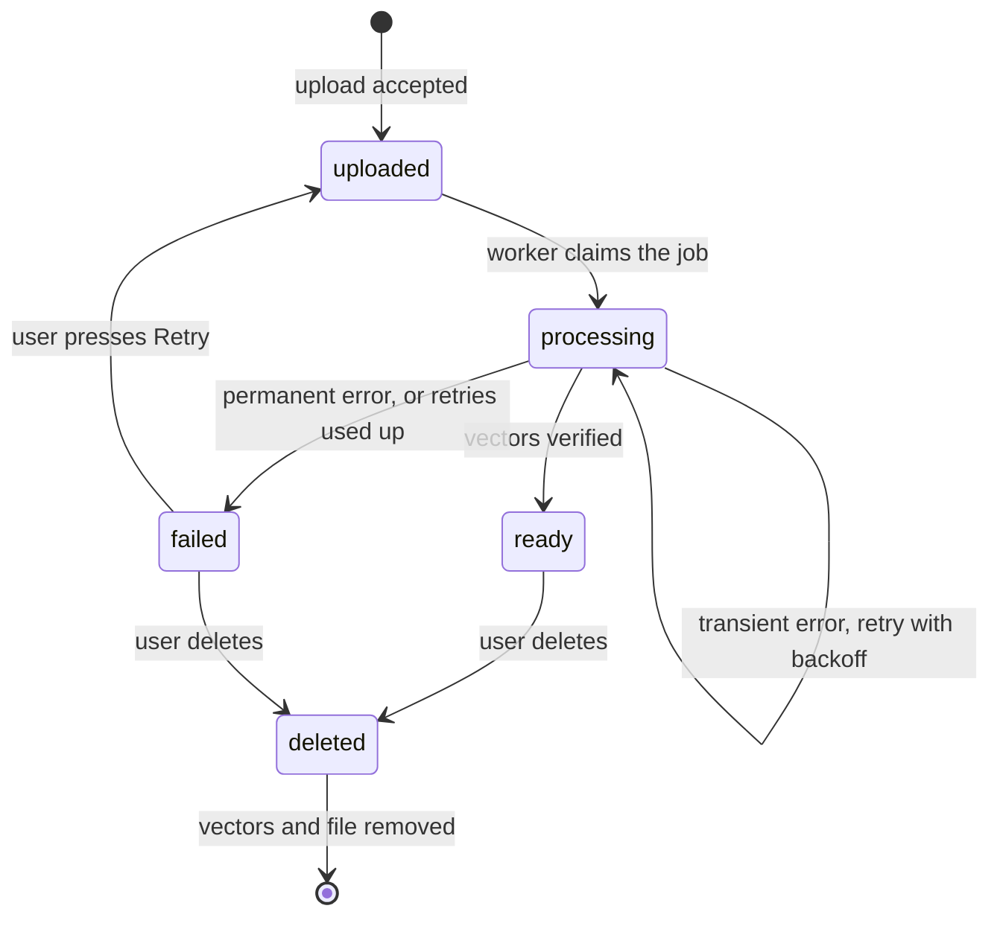
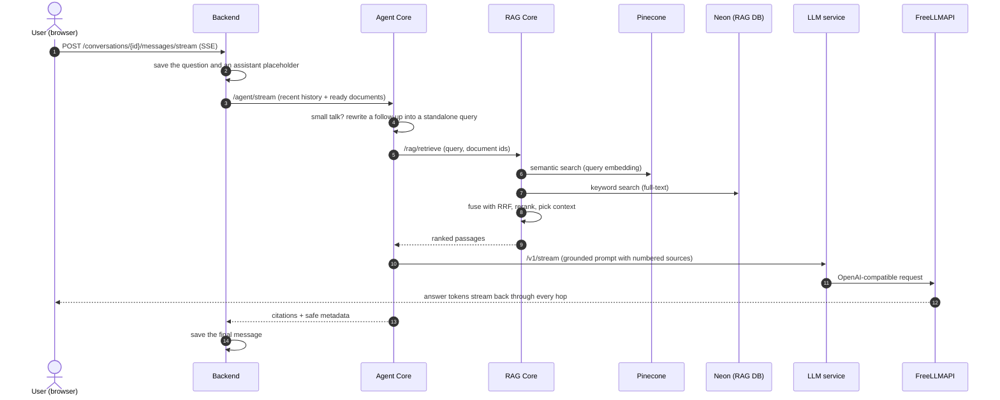
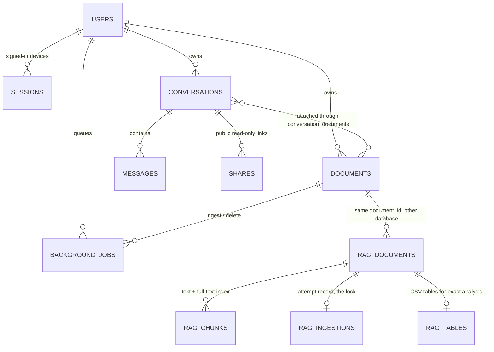

# AdvancedRAG

**Chat with your own documents.** Upload a PDF, Word file, spreadsheet-style CSV or plain text, then ask questions in a chat. Answers are written by an LLM, grounded in *your* files, and carry citations that point back to the exact document and page.



*Read it top to bottom: the top floor is what the user touches, the middle floor is our code, the ground floor is where data lives. Each arrow points from the caller to the thing it calls. The diagram is generated from [scripts/render_architecture_svg.py](scripts/render_architecture_svg.py).*

---

## Contents

1. [What it does](#what-it-does)
2. [Architecture](#architecture)
3. [How a document is indexed](#how-a-document-is-indexed)
4. [How a chat answer is made](#how-a-chat-answer-is-made)
5. [Where data lives](#where-data-lives)
6. [Security model](#security-model)
7. [Where it runs: free-tier deployment and its limits](#where-it-runs-free-tier-deployment-and-its-limits)
8. [Repository map](#repository-map)
9. [Local setup](#local-setup)
10. [Tests](#tests)
11. [Deployment notes](#deployment-notes-and-limitations)
12. [More documentation](#more-documentation)

---

## What it does

| You can | How it behaves |
|---|---|
| **Sign up and sign in** | Name, email and password. Short-lived access tokens, a rotating refresh cookie, and immediate logout. |
| **Upload documents** | PDF, DOCX, TXT, MD and CSV, up to 25 MB per file. Each file is validated, stored, then indexed in the background. |
| **Ask questions** | Streaming answers (Server-Sent Events). With ready documents, each answer is grounded in retrieved passages and cites its sources. Plain chat without documents also works. |
| **Trust the answer** | Citations only point at passages that were really retrieved. If search is unavailable, no answer is invented. |
| **Keep your data separate** | Every document, chunk and vector belongs to one user. Nobody else can search or read it. |
| **Organise** | Conversation history, chat search, rename and delete, read-only share links that can be revoked, and a profile with settings. |
| **Analyse CSV exactly** | CSV files also keep their full table, so questions like "total quantity for region EU" use exact calculations instead of guessing from text snippets. |

Not supported: images and scanned PDFs (there is no OCR). Those fail with a clear message.

---

## Architecture

### The four services

```text
Frontend (React/TS)          UI, streaming display. No secrets.
   │  HTTPS + SSE (/api/v1)
Backend (FastAPI)            auth, users, conversations, messages, documents, shares, jobs, SSE
   │  internal HTTP + Bearer INTERNAL_SERVICE_TOKEN
Agent Core                   decides retrieval, rewrites follow-ups, builds grounded prompt, citations
   ├──► RAG Core             parse → chunk → local embeddings (fastembed bge-small, 384-d) → Pinecone
   │                         + PostgreSQL full-text
   │                         → hybrid retrieval → RRF → Pinecone rerank → context
   └──► LLM layer            provider abstraction (LLMProvider) → FreeLLMAPIProvider
          │  OpenAI-compatible HTTP
        FreeLLMAPI           routes "auto" / "auto:fast" / "auto:smart" to an actual model
```

| Component | Owns | Holds secrets for |
|---|---|---|
| `frontend/` | UI only | none (everything in `VITE_*` is public) |
| `backend/` | users, sessions, chats, document metadata and files, shares, background jobs | JWT secrets, DB, Redis, storage, email |
| `agent-core/` | orchestration decisions, prompts, citations | none |
| `rag-core/` | parsing, chunking, local embeddings, vectors, keyword index, reranking, context | Pinecone |
| `llm/` | model calls, streaming, retries, timeouts | **FreeLLMAPI key** |
| `shared/` | request IDs, redacting logs, metrics, internal auth helpers, the wake helper | none |

**Why four services and not one?** Each has a different job, a different failure mode and a different secret. The backend owns users and data and is the only public API. Agent Core holds the *decisions* (when to search, how to phrase the prompt), RAG Core holds the *heavy lifting* (parsing and embedding documents, searching), and the LLM layer is the only part that knows how to talk to model providers. If a provider changes, only `llm/` changes. If retrieval improves, only `rag-core/` changes.

### Technology choices

| Concern | Choice | Notes |
|---|---|---|
| Frontend | React 19, TypeScript, Vite | Hosted on Vercel. Calls `/api/v1/*`, which Vercel proxies to the backend. |
| Backend and internal services | Python 3.11+, FastAPI, SQLAlchemy 2 (async), Alembic | Four separate containers. |
| Databases | PostgreSQL (Neon) | One database for the backend, one for RAG Core. |
| Vectors | Pinecone serverless, index `advancerag-bge384` | 384 dimensions, cosine, one namespace per user. |
| Embeddings | `BAAI/bge-small-en-v1.5` through fastembed (ONNX, CPU) | Runs *inside* RAG Core. No embedding API and no key. English only. |
| Reranking | Pinecone-hosted `bge-reranker-v2-m3` | Used after hybrid retrieval. |
| Keyword search | PostgreSQL full-text search | Fused with vector search by Reciprocal Rank Fusion. |
| LLM access | FreeLLMAPI (OpenAI-compatible gateway) | Hosted on Railway. Routes to whichever providers you configured. |
| Rate limits | Redis (Render Key Value) | In-memory fallback for local development. |

### Observability

Observability works the same way in every service:

- `X-Request-ID` is propagated through every hop, so one user action can be followed across services.
- Logs are structured JSON and redact secrets (bearer tokens, JWTs, API keys, passwords).
- Each service records latency for every dependency call.
- `/metrics` (Prometheus format) is protected by the internal token.
- `/health` says the process is alive. `/ready` says its dependencies work. The backend's `/ready` checks the database, storage, Agent Core and RAG Core, and Agent Core's `/ready` in turn checks RAG Core and the LLM layer, whose `/ready` checks FreeLLMAPI reachability and authentication.

The interfaces are documented in [backend/API_CONTRACT.md](backend/API_CONTRACT.md).

<details><summary>Text-only version of the topology (for terminals and screen readers)</summary>

```text
                    ┌─────────────────────────────  1 · CLIENT & EDGE  ─────────────────────────────┐
                    │   Browser (React)  ──HTTPS──►  Vercel (static app, /api proxy, /wake relay)    │
                    └───────────────────────────────────────┬────────────────────────────────────────┘
                                                            │ /api/v1
                    ┌─────────────────────────────  2 · APPLICATION SERVICES  ──────────────────────┐
                    │   Backend ──► Agent Core ──► LLM service                                       │
                    │      │            └──► RAG Core                                                │
                    │      └──ingest────────►┘                                                       │
                    └──────┬──────────┬──────────┬──────────────┬──────────────┬──────────────┬──────┘
                    ┌──────▼──────────▼──────────▼──────────────▼──────────────▼──────────────▼──────┐
                    │ 3 · DATA & EXTERNAL                                                              │
                    │ Neon (app DB) · File storage · Redis · Neon (RAG DB) · Pinecone · FreeLLMAPI     │
                    └──────────────────────────────────────────────────────────────────────────────────┘
```
</details>

---

## How a document is indexed



1. **Upload.** The browser sends the file to `POST /api/v1/documents`.
2. **Validation.** The backend checks:
   - the extension allowlist (`pdf`, `txt`, `md`, `csv`, `docx`);
   - that the file's bytes actually match the extension (the browser's MIME type is ignored);
   - the 25 MB size limit and the per-user quota.

   It also cleans up the filename (no path parts, no control characters).
3. **Storage and queue.** The backend stores the file under a key it generates itself (local disk, or S3-compatible storage) and, in the same database commit, creates the document row and a `background_jobs` row. Uploading is now finished from the user's point of view.
4. **Worker.** An in-process worker claims the job with a compare-and-set, so two workers can never run the same job. It hands the file to RAG Core (`POST /api/v1/rag/ingestions`, answered with `202` straight away) and then **polls** RAG Core's status, renewing the job's lease on every poll.
5. **RAG Core** processes the file in the background, holding a per-document lock so duplicate requests join the running attempt instead of starting another:
   - parses PDF, DOCX, TXT, MD or CSV, keeping page numbers;
   - splits the text into overlapping chunks (1,200 characters with 200 overlap, cut at paragraph, line or word boundaries, and split further if a chunk would exceed the model's 512-token limit);
   - embeds the chunks locally in small, bounded batches;
   - writes the chunk text to PostgreSQL with a full-text index;
   - upserts the vectors into Pinecone under deterministic ids (`<document_id>:<chunk_index>`), so re-running overwrites instead of duplicating;
   - reads sample vectors back from Pinecone, and only then commits.
6. **Status.** The backend marks the document `ready`. A document is never reported ready until its vectors can be read back.



**Failures are bounded and visible:**

- Transient errors are retried with exponential backoff (30 s, 60 s, 2 min, and so on, capped at 15 min) and a small attempt limit.
- Permanent errors (empty or scanned PDFs, unsupported content, damaged files) fail at once with a plain-language message.
- A reconciler recovers jobs left behind by a crashed worker, and a failed attempt removes any vectors it wrote.
- Deletes also go through RAG Core (vectors) and storage (the file), with bounded re-drives, so nothing is orphaned.

---

## How a chat answer is made



1. **Request.** The browser sends the question as a Server-Sent-Events request.
2. **Backend.** It saves the user message and an assistant placeholder, then calls Agent Core with the recent history and the conversation's *ready* documents.
3. **Agent Core decides what to do.**
   - With documents attached (and a message that isn't small talk), it rewrites a follow-up question into a standalone search query using a fast model, then asks RAG Core for passages: semantic search plus keyword search, fused with Reciprocal Rank Fusion and reranked by Pinecone.
   - It builds a grounded prompt with numbered sources. Retrieved text is treated as untrusted *data*, never as instructions, and is fenced off from the system prompt.
   - It streams the answer from the LLM layer, which streams from FreeLLMAPI.
   - It turns `[n]` markers into citations, and only for sources that actually exist.
4. **Streaming back.** The backend forwards only safe events (`agent.started`, `retrieval.*`, `generation.started`, `content.delta`, `message.completed` or `error`) and saves partial output every few seconds. The final message is saved with its citations and safe metadata (model, token usage, latencies).
5. **Failures. Nothing is ever fabricated:**
   - If RAG Core is unavailable, no answer is generated.
   - If the LLM layer fails, the message is saved as `failed` with a safe error code, keeping any partial text, and the user can retry.
   - If the browser disconnects, the message is saved as `cancelled`.
   - If the process crashes mid-stream, the reconciler marks the message `failed` (`INTERRUPTED`) and it can be retried.

---

## Where data lives



| Store | Holds | Notes |
|---|---|---|
| **Neon `advancerag`** (backend) | `users`, `sessions`, `auth_tokens`, `conversations`, `messages`, `documents`, `conversation_documents`, `background_jobs`, `shares` | Ownership, history, document status, the job queue. 4 migrations. |
| **Neon `advancerag_rag`** (RAG Core) | `rag_documents`, `rag_chunks`, `rag_ingestions`, `rag_tables` | Chunk text with a full-text index, the per-document lock and progress, and CSV tables. 3 migrations. |
| **Pinecone** `advancerag-bge384` | One 384-d vector per chunk, in namespace `user-<id>` | Metadata is only `document_id`, `chunk_index` and `page`. **Chunk text is never stored in Pinecone.** |
| **File storage** | The original upload | Local disk for development, S3-compatible storage for production. Keys are server-generated. |
| **Redis** | Rate-limit counters | Not required for correctness, only for abuse protection. |

The two databases are linked only by `document_id` and `user_id`. The backend is the single source of truth for *who owns what*; RAG Core only accepts a user id from authenticated internal callers (the backend and Agent Core).

---

## Security model

- **Passwords** are hashed with argon2. Login takes the same time and gives the same answer for a wrong password and an unknown email.
- **Sessions:** a 15-minute access token (held in memory) plus a 7-day refresh token in an `HttpOnly`, `SameSite` cookie scoped to `/api/v1/auth`. Refresh tokens rotate; presenting an old one revokes the whole session. Logging out kills the access token immediately because every request checks its session.
- **Isolation:** every query is scoped to the signed-in user. In RAG Core, a user's data is protected four ways: owner checks, a Pinecone namespace per user, a document filter, and an owner filter on chunk rows.
- **Service-to-service:** Agent Core, RAG Core and the LLM service only accept requests carrying `INTERNAL_SERVICE_TOKEN`. They are not meant to be public.
- **Uploads:** extension allowlist, byte-level type check, size limit, sanitised filenames, server-generated storage keys, and downloads are always sent as attachments with `nosniff`.
- **Prompt injection:** retrieved text is fenced and marked untrusted, and citations can only reference sources that were actually retrieved.
- **Secrets:** each secret lives in exactly one service (see the table above). The frontend contains none, logs redact them, and production refuses to start with weak or missing ones.
- **Browser:** the frontend ships a strict Content-Security-Policy, HSTS, `X-Frame-Options: DENY` and `nosniff`. CORS only allows the configured frontend origin.

---

## Where it runs: free-tier deployment and its limits

The deployed system uses only free tiers:

| Piece | Host | Plan |
|---|---|---|
| Frontend, `/api` proxy, `/wake` relay | Vercel (`advancerag-web`) | Hobby (free) |
| Backend, Agent Core, RAG Core, LLM service | Render, four web services | Free |
| Redis (rate limits) | Render Key Value | Free |
| Both PostgreSQL databases | Neon | Free |
| Vectors | Pinecone serverless | Free (Starter) |
| FreeLLMAPI gateway | Railway | Free credit |

Everything is described in [render.yaml](render.yaml) and [docs/render-free.md](docs/render-free.md).

**What free tiers mean in practice. Please read this before you rely on it:**

- **Services sleep.** Render stops a free service after 15 minutes without traffic. The first request after a pause can take 15 to 35 seconds, and RAG Core needs up to several more minutes to load its embedding model. A few settings (`WAKE_*`, `CHAT_WAKE_SECONDS`, `RAG_WAKE_SECONDS`) make the services wake each other. Render only wakes a service for requests from *outside* Render, so the Vercel app exposes `/wake/<service>` rewrites that act as a relay.
- **Small CPU and memory.** A free Render instance has 0.1 CPU and 512 MB RAM. Embedding costs roughly 1 to 2 seconds per chunk there (one chunk is about 850 characters), so indexing is slow and large files are risky. **As a rule of thumb, keep documents under about 500 KB of text on Render free.** The app accepts uploads up to 25 MB, but a document that produces more than 5,000 chunks is rejected, and very large ones can exhaust memory or hit the one-hour ingestion limit. On an ordinary laptop (all CPU cores) the same work is about 20 times faster.
- **No persistent disk.** Uploaded originals on local disk do not survive a restart. Use S3-compatible storage (Cloudflare R2 has a free tier but asks for a payment method) if you need to download or reprocess originals later.
- **Shared hours.** Render gives 750 free instance-hours a month to the whole workspace. Four services awake at once burn them four times faster.
- **Neon storage is small** (about 0.5 GB per project). Chunk text and its search index live there.

When quality or speed matter more than cost, the same code runs on a single VM ([infrastructure/production-vm/](infrastructure/production-vm/)) or on paid instances without changes.

---

## Repository map

```text
frontend/           React + Vite app (src/), Playwright end-to-end tests (e2e/), vercel.json
backend/            FastAPI app: api/routes, services, workers (jobs), integrations, db/models, alembic/
agent-core/         orchestrator, prompts, query rewriting, grading, citations, clients to RAG and LLM
rag-core/           parsing, chunking, embeddings, vector store, ingestion lifecycle, retrieval, tables, alembic/
llm/                provider abstraction and the FreeLLMAPI adapter
shared/             request ids, logging, metrics, internal auth, SSE helpers, dual-stack server, wake helper
tests/contract/     tests that run the real services against each other
scripts/            run_stack.py, smoke_production.py, configure_vercel.py, render_architecture_svg.py, ...
infrastructure/     single-VM Docker Compose deployment, production rehearsal, PostgreSQL init
docs/               architecture notes, deployment guides, benchmarks
render.yaml         the Render Blueprint (four web services + Key Value)
```

---

## Local setup

**Prerequisites:**

- Python 3.11+ (3.13 tested)
- Node 20+
- Docker Desktop
- Google Chrome (for the end-to-end tests)
- The FreeLLMAPI desktop app

### 1. Infrastructure (PostgreSQL + Redis)

```bash
cp .env.example .env            # set POSTGRES_PASSWORD (any random string)
docker compose up -d            # postgres on 127.0.0.1:5434, redis on 127.0.0.1:6380
```

The first start creates these databases:

- `advancerag` (backend)
- `advancerag_rag` (RAG Core)
- `advancerag_test` and `advancerag_rag_test` (test suites)

If the ports clash with something else on your machine, change `POSTGRES_PORT` / `REDIS_PORT` in `.env`.

### 2. Python environment (one venv for all services)

```bash
python -m venv .venv
.venv/Scripts/pip install -r requirements-dev.txt        # Windows
# .venv/bin/pip install -r requirements-dev.txt          # Linux/macOS
```

### 3. Configure each service

Copy each `.env.example` to `.env` and fill it in:

| File | What to set |
|---|---|
| `backend/.env` | `DATABASE_URL` (password from `.env`, host `127.0.0.1`, port `5434`), `JWT_SECRET`, `JWT_REFRESH_SECRET`, `INTERNAL_SERVICE_TOKEN` |
| `agent-core/.env` | the same `INTERNAL_SERVICE_TOKEN` |
| `rag-core/.env` | `DATABASE_URL` (…`/advancerag_rag`), `INTERNAL_SERVICE_TOKEN`, `PINECONE_API_KEY`, `PINECONE_INDEX` |
| `llm/.env` | `INTERNAL_SERVICE_TOKEN`, `FREELLMAPI_API_KEY` |
| `frontend/.env` *(optional)* | nothing needed for local development |

Generate secrets with:

```bash
python -c "import secrets; print(secrets.token_urlsafe(48))"
```

**Embeddings are local, so no embedding API key is needed.** RAG Core runs `BAAI/bge-small-en-v1.5` through fastembed (ONNX, on the CPU). It downloads the model once (about 70 MB) into `rag-core/var/models` on first start. Documents and queries are embedded with the same model, into **384-dimensional** vectors.

**Pinecone:** create a *serverless* index with **dimension 384** and **metric cosine**. Put its name in `PINECONE_INDEX` and your key in `PINECONE_API_KEY`.

- The dimension must match the embedding model. RAG Core checks this: `/ready` reports `DIMENSION_MISMATCH: index has X, embedding model produces 384`, and writes to a mismatched index are refused.
- An existing 768-dimension index cannot be reused with this model; create a new 384-dimension one.
- If you ever change `EMBEDDING_MODEL`, create a new index with the new model's dimension and re-ingest your documents.

### 4. FreeLLMAPI (desktop)

1. Start the **FreeLLMAPI** desktop app and, in **its dashboard, add at least one upstream provider key** (e.g. OpenRouter, Groq, Google AI Studio). Without one, FreeLLMAPI answers every request with `503 no_providers_configured`. Its OpenAI-compatible API listens locally (for example `http://127.0.0.1:31415/v1`; the port depends on the app version), so set `FREELLMAPI_BASE_URL` to match.
2. Copy its **unified API key** from the app into `llm/.env` as `FREELLMAPI_API_KEY`. Only the LLM service ever sees this key.
3. Check the connection. This never prints the key:

```bash
cd llm
../.venv/Scripts/python -m llm_service.healthcheck          # config, reachability, auth
../.venv/Scripts/python -m llm_service.healthcheck --chat   # also a tiny real completion
```

To choose a model, set `FREELLMAPI_MODEL` (in `llm/.env`) and `AGENT_FAST_MODEL` (in `agent-core/.env`). Both accept any id that `GET /v1/models` lists (for example `auto`); leave `AGENT_FAST_MODEL` empty to use the default. No code changes are needed.

### 5. Accounts and email

Sign-up asks for a name, an email and a password, and signs the user in straight away. Login is email and password. Neither sends any email.

Email is used only for **forgot-password** links, and it is optional. With `EMAIL_PROVIDER` empty, development writes reset emails to `backend/var/outbox/` (open the newest file to get the link). For real delivery, set Resend (production) or SMTP in `backend/.env` (see `backend/.env.example` and [docs/production-deployment.md](docs/production-deployment.md#5a-password-reset-email-resend)). Passwords cannot be changed from the profile, so without an email provider, a user who forgets their password cannot reset it.

### 6. Run everything

```bash
.venv/Scripts/python scripts/run_stack.py --frontend
```

This applies migrations and starts each part on its own port:

| Service | Port |
|---|---|
| llm | :8003 |
| rag-core | :8002 |
| agent-core | :8001 |
| backend | :8000 |
| Vite | :5173 |

Then open http://localhost:5173. Press Ctrl+C to stop everything.

> **No Docker and no FreeLLMAPI yet?** `python scripts/run_stack.py --mode e2e` starts the whole stack in an isolated mode: temporary SQLite databases, a built-in mock LLM, the real local embedding model, and a local vector store instead of Pinecone. The UI is at http://localhost:5174. Answers are canned, but upload, indexing, retrieval, citations, sign-in and sharing all work for real.

<details><summary>Or run the services one by one</summary>

```bash
# each from its own directory, so it reads its own .env
cd llm        && ../.venv/Scripts/python -m uvicorn llm_service.main:app --port 8003
cd rag-core   && ../.venv/Scripts/python -m alembic upgrade head && ../.venv/Scripts/python -m uvicorn rag_core.main:app --port 8002
cd agent-core && ../.venv/Scripts/python -m uvicorn agent_core.main:app --port 8001
cd backend    && ../.venv/Scripts/python -m alembic upgrade head && ../.venv/Scripts/python -m uvicorn app.main:app --port 8000
cd frontend   && npm install && npm run dev
```
</details>

**Readiness:** `GET http://localhost:8000/ready` reports the database, storage, Agent Core and RAG Core. Agent Core's `/ready` in turn checks RAG Core and the LLM layer, and the LLM layer's `/ready` checks FreeLLMAPI reachability and authentication.

---

## Tests

```bash
# per service (each from its directory)
cd backend    && ../.venv/Scripts/python -m pytest      # API, auth, isolation, jobs, SSE, security
cd llm        && ../.venv/Scripts/python -m pytest      # FreeLLMAPI adapter vs a mock OpenAI-compatible HTTP server
cd rag-core   && ../.venv/Scripts/python -m pytest      # parsing, chunking, the real local model, retrieval, Pinecone adapter vs mock Pinecone
cd agent-core && ../.venv/Scripts/python -m pytest      # orchestration decisions and failure handling
.venv/Scripts/python -m pytest tests/contract           # real backend -> agent-core -> rag-core/llm -> mock FreeLLMAPI

# against real PostgreSQL / Redis / S3 (docker compose up -d; --profile storage for S3)
TEST_DATABASE_URL=postgresql+asyncpg://advancerag:<pw>@127.0.0.1:5434/advancerag_test \
TEST_REDIS_URL=redis://127.0.0.1:6380/15 \
TEST_S3_ENDPOINT=http://127.0.0.1:8333 TEST_S3_ACCESS_KEY=any TEST_S3_SECRET_KEY=any \
  ../.venv/Scripts/python -m pytest                     # from backend/
TEST_DATABASE_URL=postgresql+asyncpg://advancerag:<pw>@127.0.0.1:5434/advancerag_rag_test \
  ../.venv/Scripts/python -m pytest                     # from rag-core/

# browser end-to-end (starts its own isolated stack with a mock FreeLLMAPI; no keys needed)
cd frontend && npm run test:e2e
```

No automated test needs a real FreeLLMAPI or Pinecone key. The first run downloads the local embedding model.

---

## Deployment notes and limitations

> **FreeLLMAPI on your desktop is for local development only.** A cloud deployment of the LLM service (Railway, Fly, any server) cannot reach `127.0.0.1:31415` on your machine. In production, `FREELLMAPI_BASE_URL` must point to a **secure (https), remotely reachable** FreeLLMAPI instance that you host (FreeLLMAPI ships a Docker server image). The LLM service refuses to start in staging or production with a missing, localhost or plain-http URL. Do not expose your desktop FreeLLMAPI to the internet. See **[docs/production-freellmapi.md](docs/production-freellmapi.md)**.

Production (`ENVIRONMENT=production`) **fails fast** unless all of the following are true:

- strong, distinct JWT secrets;
- a PostgreSQL `DATABASE_URL`;
- no wildcard CORS;
- `INTERNAL_SERVICE_TOKEN` of at least 32 characters, in every service;
- Redis rate limiting (`RATE_LIMIT_BACKEND=redis` with `REDIS_URL`);
- if an email provider is chosen (`resend` or `smtp`, used only for password-reset links), it must be fully configured, send from a real domain and link to an https frontend; the test/dev providers (`mock`, `file`) are refused;
- persistent storage (`STORAGE_BACKEND=s3`, or an explicit `ALLOW_LOCAL_STORAGE_IN_PRODUCTION=true` for a mounted volume);
- for RAG Core: Pinecone key and index (the fake embeddings and local vector store are refused);
- for the LLM layer: a FreeLLMAPI key plus an https, non-localhost URL.

Other deployment notes:

- Run `alembic upgrade head` for the backend and for RAG Core as a release step.
- The backend Dockerfile migrates on start, which is only safe for a single replica.
- Keep Agent Core, RAG Core and the LLM layer on a private network where the host allows it. They also require the internal token.
- Build images from the repository root, for example `docker build -f backend/Dockerfile .`. `docker compose --profile app up --build` runs everything in containers (the desktop FreeLLMAPI is reached via `host.docker.internal:31415`, which works only if the app accepts non-loopback connections).
- Images cannot be indexed yet. RAG Core has no OCR or vision step, so uploads are limited to PDF, TXT, MD, CSV and DOCX. Scanned PDFs fail with a clear message.
- Do not change `EMBEDDING_MODEL`, `CHUNK_SIZE` or `CHUNK_OVERLAP` casually. They define the stored vectors; see "Changing a frozen value" in [docs/rag-architecture.md](docs/rag-architecture.md).

---

## More documentation

| Document | What it covers |
|---|---|
| [backend/API_CONTRACT.md](backend/API_CONTRACT.md) | Every HTTP endpoint, event and error code |
| [docs/rag-architecture.md](docs/rag-architecture.md) | The frozen retrieval settings, ingestion lifecycle, measurements and speed notes |
| [docs/agent-core-architecture.md](docs/agent-core-architecture.md) | How Agent Core plans, retrieves, verifies and cites |
| [docs/render-free.md](docs/render-free.md) | The free-tier deployment (Vercel, Render, Neon, Pinecone) step by step, with measured limits |
| [docs/production-deployment.md](docs/production-deployment.md) | Production checklist, email, DNS and environment variables |
| [docs/production-freellmapi.md](docs/production-freellmapi.md) | Hosting FreeLLMAPI remotely |
| [docs/deployment-checklist.md](docs/deployment-checklist.md) | A short list to tick before going live |
| [docs/mobile-readiness-report.md](docs/mobile-readiness-report.md) | API readiness for a future mobile client |
