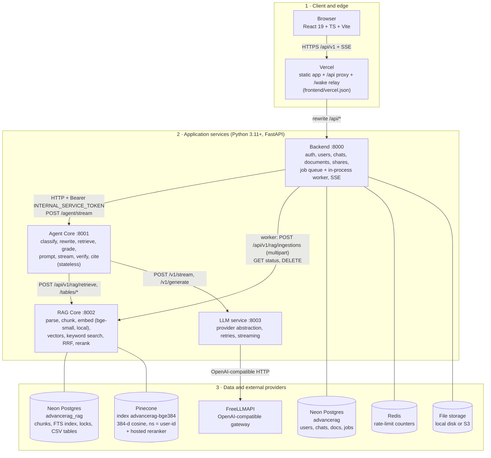
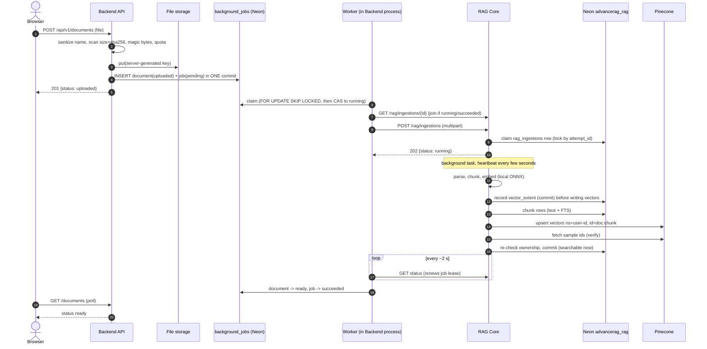
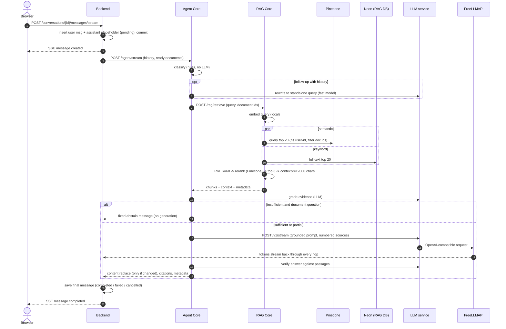

# Module 1: System Architecture

> Part of [ADVANCED_RAG_2026_MASTER_COURSE.md](../../ADVANCED_RAG_2026_MASTER_COURSE.md). Self-study module: attempt the assessment (section 12) first, then check yourself against the answer key at the end of this file (section 15). Marking yourself "passed" is your decision; the master course does not mark any module as mastered.
>
> Evidence rule used in this module: every statement about AdvancedRAG cites a file I actually read. Line numbers are from the repository at commit `31bad7e`. Where I only know something from the README or docs and did **not** confirm it in code, I say so. I did not run the stack, so nothing here is a measured result.

> **Update after the implementation pass (2026-10-23, working tree on top of `31bad7e`, uncommitted).** Statements below were first written against `31bad7e`; where the code changed they are corrected in place or listed here. All new evidence is hermetic (local vector store, mock gateway, throw-away PostgreSQL); nothing ran against Pinecone, the real LLM gateway or a deployment. Traceability: [FEATURE_MATRIX](../verification/FEATURE_MATRIX.md). Old line numbers have shifted; search by name.
>
> **What changed for this module:** uploads reference durable storage (`local`/`s3`/`db`) instead of carrying base64 in the job; identical uploads are deduplicated; documents have versions (replace/restore); RAG Core spools uploads to disk and can OCR scans/images (off by default); W3C `traceparent` is propagated across hops and queue depth/age are exported as metrics; concurrent chat streams are capped per user; the frontend no longer logs users out on a cold-start refresh failure.

---

## 1. Learning objectives

By the end you can, without notes:

1. Say what AdvancedRAG does and why a plain LLM chat is not enough for it.
2. Draw the five-box architecture (Frontend, Backend, Agent Core, RAG Core, LLM service) plus the six external stores/providers, and label every arrow with protocol and purpose.
3. Narrate the two request flows (document ingestion, question answering) naming the real function at each step.
4. Say which steps are synchronous, which are asynchronous, and where the system can fail without losing data.
5. Justify (and critique) splitting the project into four backend services.
6. Give a 30-second, 2-minute and 5-minute explanation.

## 2. Prerequisites

You need these before the deep dive. One-paragraph explanations are in Section 3.

- HTTP request/response, JSON, status codes (201, 202, 401, 503).
- What a REST API and a database are.
- What an environment variable is.
- "Async" in the sense of *not waiting for a slow thing before replying*.

You do **not** yet need embeddings, vectors or LLM internals. Module 1 treats RAG Core and the LLM service as boxes with a contract. Modules 2 to 5 open them.

---

## 3. Fundamentals

### 3.1 Three kinds of application

| | Traditional app | LLM app | RAG app |
|---|---|---|---|
| Answer comes from | Code + database rows | The model's training data | Your documents, found at question time, then written up by the model |
| Failure looks like | Exception, wrong query | Fluent but invented answer (hallucination) | Right document not found, or found but ignored |
| Knowledge update | Change data | Retrain/fine-tune (slow, costly) | Add/remove a document (minutes) |
| Can cite a source? | Yes (it is the row) | No | Yes, if you keep the chunk ↔ file link |

**RAG = Retrieval-Augmented Generation.** Two phases:

1. **Indexing (offline, once per document):** split the document into pieces ("chunks"), turn each into a list of numbers (an "embedding", a vector), store them so "similar meaning" can be searched fast.
2. **Answering (online, per question):** embed the question the same way, fetch the most similar chunks, paste them into the prompt, and ask the LLM to answer **only from them** and cite them.

AdvancedRAG is a RAG app with extra safeguards: after retrieval it *grades* whether the evidence is enough, may retry with a rewritten query, and *verifies* the draft answer against the passages before finalising (see [orchestrator.py](../../agent-core/agent_core/orchestrator.py) docstring, lines 1-29).

### 3.2 Vocabulary used in this module

- **Service**: a separately running program with its own HTTP API (here: four Python FastAPI programs).
- **SSE (Server-Sent Events)**: one long HTTP response that the server keeps writing small `event:`/`data:` text frames into. One-way, server to browser. Simpler than WebSockets.
- **Job queue**: a table of "things to do later" that a worker picks up. Here it is the `background_jobs` table in PostgreSQL.
- **Idempotent**: doing it twice has the same effect as doing it once.
- **Lease / heartbeat**: a worker marks a job "mine until time T" and keeps renewing T. If it dies, T lapses and someone else may take over.
- **Compare-and-set (CAS)**: `UPDATE ... WHERE state = expected`; exactly one concurrent caller sees "1 row updated".
- **Namespace** (Pinecone): a partition of an index. Here: one per user.

---

## 4. Technical deep dive

### 4.1 Architecture diagram (matches the code I read)

Two things most people miss on first read:

- **The backend talks to RAG Core directly for ingestion**, and **Agent Core talks to RAG Core for retrieval**. RAG Core is called by two different callers for two different jobs.
- **Agent Core owns no data** ("Agent Core is stateless: it persists nothing", [orchestrator.py](../../agent-core/agent_core/orchestrator.py)). The backend sends it the history and the user's ready documents on every request ([message_service.py::_build_agent_request](../../backend/app/services/message_service.py)).

### 4.2 Responsibilities

| Component | Owns | Does not own | Secrets it holds |
|---|---|---|---|
| `frontend/` | UI, token in memory, SSE rendering | any secret | none (`VITE_*` is public) |
| `backend/` | users, sessions, conversations, messages, document metadata and file, shares, job queue, public API, rate limits | parsing, embeddings, prompts | JWT secrets, DB, Redis, storage, email |
| `agent-core/` | decide *whether and how* to retrieve, prompt building, grading, verification, citations | any stored data | none beyond the internal token |
| `rag-core/` | parsing, chunking, embeddings, vector store, keyword index, fusion, rerank, CSV tables, ingestion lock | users/chats | Pinecone key |
| `llm/` | talking to model providers, streaming, retries, timeouts | prompts or retrieval | FreeLLMAPI key |
| `shared/` | request ids, redacting logs, metrics, internal-auth helper, SSE helper, "wake" helper | business logic | none |

Source: README "Architecture" table; confirmed against `render.yaml` env vars per service (each secret really appears in only one service block).

### 4.3 Communication paths

| From → To | Protocol | Auth | Code |
|---|---|---|---|
| Browser → Backend | HTTPS JSON; SSE for chat | short-lived JWT access token (+ refresh cookie) | [api/routes/](../../backend/app/api/routes/), [frontend/src/api.ts](../../frontend/src/api.ts) |
| Backend → Agent Core | HTTP, SSE stream back | `Bearer INTERNAL_SERVICE_TOKEN` | [integrations/agent_core.py](../../backend/app/integrations/agent_core.py) |
| Backend worker → RAG Core | HTTP multipart upload, then polling | same internal token | [integrations/rag_core.py::RAGCoreClient.start_ingestion](../../backend/app/integrations/rag_core.py) |
| Agent Core → RAG Core | HTTP JSON | same token | [agent_core/clients.py](../../agent-core/agent_core/clients.py) |
| Agent Core → LLM service | HTTP, SSE stream back | same token | `clients.py` |
| LLM service → FreeLLMAPI | OpenAI-compatible HTTP | FreeLLMAPI API key | [providers/freellmapi.py](../../llm/llm_service/providers/freellmapi.py) |
| RAG Core → Pinecone | REST (upsert/query/fetch/delete + rerank) | Pinecone key | [vectorstore.py](../../rag-core/rag_core/vectorstore.py), [rerank.py](../../rag-core/rag_core/rerank.py) |

Note the **single shared** `INTERNAL_SERVICE_TOKEN` across all four services (render.yaml). Interview-worthy weakness: compromise of one service exposes the others' internal APIs; per-service tokens or mTLS would limit that. (Security detail belongs to Module 6.)

### 4.4 Synchronous vs asynchronous

| Step | Style | Why |
|---|---|---|
| `POST /documents` | Sync validate + store, **returns 201 immediately** | Indexing can take minutes ([docs/rag-architecture.md](../rag-architecture.md): 812-page PDF about 1,100 s) |
| Ingestion | **Async**: job row → worker → RAG Core returns 202 → background task → worker polls | No HTTP timeout should bound indexing |
| `POST .../messages/stream` | Request stays open; **streamed** (SSE) | Users see tokens as they arrive; hides LLM latency |
| `POST .../messages` (non-streaming) | Sync, waits for full answer ([messages.py::send_message](../../backend/app/api/routes/messages.py)) | Simple clients |
| Delete document | Soft-delete now, vectors/file removed by job later | Fast UI; bounded retries |
| Stale recovery | Background loops (60 s sweep, reconcile) | Crash safety |

Inside each service the code is `async`/`await` (FastAPI + SQLAlchemy async + httpx). CPU-heavy work (PDF parse, embedding tokenisation) is pushed off the event loop with `anyio.to_thread.run_sync` ([pipeline.py::ingest](../../rag-core/rag_core/pipeline.py), [document_service.py::upload](../../backend/app/services/document_service.py)). Concept to be able to state: *async I/O helps with waiting, not with CPU*; CPU-bound work needs threads/processes/other machines.

### 4.5 Why split into services? (honest version)

**Reasons the project gives and I can confirm in config:**

1. **Different secrets in different places.** Only `llm/` has the FreeLLMAPI key; only `rag-core/` has the Pinecone key (render.yaml).
2. **Different failure and resource profiles.** RAG Core needs an ONNX model in memory and CPU (README says up to several minutes to load at 0.1 CPU); the backend is light.
3. **Swap-ability.** A new model provider changes only `llm/`; new retrieval changes only `rag-core/` (`LLMProvider` abstraction in [providers/base.py](../../llm/llm_service/providers/base.py)).
4. **Independent deploy filters** (`buildFilter` paths in render.yaml).

**Costs you should volunteer in an interview (a strong signal of seniority):**

- Four deployables on a project with (as far as I can see) one developer. A modular monolith with the same package boundaries would be simpler and has no network hops between Agent Core and RAG Core.
- On Render free, each service sleeps; this forced extra machinery: wake helper, `/wake` relay on Vercel, keep-awake loop, long timeouts (`RAG_WAKE_SECONDS=300`, `AGENT_TURN_TIMEOUT_SECONDS=600`). A good chunk of the complexity is **a hosting workaround**, not a domain need.
- Services call each other over **public HTTPS** on free Render (render.yaml), protected only by the bearer token.
- One shared internal token (above).

So: *justified by secret/failure separation, but it is a trade-off, and the cheapest correct alternative is a modular monolith.*

### 4.6 Data stores

| Store | Holds | Link key |
|---|---|---|
| Neon `advancerag` | `users, sessions, auth_tokens, conversations, messages, documents, conversation_documents, background_jobs, shares` | `user_id`, `document_id` |
| Neon `advancerag_rag` | `rag_documents, rag_chunks (text + full-text index), rag_ingestions (the lock), rag_tables (CSV)` | `document_id`, `user_id` |
| Pinecone `advancerag-bge384` | one 384-d vector per chunk; metadata only `document_id, chunk_index, page`; **no text** | id `<document_id>:<chunk_index>`, namespace `user-<user_id>` |
| File storage | original upload | server-generated key |
| Redis | rate-limit counters | n/a |

The two Postgres databases are joined **only by convention** (same `document_id`/`user_id`), not by foreign key. Consequence: consistency is maintained by the job/retry/cleanup machinery, not by the database. That is why so much code exists for orphan cleanup.

### 4.7 Failure boundaries and error handling

Rule of thumb in this codebase: **fail visibly, never fabricate, leave nothing half-written.**

| Failure | What happens | Where |
|---|---|---|
| Upload invalid (bad ext, bytes ≠ ext, >25 MB, empty, quota) | 415/413/422/409 before anything is stored | [document_service.py::upload](../../backend/app/services/document_service.py) |
| DB commit fails after file stored | rollback + delete the blob (no orphan) | document_service.py::upload |
| RAG Core down during ingestion | `RAGCoreError(retryable=True)` → job back to `pending` with backoff 30 s, 60 s, ... cap 15 min | [runner.py::process_one](../../backend/app/workers/runner.py), [job_service.py::retry_delay](../../backend/app/services/job_service.py) |
| Permanent parse error | job `failed`, document `failed`, user-safe message, cleanup job queued | [document_jobs.py::on_final_failure](../../backend/app/workers/document_jobs.py) |
| Worker crashes | lease (`locked_at`) lapses; 60 s sweep requeues; the new run **joins** the RAG attempt that kept running | runner.py `_stale_loop`, document_jobs.py::ingest_document |
| RAG process crashes mid-ingest | heartbeat stops → status `stale` → worker clears it and retries | [ingestion.py::is_alive](../../rag-core/rag_core/ingestion.py), document_jobs.py::_wait_for_ingestion |
| Pinecone unreadable after upsert | `VECTOR_INDEX_UNVERIFIED` (retryable); document not marked ready | [pipeline.py::_verify_vectors](../../rag-core/rag_core/pipeline.py) |
| Pinecone down at query time | retrieval degrades to **keyword-only**, recorded as `keyword_only_degraded` | pipeline.py::retrieve |
| Reranker fails | fall back to RRF order, `reranker: skipped` | pipeline.py::retrieve |
| RAG Core down at query time | no answer is generated (error code `RAG_SERVICE_UNAVAILABLE`) | agent_service.py |
| LLM fails mid-stream | message saved `failed` with partial text; user can retry | agent_service.py::stream_turn |
| Browser disconnects | message saved `cancelled` | agent_service.py::stream_turn |
| Backend dies mid-stream | reconciler marks stuck `pending/streaming` rows `failed (INTERRUPTED)` | [message_service.py::mark_stale_generations](../../backend/app/services/message_service.py) |

### 4.8 Deployment architecture and configuration

- Frontend: Vercel (static build, rewrites `/api/*` to the backend, `/wake/*` relays to Render health endpoints, CSP/HSTS headers) — [frontend/vercel.json](../../frontend/vercel.json).
- Four Render web services + one Render Key Value (Redis), all on the free plan, described in [render.yaml](../../render.yaml). Neon for both Postgres DBs, Pinecone Starter for vectors.
- Alternative: single VM with Docker Compose + Caddy ([infrastructure/production-vm/](../../infrastructure/production-vm/)).

Key environment variables (from render.yaml; secrets shown as `sync: false` there):

| Variable | Service | Meaning |
|---|---|---|
| `ENVIRONMENT=production` | all | switches on fail-fast validation, disables `/docs` |
| `INTERNAL_SERVICE_TOKEN` | all (same value) | service-to-service bearer |
| `DATABASE_URL` | backend, rag-core | Neon pooled URL (`sslmode=require`), different DB per service |
| `JWT_SECRET`, `JWT_REFRESH_SECRET` | backend | token signing |
| `AGENT_CORE_URL`, `RAG_CORE_URL` | backend | where to call |
| `RAG_CORE_URL`, `LLM_SERVICE_URL` | agent-core | where to call |
| `PINECONE_API_KEY`, `PINECONE_INDEX` | rag-core | vector store |
| `FREELLMAPI_BASE_URL`, `FREELLMAPI_API_KEY`, `FREELLMAPI_MODEL=auto` | llm | model gateway |
| `RATE_LIMIT_BACKEND=redis`, `REDIS_URL` | backend | abuse protection |
| `STORAGE_BACKEND=local` + `ALLOW_LOCAL_STORAGE_IN_PRODUCTION=true` | backend | ephemeral disk on Render free |
| `EMBEDDING_BATCH_SIZE=4`, `EMBEDDING_THREADS=1`, `INGEST_CONCURRENCY=1`, `INGEST_EMBED_SLICE=32` | rag-core | memory/CPU tuning for 512 MB / 0.1 CPU |
| `*_WAKE_SECONDS`, `WAKE_*`, `KEEP_AWAKE_URL` | backend, agent-core | free-tier sleep workarounds |
| `RAG_TIMEOUT_SECONDS=420`, `LLM_TIMEOUT_SECONDS=180`, `AGENT_TURN_TIMEOUT_SECONDS=600`, `AGENT_CORE_TIMEOUT_SECONDS=660` | agent-core, backend | nested timeouts: each outer one is larger than the inner one |

**Status caveat you must remember:** my saved notes from earlier sessions say production hosting of FreeLLMAPI was *not yet deployed* (desktop `127.0.0.1:31415` locally). `render.yaml` and the README describe a Railway-hosted gateway as the target. Do not say "it is deployed on X" in an interview unless you have checked today. Say "designed for / configured for".

### 4.9 Trade-offs and alternative designs

| Decision | Chosen | Alternative | Why chosen / what it costs |
|---|---|---|---|
| Queue | Postgres table, `FOR UPDATE SKIP LOCKED`, in-process worker ([job_service.py](../../backend/app/services/job_service.py)) | Celery/RQ/arq + Redis/RabbitMQ, or a cloud queue | No extra infra, transactional with the upload commit. Cost: polling, throughput ceiling, worker shares the API process (the docstring itself says "Swap for a dedicated queue") |
| Ingestion completion | Worker **polls** RAG Core every 2 s and renews lease | Webhook/callback, or message bus | Works behind sleeping hosts and survives either side restarting; costs extra requests |
| Embeddings | Local ONNX `bge-small-en-v1.5` inside RAG Core | Hosted embedding API | No key/cost, no data leaves; costs CPU/RAM, slow on 0.1 CPU, English-only |
| Vectors | Pinecone serverless, namespace/user | pgvector in the RAG Postgres | Managed ANN, hard isolation per namespace; costs a vendor + namespace limits. pgvector would remove one system and make the vector↔chunk join transactional |
| Chunk text | PostgreSQL, not Pinecone metadata | Store text in metadata | Smaller index, complete deletion; costs a second lookup per query |
| Retrieval | Hybrid (vector + Postgres FTS) → RRF → cross-encoder rerank | Dense only | Catches exact codes/SKUs and is the fallback if Pinecone is down; costs complexity and latency (the project's own benchmark found dense alone looked stronger on its corpus, docs/rag-architecture.md §4) |
| Streaming | SSE | WebSocket | Simpler, one-way, proxy-friendly |
| Answer safety | grade → correct → generate → verify | single prompt | Fewer unsupported answers; costs extra LLM calls = latency and tokens |

---

## 5. AdvancedRAG implementation: tracing real requests

### 5.1 Trace A: uploading `handbook.pdf` (25 MB or small)

1. **Browser** → `POST /api/v1/documents` (multipart field `file`). Vercel rewrites to the backend.
2. [documents.py::upload_document](../../backend/app/api/routes/documents.py) `upload_document`: authenticates (`CurrentUser`), applies `hit_user_limit("upload", user.id, times=60, seconds=600)`, calls `document_service.upload`.
3. [document_service.py::upload](../../backend/app/services/document_service.py) `upload`:
   - `sanitize_filename` (NFKC, last path component, strip control chars) → `extension_of`.
   - Extension must be in `settings.allowed_extensions` **and** `MIME_BY_EXT` (`MIME_BY_EXT` also lists png/jpg, but `ALLOWED_UPLOAD_EXTENSIONS` defaults to `pdf,txt,md,csv,docx` in [config.py](../../backend/app/core/config.py), so images are rejected unless that setting is changed).
   - `_scan` (run in a thread): streams the file in 1 MB reads computing size and SHA-256, aborts when size exceeds `MAX_UPLOAD_BYTES`; `_content_matches` checks magic bytes (`%PDF-`, `PK\x03\x04` + `word/document.xml` in the zip for docx, no NUL in the first 8 KB for text).
   - Checks emptiness, per-user document count and byte quota.
   - `make_storage_key(user_id, doc_id)` → `storage.put` (disk or S3).
   - Adds `Document(status=UPLOADED)` and `job_service.enqueue(DOCUMENT_INGEST)` **in the same transaction**; on commit failure deletes the blob.
   - **Superseded gotcha:** at `31bad7e` local storage base64-copied the whole file into `job.payload["file_data"]` (x4/3, retained 30 days). That path is gone: the job carries only a reference, and the document records which backend holds the bytes (Module 3 §4.10). Old queued jobs with `file_data` are still processed and scrubbed. The production config still says `STORAGE_BACKEND=local`, so an operator must choose `db` or `s3` for restarts to stop losing files.
   - Before storing, the upload looks up `(user_id, checksum)`: a match returns the existing document (`duplicate: true`).
   - Returns 201 with `status: uploaded`. `notify_worker()` wakes the worker loop.
4. **Worker** ([runner.py::process_one](../../backend/app/workers/runner.py) `process_one`): `claim_next` selects one pending job with `FOR UPDATE SKIP LOCKED`, then CAS-updates it to `running`, `attempts+1`.
5. [document_jobs.py::ingest_document](../../backend/app/workers/document_jobs.py) `ingest_document`:
   - marks document `processing`; heartbeat; `_ensure_rag_awake` (free-tier wake).
   - **Idempotency**: `rag.ingestion_status` first. If an attempt is `running` or `succeeded`, *join* it. Otherwise load bytes (from payload or storage) and `rag.start_ingestion`.
6. [rag_core.py::RAGCoreClient.start_ingestion](../../backend/app/integrations/rag_core.py) posts multipart to RAG Core. [main.py](../../rag-core/rag_core/main.py) `start_ingestion` reads up to `MAX_FILE_BYTES+1`, calls `IngestionManager.start`.
7. [ingestion.py::IngestionManager.claim](../../rag-core/rag_core/ingestion.py) `claim`: `SELECT ... FOR UPDATE` on `rag_ingestions`; if a live attempt exists, return it (`started=False`); otherwise insert/CAS a new `attempt_id`. `start` then spawns `asyncio.create_task(self._run(...))` and **returns 202 immediately**.
8. `_run` → [pipeline.ingest](../../rag-core/rag_core/pipeline.py): parse (thread) → `chunk_pages` (1200/200 characters) → `fit_to_token_limit` → embed in slices → `record_extent` **before** writing → delete old chunk rows, insert new → `vectors.upsert` in slices → delete leftover ids → `_verify_vectors` (read back sample ids) → `before_commit` (re-check ownership under row lock) → `db.commit()`. Any exception → rollback + `discard_index`.
9. Back in the worker, `_wait_for_ingestion` polls every `INGEST_POLL_INTERVAL_SECONDS`, heartbeating the job each poll, until `succeeded` / `failed` / `stale` / timeout (`INGEST_MAX_SECONDS`, 1 h of *active* time).
10. `mark_status(READY)`. The browser, polling `GET /documents`, now sees `ready`.

### 5.2 Trace B: asking "What is the notice period?"

1. **Browser** → `POST /api/v1/conversations/{id}/messages/stream`. [messages.py::stream_message](../../backend/app/api/routes/messages.py) `stream_message`, rate limit 30/min/user.
2. [message_service.prepare_turn](../../backend/app/services/message_service.py): locks the conversation row (`for_update=True`), inserts the **user message** and an **assistant placeholder (`pending`)**, sets the title from the first line, builds the `AgentRequest` (recent *completed* history, all of the user's `ready` documents as `library_documents`, count of documents still processing). Commit. Note `document_ids=[]`: retrieval scope is the user's whole Knowledge Base, not just attachments.
3. [agent_service.stream_turn](../../backend/app/services/agent_service.py): emits `message.created`, optionally wakes dependencies, then iterates Agent Core's events. It forwards only a whitelist (`content.delta`, `content.replace`, status events) and saves partial content every `STREAM_FLUSH_SECONDS`.
4. [Orchestrator.stream](../../agent-core/agent_core/orchestrator.py):
   1. `classify` ([classification.py::classify](../../agent-core/agent_core/classification.py)): small talk → no retrieval; no documents → general; a named file/type → search only those; quantitative question over CSV → `STRUCTURED`; else search the Knowledge Base. Pure rules, no model call.
   2. Follow-up of an earlier answer ("give the above as a table")? Try to reuse it without retrieval.
   3. `_retrieve_and_grade`: `resolve_search_query` (rewrite a follow-up into a standalone query with a fast model) → `_search` → `RAGClient.retrieve` → **grade** the evidence (relevant? sufficient? contradictory?) → up to `MAX_CORRECTION_ATTEMPTS` rewritten-query retries.
   4. Decide the mode: `GROUNDED`, `TABLE`, `ABSTAIN` (fixed "not in your documents" message, **no model call**), `GENERAL`, `NO_EVIDENCE`.
   5. `prompts.build_messages` → `_generate` streams tokens from the LLM service.
   6. `_finalise`: strip citation markers that name no supplied source; `grading.verify` the draft against the evidence; may emit `content.replace` with a corrected or abstaining answer; map `[n]` to real citations.
5. **RAG Core** [`/api/v1/rag/retrieve`](../../rag-core/rag_core/main.py) → [pipeline.retrieve](../../rag-core/rag_core/pipeline.py): keep only documents this user has indexed; embed query; Pinecone top 20 (namespace `user-<id>`, filter on document ids); Postgres full-text top 20 (OR semantics, `ts_rank_cd`); [`rrf`](../../rag-core/rag_core/pipeline.py) with k=60; rerank to top 6; assemble numbered context (`[n] filename (page p)` + text) capped at 12,000 characters.
6. **LLM service** [`/v1/stream`](../../llm/llm_service/main.py) forwards to FreeLLMAPI and re-emits `token`/`done`/`error` SSE frames.
7. Backend saves the final message with citations and metadata; emits `message.completed`.

### 5.3 What a request costs (count the network hops)

A normal grounded question can involve: Backend → Agent Core (1), Agent Core → LLM (rewrite, optional), → RAG Core (2), RAG Core → Pinecone (query) and → Pinecone (rerank), → LLM (grade), → LLM (generate, streamed), → LLM (verify). That is up to **four LLM calls and two Pinecone calls** for one answer. This is the single most important fact for the later latency and cost modules. I have not measured an end-to-end figure; the only documented latency is retrieval alone (p50 1.1 s) in [rag-architecture.md §3](../rag-architecture.md).

---

## 6. Worked examples

### Example 1: "The document says ready but search returns nothing"

Reason about which boundary failed, in order:

1. Backend `documents.status`? Must be `ready` (set only after RAG `succeeded`).
2. RAG `rag_ingestions.status` and `chunk_count` for that `document_id`?
3. `rag_chunks` rows for the id? (text exists)
4. Pinecone vectors exist in namespace `user-<id>` with ids `<doc>:<n>`? (the verification step is meant to guarantee this)
5. Was the question scoped to that document? (`classify` may restrict to a *named* file)
6. Did grading call it `insufficient`? Then you get the abstain message **even though retrieval worked** (`meta["evidence_grade"]`, logged in `turn_finished`).

Lesson: "no answer" has at least three distinct causes (not indexed, not retrieved, retrieved but judged insufficient). The logs expose each (`retrieve_done`, `turn_finished`) without storing question or document text.

### Example 2: Two workers claim the same job

`claim_next` does `SELECT ... FOR UPDATE SKIP LOCKED` (another worker skips locked rows) **and** then `UPDATE ... WHERE status='pending'` checking `rowcount == 1`. The second guard exists "even where SKIP LOCKED is unavailable (SQLite)" ([job_service.py::claim_next](../../backend/app/services/job_service.py)). Be ready to explain why two layers: one is an optimisation for concurrency, the other is the correctness guarantee.

### Example 3: Worker restarts in the middle of a 15-minute ingestion

Job lease lapses; sweep requeues; the new `ingest_document` calls `ingestion_status`, sees RAG's attempt still `running`, and **joins** instead of re-uploading (document_jobs.py::ingest_document). If RAG itself died, status becomes `stale`, the worker deletes the partial writes and retries from scratch.

---

## 7. Common mistakes

1. **Drawing Agent Core as the only caller of RAG Core.** The backend worker also calls it (ingestion).
2. **Saying "Pinecone stores the documents".** It stores 384-d vectors with 3 metadata fields. Text is in Postgres.
3. **Saying "the LLM searches the documents".** Retrieval is deterministic code; the LLM only reads what it is handed (and is also used for rewrite/grade/verify).
4. **Saying "four microservices for scalability".** The honest reason is secret and failure separation; scalability is not demonstrated (free-tier, 0.1 CPU, `INGEST_CONCURRENCY=1`).
5. **Claiming "it is secure/isolated" without naming the mechanism.** Say: owner checks, a Pinecone namespace per user, document-id filter, user filter on chunk rows (README Security). Whether each is *tested* is Module 6.
6. **Saying a document is "ready" when upload finishes.** `uploaded → processing → ready`; ready means vectors were read back.
7. **Quoting benchmark numbers as production performance.** They are 20 questions on a 69-chunk corpus (Module 4).
8. **Claiming deployment facts you have not verified** (Section 4.8 caveat).
9. **Forgetting OCR is off by default.** Scanned PDFs still fail with `NO_EXTRACTABLE_TEXT` unless RAG Core runs with `OCR_ENABLED=true` (and images additionally need the backend allowlist).

---

## 8. Interview questions (with model answers)

### Beginner

**Q1. What does AdvancedRAG do?**
Users upload PDF/DOCX/TXT/MD/CSV files and chat with them. Answers are generated by an LLM from passages retrieved from those files, with citations pointing to file and page. If the documents do not contain the answer, it says so instead of guessing.

**Q2. What is RAG and why not just paste the document into the prompt?**
RAG retrieves only the relevant passages per question. Pasting everything hits the context window limit, costs more tokens per call, slows responses, and degrades accuracy on long inputs. Retrieval also gives you a citation trail and lets you add documents without retraining.

**Q3. Name the services and what each does.**
Backend (auth, data, jobs, public API), Agent Core (decides retrieval, prompts, grading, verification, citations), RAG Core (parse/chunk/embed/search), LLM service (provider access). Frontend is React on Vercel.

**Q4. Where is data stored?**
Neon Postgres twice (app data; chunk text and locks), Pinecone (vectors), file storage (originals), Redis (rate limits).

**Q5. Why does upload return before the document is searchable?**
Indexing takes seconds to many minutes (embedding is CPU-bound). Blocking an HTTP request that long is fragile, so the upload stores the file plus a job and returns 201; the document moves `uploaded → processing → ready`.

### Intermediate

**Q6. Walk me through a question end to end.**
Use Trace B. Name: SSE endpoint → save user message + pending assistant message → Agent Core classify → (rewrite) → RAG retrieve (vector + keyword → RRF → rerank → top 6, ≤12k chars) → grade → (correct) → generate (streamed) → verify → citations → save.

**Q7. How do you make ingestion reliable?**
Same-transaction document+job insert; atomic claim; heartbeat/lease with stale sweep; per-document lock in RAG Core; deterministic vector ids (re-run overwrites); extent recorded before writing so cleanup knows what to delete; read-back verification before `ready`; failure removes partial writes; bounded retries with backoff; cleanup job as a backstop.

**Q8. Why poll RAG Core instead of a callback?**
Polling survives either side restarting or sleeping (free tier), needs no inbound route on the worker, and doubles as the lease heartbeat. Cost: periodic requests and up to one poll interval of added latency.

**Q9. What happens if Pinecone is down at question time?**
Retrieval degrades to PostgreSQL keyword search only and records `keyword_only_degraded`. Permanent errors are raised, not masked. If the reranker fails, RRF order is used.

**Q10. How is one user's data kept from another's?**
Backend scopes every query by `user_id`; RAG Core re-checks ownership, uses a Pinecone namespace per user, filters on document ids, and filters chunk rows by `user_id`. A non-owner asking with another user's document ids gets 0 chunks (`test_cross_user_document_id_retrieves_nothing` in the contract suite passed in my run; the benchmark's own isolation check is documented only). Weak point: RAG Core trusts the `user_id` sent by any caller holding the shared internal token (Module 6, R5).

### Advanced

**Q11. Why four services? Would you do it again?**
Give both sides (Section 4.5). A strong answer: "Secrets and failure domains justified separating `llm` and `rag-core`. Agent Core could be a package inside the backend without losing much. The free-tier sleep behaviour added a lot of wake-up code that a single always-on VM wouldn't need, which is why there's also a single-VM compose deployment."

**Q12. Where would the system break first at 10x load?**
Candidates, in order of evidence: (1) RAG Core CPU for embedding (docs: 1-2 s per chunk at 0.1 CPU, `INGEST_CONCURRENCY=1`); (2) in-process worker + Postgres polling queue sharing the API process; (3) per-question LLM call count (up to 4) hitting FreeLLMAPI rate limits; (4) Pinecone namespace-per-user limits by plan. I would say "measure first" and name which metric (p95 retrieval latency, queue depth, 429 rate) shows each.

**Q13. Design the idempotency of document ingestion.**
Primary key per document; deterministic chunk ids `<doc>:<n>`; attempt row as a lock (CAS on `attempt_id`); "join if running"; upsert overwrites; stale-id deletion beyond new chunk count; commit-time ownership re-check. Be ready for: "what if two replicas race at claim?" → `FOR UPDATE` + unique `document_id` + `IntegrityError` retry loop (ingestion.py::IngestionManager.claim).

**Q14. What would you change to move this to production-grade?**
Dedicated queue/worker process; per-service credentials; pgvector or a consolidated store if scale stays small; real tracing spans (the `traceparent` id is propagated and logged now, but no spans or exporter exist); production switch to durable storage (the code exists); load tests with documented SLOs. Mark each as *proposal*, not current state.

**Q15. The user says "it's slow". How do you locate the cause?**
Per-hop timings exist in metadata: `rag_call_ms`, `retrieval_latency_ms`, `rerank_latency_ms`, `grading_ms`, `generation_latency_ms`, `verification_ms`, `total_latency_ms` ([orchestrator.py::Orchestrator.stream](../../agent-core/agent_core/orchestrator.py)). Read those first, then cold-start (free tier sleep) before blaming the model.

---

## 9. Follow-up questions an interviewer could ask

- Why is the Agent Core stateless, and what does that cost per request? (History resent each turn.)
- Why does `prepare_turn` lock the conversation row? (Strictly ordered message timestamps; no double turns.)
- Why does the backend forward only whitelisted SSE events? (Never leak internal fields.)
- What does `content.replace` do and why is it necessary? (Verification may correct a draft the user already saw streaming.)
- Why `202 Accepted` and not `200`? (Work accepted, not completed.)
- Why store a SHA-256 of every upload? (Integrity/dedupe potential. Check whether the code actually deduplicates: in `upload`, I saw it stored but not used to reject duplicates; state that honestly.)
- Why are the two databases separate? (Different owners and lifecycles; cost: no cross-DB transaction, hence reconcilers.)
- What is the failure mode of the shared bearer token?
- What breaks if the worker is disabled (`WORKER_ENABLED=false`) and nothing else runs it?

## 10. Practical exercises

**Exercise 1: Draw it.** On paper, draw Section 4.1 from memory in 5 minutes, labelling protocol and auth on every arrow. Then diff against the diagram. *Pass:* no missing arrow, backend→RAG Core ingestion arrow present.

**Exercise 2: State-machine trace.** Starting from `uploaded`, list every transition of `Document.status` and every `job.status`, with the function that causes it. Solution skeleton: `uploaded` (document_service.upload) → `processing` (document_jobs.py::ingest_document) → `ready` (:179) or `failed` (on_final_failure :202) → `deleted` (document_service._soft_delete :209); jobs `pending → running → succeeded | pending(retry) | failed | cancelled` (runner.py).

**Exercise 3: Failure injection (do it locally with `scripts/run_stack.py --mode e2e`).** Kill RAG Core while a document is `processing`. Predict: job goes to retry with backoff; document stays `processing` then `failed` only after attempts are exhausted. Observe and write down what actually happened; if it differs, you found a gap, which is the best interview story.

**Exercise 4: Prove the job carries no bytes.** Upload a 5 MB file, then query `length(payload::text)` of its `background_jobs` row; it should be a few dozen bytes. Then compute what the old base64 payload would have been (4*ceil(n/3)) and explain why it was retired.

**Exercise 5: Small design question.** "Replace polling with a callback." Write the new sequence diagram, then list three new failure modes it introduces. Model answer: lost callback (need reconciliation anyway), callback to a sleeping worker, auth for the callback route; conclusion: you keep the reconciler, so polling already earns its keep at this scale.

## 11. Revision notes

- RAG = index (parse → chunk → embed → store) + answer (embed query → retrieve → prompt → generate → cite).
- 4 backend services: **Backend, Agent Core, RAG Core, LLM**. Frontend on Vercel.
- Backend → RAG Core (ingest); Agent Core → RAG Core (retrieve) and → LLM (generate, rewrite, grade, verify).
- Stores: Neon×2, Pinecone (vectors only), storage, Redis.
- Upload: validate → store → document+job in one commit → 201. Worker: claim → start/join → poll+heartbeat → `ready`.
- Ingestion safety: lock by attempt, deterministic ids, extent before write, read-back verify, commit-time ownership check, cleanup on failure.
- Query: classify → (rewrite) → hybrid retrieve → RRF k=60 → rerank → top 6, ≤12,000 chars → grade → generate → verify → cite.
- Degrade, don't fabricate: keyword-only if Pinecone down; RRF if reranker down; no answer if RAG down.
- Free-tier workarounds (wake helper, long timeouts) are hosting artefacts; the base64 payload workaround was removed in favour of durable storage.
- Do not claim: deployment status, measured end-to-end latency, "secure".

## 12. Assessment (attempt in writing before reading the answer key in section 15)

1. Draw the architecture and list, for each arrow, protocol and credential.
2. Why does the document row and the job row get inserted in the same transaction? What bug would exist otherwise?
3. List every place a user's question can end without a model-written answer, and which component decides it.
4. Explain "join an existing attempt". Which two functions implement it and what could go wrong without it?
5. Pinecone returns 5xx at query time. Which strategy string appears in metadata and what does the user experience?
6. Give two reasons AdvancedRAG polls instead of using callbacks, and one cost.
7. A 25 MB PDF is uploaded with local storage. Where do its bytes live, in order, and what is the memory implication?
8. Defend or attack: "Four services was the right decision."
9. Deliver the 30-second pitch aloud (Section 13) and time yourself.
10. Which claims in this module did I mark as *unverified or proposal*? List at least four.

## 13. Explain it: 30 seconds, 2 minutes, 5 minutes

**30 seconds.**
"AdvancedRAG lets you chat with your own documents. You upload a PDF, Word, text or CSV file; it's indexed in the background. When you ask a question, the system searches your documents with both semantic and keyword search, re-ranks the results, and has an LLM answer using only those passages, with citations. If your documents don't contain the answer, it says so rather than guessing."

**2 minutes.** Add: the four services and why (Backend owns users and jobs; Agent Core decides retrieval and checks the answer; RAG Core parses, chunks, embeds locally with bge-small, and searches Pinecone plus Postgres; LLM service is the only thing that knows model providers). Describe upload → job queue → worker → RAG Core → verified vectors → `ready`. Describe question → classify → hybrid retrieval → grade → stream → verify → cite. One safety sentence: per-user namespaces, internal bearer tokens, abstain instead of invent. One honesty sentence: it runs on free tiers, so cold starts and slow CPU embedding are known limits.

**5 minutes.** The 2-minute version plus: the ingestion reliability design (atomic claim, lease/heartbeat, attempt lock, deterministic ids, read-back verify, cleanup); degradation behaviour; the trade-offs table (Postgres queue vs Celery, local embeddings vs API, Pinecone vs pgvector, four services vs modular monolith); what you would change next (dedicated worker and persistent storage, tracing, load tests); and what is measured vs claimed (20-question retrieval benchmark, no end-to-end load test as far as the repo shows).

## 14. Completion criteria

You may mark Module 1 **Assessment passed** only when all are true:

- [ ] You drew the architecture from memory with correct arrows (Exercise 1) and compared it with the diagram in section 4.1.
- [ ] You answered Section 12 questions 1-8 in writing, then compared with the answer key (section 15) and fixed the gaps.
- [ ] You delivered the 2-minute explanation without notes in under 2:30.
- [ ] You ran Exercise 3 or 4 locally and can say what you observed (not what you expected).
- [ ] You can name which statements about deployment are unverified.

Until then the status in the master course stays **Learning**.

---

## 15. ANSWER KEY (do not read until you have attempted the section 12 assessment)

**A1. Draw it.** Compare with the diagram in §4.1. Required arrows: Browser→Vercel→Backend (HTTPS, JWT; SSE for chat); Backend→Agent Core (`/api/v1/agent/stream`, bearer `INTERNAL_SERVICE_TOKEN`); Backend worker→RAG Core (`/api/v1/rag/ingestions`, same token); Agent Core→RAG Core (`/rag/retrieve`, `/rag/tables/*`, same token); Agent Core→LLM service (`/v1/stream`, `/v1/generate`, same token); LLM service→FreeLLMAPI (OpenAI-compatible HTTP, the gateway key); RAG Core→Pinecone (REST, Pinecone key) and RAG Core→Neon RAG DB; Backend→Neon app DB, Redis, file storage. Most-missed arrow: backend→RAG Core for ingestion. *Misconception:* a single token or a single arrow "backend→RAG→LLM".

**A2. Why one transaction for the document row and the job row?** If they were separate commits, a crash between them leaves either a document with no job (stuck in `uploaded` forever, which the reconciler later has to detect) or a job whose document does not exist. One commit makes "document exists" and "work is queued" atomic. If the commit fails, the code also deletes the blob it already stored, so no orphan file remains (`document_service.py::upload`).

**A3. Where can a question end without a model-written answer, and who decides?**
1. Evidence graded `insufficient` on a document question → the fixed abstain sentence is returned with no generation call (Agent Core, `orchestrator.py::Orchestrator.stream`).
2. Verification finds nothing supported → the abstain answer replaces the draft (Agent Core `_finalise`).
3. "Give me the above as a table" with nothing to reuse → a fixed clarification text (Agent Core `followup`), and deterministic table re-rendering reuses stored results without a model.
4. CSV analysis → if the model's numbers are not in the computed results, the answer is replaced by the computed text.
5. Failures: RAG Core unavailable → error event and a `failed` message (Agent Core/backend); LLM failure → `failed` with partial text; browser disconnect → `cancelled`; process crash → reconciler marks `failed (INTERRUPTED)`.
The decision makers are Agent Core (1–4) and the backend (5).

**A4. "Join an existing attempt".** `document_jobs.ingest_document` first calls `rag.ingestion_status`; if an attempt is `running` or `succeeded` it skips `start_ingestion` and just waits or records the result (`document_jobs.py::ingest_document`). In RAG Core, `IngestionManager.claim` takes a row lock on `rag_ingestions` and returns the existing attempt with `started=False` if it is alive (`ingestion.py::IngestionManager.claim`). Without joining, a retried or duplicated job would start a second ingestion for the same document: duplicate work, racing writes, possibly one attempt deleting the other's vectors.

**A5. Pinecone returns 5xx at query time.** A retryable `ServiceError` is caught in `pipeline.retrieve`, which logs `vector_search_failed_using_keyword_only` and sets `retrieval_strategy = "keyword_only_degraded"` in the metadata. The user still gets an answer based on PostgreSQL full-text results (lower quality, especially for paraphrases), not an error. If the keyword search also finds nothing while degraded, `vector_store_unavailable` is raised. Note the query path is not retried (only upsert/fetch/delete are).

**A6. Two reasons to poll rather than use callbacks, and a cost.** (1) Polling survives either side restarting or sleeping (free-tier hosting) and needs no inbound route on the worker; (2) each poll doubles as the job's lease heartbeat, so a long but alive ingestion never looks crashed. Cost: periodic requests and up to one poll interval (2 s) of extra latency; a callback design would still need a reconciler, so polling is not much more complex.

**A7. A 25 MB PDF with local storage: where do its bytes live, in order?** Browser → request body (middleware limit 25 MiB + 64 KiB) → `UploadFile` (spooled to memory then disk) → hashed in 1 MiB steps → copied to local storage → read fully and base64-encoded into the job payload (≈ 33.33 MiB) held in memory, then stored in `background_jobs.payload` → loaded by the worker (payload ≈ 33.33 MiB) → decoded back to bytes (25 MiB) → sent as a multipart body to RAG Core → read fully into memory there (up to 30 MiB allowed) → parsed. Memory implication: several simultaneous copies of the file; on a 512 MB instance this is risky (not measured by me). See Module 3 §4.10.

**A8. Four services: defend or attack.** Use §4.5: for = separate secrets, failure domains, swap-ability, independent deploys; against = single developer, network hops, public URLs on free hosting, much wake/timeout code, one shared token, modular monolith alternative. A strong answer states which components you would merge first (Agent Core into the backend) and which separation you would keep (`llm` and `rag-core`).

**A9. The 30-second pitch.** Compare with §13. It must contain: what it does, hybrid retrieval, grounded answers with citations, abstention. Under 30 seconds means about 75 words.

**A10. Claims marked unverified or proposal.** Examples (any four): the deployment status of FreeLLMAPI/Railway; whether the allowed extensions include images (resolved: default excludes them); whether the checksum is used for dedup (resolved: no); the benchmark's isolation result (documented only; the contract-suite isolation test did pass in my run); the `TRUSTED_PROXY_HOPS` value correctness; end-to-end latency (unmeasured); the production-readiness proposals in Q14 (all proposals, not current state); the base64 memory multiples (reasoned, not measured).

**Self-grading guide.** 9–10 correct: move on. 6–8: re-read §4.7 and §5. Below 6: redraw the diagrams from memory twice, then retry.
