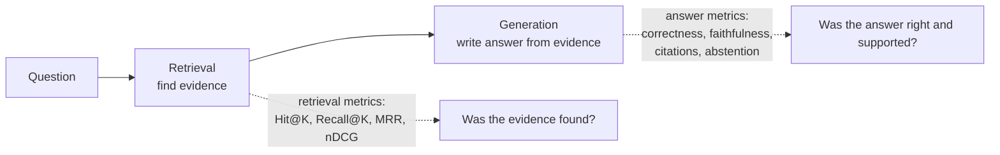

# Module 4: Evaluation and Benchmarking

> Part of [ADVANCED_RAG_2026_MASTER_COURSE.md](../../ADVANCED_RAG_2026_MASTER_COURSE.md). Builds on [Module 2](MODULE_2_EMBEDDINGS_AND_RETRIEVAL.md) (metric formulas) and [Module 3](MODULE_3_CHUNKING_AND_DOCUMENT_PARSING.md) (what gets indexed).
> Labels: **[Code-read]** I read the source; **[Ran]** I executed it in this session; **[Documented]** a repo doc states it, not reproduced by me; **[Missing]**; **[Unknown]**.
> **What I did and did not run.** I did **not** run `scripts/rag_benchmark.py`. It needs a live stack with a real Pinecone key, creates and deletes vectors in a benchmark namespace, and calls the LLM gateway; that is external, billable-or-quota-consuming and I was not authorized to do it. Every benchmark number below is therefore **documented but unverified by me**. What I *did* run: the repo's own automated test suites (hermetic, mocks) and arithmetic checks on the documented numbers.

> **Update after the implementation pass (2026-10-23, working tree on top of `31bad7e`, uncommitted).** Statements below were first written against `31bad7e`; where the code changed they are corrected in place or listed here. All new evidence is hermetic (local vector store, mock gateway, throw-away PostgreSQL); nothing ran against Pinecone, the real LLM gateway or a deployment. Traceability: [FEATURE_MATRIX](../verification/FEATURE_MATRIX.md). Old line numbers have shifted; search by name.
>
> **What changed for this module:** there is now a reproducible retrieval evaluation (`evaluation/build_dataset.py` generates a synthetic corpus with distractors and content-labelled questions; `scripts/run_retrieval_eval.py` runs dense, Postgres full-text, RRF, BM25, BM25+dense and a local cross-encoder rerank per chunking strategy) with a recorded run in `docs/verification/RETRIEVAL_EVALUATION.md`. The REFUSAL-regex defect in `scripts/rag_benchmark.py` is fixed (not re-run: the benchmark needs live Pinecone and a gateway). The historical benchmark claims in §6 remain **Documented, not reproduced**.

---

## 1. Learning objectives

1. Explain why a working demo is not evidence of reliability.
2. Separate retrieval evaluation from answer evaluation, and know which failure each can and cannot find.
3. Build a ground-truth dataset with relevance labels, avoid leakage, and justify a split.
4. Calculate Hit@K, Precision@K, Recall@K, MRR, nDCG by hand and with code, with confidence intervals.
5. Evaluate answer correctness, faithfulness, context relevance, citation correctness, abstention.
6. Measure latency (p50/p95/p99), throughput, concurrency, error rate, token usage and cost correctly.
7. Audit the project's historical claims (69 vectors, 19/20, 20/20, 0.975, 1.1 s, 2.3 s) and say what each proves and does not prove.
8. Write a reproducible evaluation plan.

## 2. Prerequisites

Module 2 §4.7 (metric formulas). Basic statistics: proportion, mean, percentile.

---

## 3. Fundamentals

### 3.1 Why "it works in the demo" proves little

A demo shows that *one* path worked *once*, on questions the demonstrator chose. It cannot tell you: how often it fails, which question types fail, whether a change made it better or worse, or whether it is safe on unanswerable questions. RAG systems fail silently: a wrong answer looks as fluent as a right one. You need a fixed set of questions with known answers, numbers computed the same way every time, and a record of what changed.

### 3.2 Two things to evaluate, separately



| | Retrieval evaluation | Answer evaluation |
|---|---|---|
| Input to judge | ranked chunks | final answer text (+ citations) |
| Ground truth | which chunks/passages are relevant | the correct answer, or the evidence the answer must follow from |
| Cheap? | yes, deterministic | needs a judge: human, rules or an LLM |
| Failure it finds | "the right passage was never shown" | "passage was shown but the answer is wrong/unsupported/missing" |
| Classic trap | great retrieval metrics, bad answers | great answers by luck (model memory), bad retrieval |

If retrieval Hit@6 rises but answer quality falls, suspect: more (noisier) context per question, prompt/context-order effects, duplicated chunks crowding out diversity, a changed chunk size that makes passages less self-contained, or grading/verification now rejecting more answers. Diagnose by measuring both layers on the same questions.

### 3.3 Ground truth and relevance labels

A **relevance label** says "for this question, this passage is relevant". Options:

| Label type | How | Pros/cons |
|---|---|---|
| Chunk-id labels | list the chunk ids | exact, but ids change whenever chunking changes |
| **Content labels** | "document X and the chunk must contain phrase P" | survives re-chunking; but a phrase match is a *proxy* and can mislabel |
| Document-level | any chunk of the right document counts | easy; hides within-document misses |
| Graded (0–3) | human assigns a grade | needed for nDCG; expensive |

The repo's benchmark uses **content labels**: each question has `(filename, [required phrases])`, and the "correct" rank is the first retrieved chunk whose document filename matches *and* whose text contains all phrases (`rag_benchmark.py::main.rank`). [Code-read]

### 3.4 Independence and data leakage

A test set must not influence the system you are testing. Leakage happens when:

- you tune chunk size, prompts or thresholds *on* the test questions (you have turned the test set into a development set);
- the questions were written by looking at the exact chunk text (lexical overlap inflates keyword retrieval);
- the same documents appear in training/tuning and testing;
- the LLM judge saw the reference answer and the model output from the same family.

Rule: split into **dev** (look at it, tune on it) and **test** (touch once per release candidate). Report test only.

### 3.5 Statistics you must know

- A proportion from n trials has uncertainty. **Wilson 95% interval** for k/n: with z = 1.96, p = k/n:
  centre = (p + z²/2n) / (1 + z²/n), half-width = z·√(p(1−p)/n + z²/4n²) / (1 + z²/n).
  For 19/20: **[0.764, 0.991]**. For 20/20: **[0.839, 1.000]**. For 18/20: **[0.699, 0.972]**. [Ran]
  Meaning: "19/20" is statistically compatible with a true hit rate anywhere from 76% to 99%.
- Differences of one question (18/20 → 19/20) are not evidence of improvement.
- For comparing two systems on the **same** questions use a paired method (count questions where A wins, B wins; sign test or paired bootstrap).

### 3.6 Latency and throughput vocabulary

- **p50 / p95 / p99**: the value below which 50/95/99% of requests fall. Nearest-rank method: sort n values; the p-th percentile is element number ⌈p/100 · n⌉ (1-based).
- Percentiles need enough samples: p95 from 20 samples is essentially the maximum; p99 needs ≥ 100 samples to mean anything.
- **Throughput** (requests/second) vs **concurrency** (requests in flight). **Little's Law**: L = λ · W (average in flight = arrival rate × average time in system).
- **Error rate** = failed / total, where "failed" must be defined (5xx, timeout, abstain-when-answerable?).
- **Warm vs cold**: discard warmup; report cold-start separately (important here: free-tier services sleep, Module 7).
- **Coordinated omission**: a load generator that waits for each response before sending the next under-reports latency during stalls; send on a schedule.

---

## 4. Technical deep dive

### 4.1 Metrics recap with a worked set

Use the formulas of Module 2 §4.7. Additional definitions:

| Metric | Definition |
|---|---|
| **Context relevance** | fraction of retrieved passages that are relevant to the question (≈ Precision@K, but judged by rule/LLM/human) |
| **Context recall** | fraction of the facts needed for the reference answer that appear in the retrieved context |
| **Answer correctness** | agrees with the reference answer on the key facts (exact numbers, names) |
| **Faithfulness / groundedness** | every claim in the answer is supported by the retrieved passages (even if the passages are wrong) |
| **Citation correctness** | (a) every cited `[n]` exists, (b) the cited passage actually supports the sentence |
| **Abstention quality** | on unanswerable questions: abstained (good); on answerable: did not abstain (good) |

Faithfulness ≠ correctness: an answer can be perfectly faithful to a wrong passage (stale policy), or correct but unfaithful (the model knew it from training data). RAG for private documents wants **faithful and correct**.

### 4.2 Evaluating unanswerable queries

Build a set of questions that *look* answerable but are not in the corpus (e.g., "What is the Bluetooth range of the Aurora X2?" when the spec never mentions Bluetooth), and some off-topic ones. Score with a confusion table:

| | System abstained | System answered |
|---|---|---|
| Question unanswerable | **correct abstention** (TN) | **hallucination** (FP: the dangerous one) |
| Question answerable | **over-refusal** (FN) | correct answer (TP) |

Report: *false-answer rate on unanswerables* = FP/(FP+TN); *over-refusal rate on answerables* = FN/(FN+TP). Trade-off: stricter grounding lowers FP but raises FN. Never report one without the other.

Worked example: 50 answerable, 20 unanswerable. System: answers 46 of the 50 answerable (4 over-refusals), abstains on 17 of 20 unanswerable (3 hallucinations). Over-refusal = 4/50 = 8%. False-answer rate = 3/20 = 15%. Wilson 95% for 3/20 is wide ([0.052, 0.360]); with only 20 negatives you cannot claim "low".

### 4.3 Answer-evaluation methods

| Method | How | Strength | Weakness |
|---|---|---|---|
| Exact/regex | required fact strings in the answer | deterministic, cheap | brittle to paraphrase, formatting ("14 months" vs "fourteen months"); `rag_benchmark.py` uses this for E2E |
| Citation checks | cited source exists and contains the key phrase | deterministic | proves attachment, not support |
| Numeric consistency | every number in the answer appears in the cited evidence | catches invented figures | misses non-numeric claims |
| LLM-as-judge | a model rates faithfulness/correctness against evidence/reference | scales | judge bias, variability, cost; validate against human labels on a sample; use a *different* model family than the one being judged where possible |
| Human review | experts grade a sample | gold standard | slow, costly; needs guidelines and agreement (Cohen's κ) |

The project's runtime also contains a **verifier** (an LLM check of every claim against the cited passages, `grading.verify`), which is a production safeguard, **not** an evaluation: you cannot grade a system with the same component that is part of it.

### 4.4 Regression tests and reproducibility

A benchmark is reproducible when someone else can re-run it and get the same numbers (within stated noise). Record per run: git commit, embedding model + version, index name and metric, chunking parameters, reranker model, corpus hash, question-set hash, date, hardware/location, random seeds, LLM model route (the gateway's `auto` may route to different models, which the script itself warns about: "FreeLLMAPI may route to different free models"). Gate changes with **non-inferiority**: the new system must not be worse than baseline by more than a margin on the test set; and keep a failure log of every question that changed outcome.

### 4.5 Cost and tokens

Cost per request ≈ Σ over LLM calls (input_tokens · price_in + output_tokens · price_out) + vector/rerank API charges + compute. With AdvancedRAG a turn can include up to four LLM calls (rewrite, grade, generate, verify), so *cost per question* is roughly "number of calls × tokens each". Prices are provider-specific; I do not state any here.

**Gap in the repo:** the LLM service requests streaming token usage only if `FREELLMAPI_STREAM_USAGE=true` (default **false**, `llm/config.py`, `providers/freellmapi.py::FreeLLMAPIProvider._body`), and the chat path streams. Agent Core stores `token_usage` from the `done` event when present (`orchestrator.py::Orchestrator.stream`). So with default settings, per-turn token usage in message metadata is likely empty for streamed answers; non-streamed helper calls (rewrite/grade/verify use `generate`) do return usage from the gateway but Agent Core does not aggregate it. Conclusion: **cost accounting is partially implemented**; to measure cost you must enable stream usage and sum usage across calls. [Code-read]

---

## 5. AdvancedRAG implementation: what exists

| Asset | Location | What it is | Status |
|---|---|---|---|
| Retrieval + E2E benchmark | `scripts/rag_benchmark.py` | corpus generator (PDF, 2 DOCX, TXT, MD, CSV, long distractor), 20 labelled questions, 6 unanswerable retrieval probes, 7 E2E answerable + 2 E2E unanswerable questions, Pinecone integrity checks, isolation check, cleanup, "baseline gate" | Exists, deterministic corpus in code. **Not run by me** |
| Documented baseline | `docs/rag-architecture.md §3` | the results of one run on 2026-10-08 | Documented |
| Frozen config guard | `rag-core/tests/test_frozen_contract.py` | fails if defaults change | Part of the rag-core suite that passed |
| Hermetic test suites | `*/tests`, `tests/contract` | functional/regression tests with mocks, not quality benchmarks | [Ran] see below |
| Datasets/logs from the original benchmark run | – | **none committed**. The only log file in the tree (`stack_dev.log`, git-ignored) contains start-up lines and no benchmark output (I counted 0 matches for "retrieve"/"benchmark") | [Missing] |
| Latency / load test tooling | – | no load-test script; only the 20-request latency sample inside the benchmark | [Missing] |
| nDCG, Precision@K, Recall@K | – | not computed anywhere | [Missing] |
| Answer-faithfulness evaluation harness | – | runtime verifier exists; no offline scoring | [Missing] |

### Test runs I executed (this session, 2026-10-23, on this Windows machine, repo at `31bad7e`, no repo files modified)

| Suite | Result |
|---|---|
| `rag-core` | 87 passed, 4 skipped |
| `agent-core` | 199 passed |
| `llm` | 92 passed |
| `backend` | 218 passed, 4 skipped |
| `tests/contract` (real services against each other with mocks) | 52 passed |

These show the code behaves as its tests specify. They are **not** retrieval-quality or answer-quality measurements, and they do not prove security or production behaviour. The 4 rag-core skips are PostgreSQL-only tests (full-text search and three concurrent-writer lifecycle tests, `skipif(not IS_PG)`); the backend skips are, per the skip markers I found, the env-gated Redis and S3 tests. I ran on SQLite without Redis/S3, so those behaviours were not exercised.

### Findings from reading `rag_benchmark.py`

1. **The corpus is small:** 69 chunks documented. Candidates per retriever are 20, i.e. ~29% of the whole corpus; "Hit@6" is therefore a much easier test than it would be on a user's real knowledge base (hundreds of documents).
2. **Labels are phrase-based proxies** (§3.3). Reasonable and reproducible, but a chunk can contain the phrase without answering the question, and a correct paraphrase without the phrase would be missed.
3. **Dev set = test set.** `docs/rag-architecture.md §3` lists fixes (DOCX table order, row-aware overlap, token guard, citation formats, keyword fallback) "that produced this baseline" made in an audit. The questions were visible while the system was fixed, so these numbers measure fit to a development set. That is normal for a regression baseline; it is not an unbiased estimate of future performance.
4. **Latency sample:** 20 requests, from the machine running the script to the running service (location unknown), each measured once. `p50` is `latencies[len//2]` (the 11th smallest of 20) and "max" is the maximum. p95/p99 are not reported, and with n = 20 they could not be.
5. **Unanswerable retrieval probes (6 questions)** only print the top score, with no pass/fail.
6. **E2E unanswerable check relies on a regex, `REFUSAL`**. I ran that regex against the current abstain sentence (`"I couldn't find sufficient evidence for this answer in your Knowledge Base."`, `prompts.py`) and it returns **False** [Ran]. If the current Agent Core answers with the exact abstain sentence (which it does for insufficient evidence on document questions, `orchestrator.py::Orchestrator.stream`), the script prints `declined=CHECK` and the gate `E2E unanswerable declined` fails, so the script would report `BASELINE NOT MET` even though the system behaved correctly. **Fixed in the implementation pass**: the script now treats the abstain sentence itself as a correct decline (`ABSTAIN_SENTENCE`); the script was parse-checked but **not run** (it needs a live stack). I cannot tell whether the E2E part was stale or merely not re-run; the E2E claims (7/7, 2/2) are therefore **documented, unverified, and possibly describing an earlier Agent Core**. The retrieval stage numbers depend only on RAG Core and are less affected. [Code-read + Ran for the regex]
7. **E2E answerable scoring** uses substring matching on facts and a citation filename match; "allow one miss" because model routing varies.
8. **Cleanup and isolation** are checked, which is good practice (and rare): namespace vector count must return to 0; a second user querying the same document ids must get 0 chunks.

---

## 6. Audit of the historical results

Source: `docs/rag-architecture.md §3` "Verified baseline (2026-10-08)". Status words: **Documented** = a repo document states it. **Reproduced** = I got the same number. **Consistent** = arithmetic-consistent with other documented numbers (I checked). Nothing below is **Reproduced**.

| Claim (your brief) | Repo statement | Status | What it proves | What it does *not* prove |
|---|---|---|---|---|
| **69 vectors for 69 chunks** | "69 vectors in the benchmark namespace, equal to 69 chunk rows"; sampled vectors 384-d, unit-norm, metadata without text, vector ≈ bge-small(chunk text) with cosine > 0.999 | Documented, not reproduced. The script's checks exist (`rag_benchmark.py::main`) | At that time, for that corpus, the number of vectors equalled the number of chunk rows and sampled vectors matched their text | That every ingestion in production is complete; that no orphan vectors exist elsewhere; only a sample of ≤ 10 vectors was inspected, not all 69 |
| **Hit@1 19/20** | final (after rerank) 19/20 | Documented; **consistent** (see below) | On this question set, the correct chunk was first for 19 of 20 | Generalization (Wilson 95% [0.76, 0.99]); the misses; independence of the question set |
| **Hit@6 20/20** | 20/20 at every stage | Documented | The right chunk was always within the top 6 on this set | Production recall on larger corpora; recall of *all* relevant chunks (only one relevant chunk per question is defined, so Hit@K = Recall@K here) |
| **MRR 0.975** | final MRR 0.975 | Documented; **consistent**: with 19 first-place hits and every question found within 6, the only rank pattern giving (19+x)/20 = 0.975 is one question at rank 2 [Ran] | Average early-ranking quality on this set | Anything about answer quality |
| **Median retrieval latency 1.1 s** | "p50 1.1 s" for "Pinecone query plus rerank", through the running service | Documented | A typical retrieve call took about 1.1 s in that run | End-to-end chat latency (excludes rewrite, grading, generation, verification, network to browser); cold-start; behaviour under concurrency; any percentile above p50 |
| **Maximum latency 2.5 s** | **The repo says 2.3 s ("max 2.3 s")**, not 2.5 s | **Contradicted by the repo.** Use 2.3 s (documented), or run again | – | – |

**Arithmetic consistency of the stage table** (I solved for the ranks by brute force [Ran]):

| Stage | hit@1 | hit@6 | MRR | Rank pattern of the non-first questions that reproduces the MRR |
|---|---|---|---|---|
| Semantic | 18/20 | 20/20 | 0.950 | two questions at rank 2 (unique) |
| Keyword | 15/20 | 20/20 | 0.837 | ranks {2, 2, 3, 5, 5} (unique given all ≤ 6) |
| RRF | 16/20 | 20/20 | 0.900 | four questions at rank 2 (unique) |
| Final | 19/20 | 20/20 | 0.975 | one question at rank 2 (unique) |

All four rows are mutually consistent, which makes transcription errors unlikely. It does not make them true; it only shows the numbers are not self-contradictory.

**One more subtle point on "hybrid is better".** In this documentation semantic-only (18/20, 0.950) is *stronger* than RRF (16/20, 0.900), and the final number is the best only after reranking. The authors recorded this honestly ("Hybrid search is kept, even though semantic search alone looks stronger on this corpus"). A good interview answer: the choice is justified by exact-code queries and by the keyword-only fallback if Pinecone is down, not by this benchmark.

**Retrieved vs the E2E claims.** "7/7 answerable correct and cited; 2/2 unanswerable declined" are documented (E2E, Agent Core → RAG Core → LLM → gateway). Per finding 6 they may predate the current abstain wording. Treat as historical.

---

## 7. A reproducible evaluation plan for AdvancedRAG

**Goal:** an unbiased, repeatable estimate of retrieval and answer quality, and a gate for changes.

1. **Corpus.** Freeze a representative set of documents (mix of PDF, DOCX, CSV, TXT/MD; include a scanned PDF, a table-heavy file, near-duplicates, a long distractor). Record SHA-256 of each file. Target ≥ a few hundred chunks per user namespace so the pool is not trivially small.
2. **Questions.** Write ≥ 100 answerable questions stratified: exact lookup, paraphrase (no shared keywords), numeric/table, multi-chunk, follow-up (with history), near-duplicate disambiguation; plus ≥ 40 unanswerable (off-topic, plausible-but-absent, answer exists only in another user's namespace). Authors should write questions **before** viewing chunk text where possible; have a second person review.
3. **Labels.** Content labels (filename + required phrases) *and* a short reference answer. For a 30-question subset, add graded relevance 0–3 for nDCG, labelled by two people; report agreement.
4. **Split.** 30% dev, 70% test. Tune only on dev. Freeze test; log every time it is run.
5. **Retrieval run.** For each question call the real `/rag/retrieve` (or `pipeline.retrieve` in-process) and also record each stage's candidates (semantic, keyword, RRF, final) as the existing script does. Compute Hit@K, Recall@K, Precision@K, MRR, nDCG@6 with Wilson/bootstrap intervals.
6. **Answer run.** Call Agent Core `/agent/stream` with the same questions. Score: correctness (rules + 20% human sample), faithfulness (verifier-independent judge model + human sample), citation correctness, abstention confusion table.
7. **Performance run.** Warm up; then a closed-loop test at concurrency 1, 5, 20 with ≥ 200 requests per level; open-loop at fixed arrival rates; separate cold-start test. Report p50/p95/p99, error rate, throughput, per-stage timings (`rag_call_ms`, `grading_ms`, `generation_latency_ms`, `verification_ms`), tokens and cost with `FREELLMAPI_STREAM_USAGE=true`.
8. **Record metadata** (§4.4) in a JSON results file committed with the report.
9. **Gate.** New ≥ baseline − margin on test Hit@6 and MRR, no increase in false-answer rate on unanswerables, p95 within budget. Any question whose outcome flips is listed.
10. **Repeat** after each frozen-parameter change (`docs/rag-architecture.md §6`).

### Runnable evaluation toolkit (educational; plug your real retriever into `retrieve_fn`)

```python
# runnable
import asyncio, math, random, time
from collections import defaultdict

# ---------- retrieval metrics ----------
def hit_at_k(rank, k): return 1.0 if rank is not None and rank <= k else 0.0
def rr(rank): return 1.0 / rank if rank else 0.0

def first_relevant_rank(retrieved, is_relevant):
    for i, item in enumerate(retrieved, start=1):
        if is_relevant(item):
            return i
    return None

def dcg(gains): return sum(g / math.log2(i + 1) for i, g in enumerate(gains, start=1))
def ndcg_at_k(gains, k):
    best = dcg(sorted(gains, reverse=True)[:k])
    return dcg(gains[:k]) / best if best else 0.0

def wilson(k, n, z=1.96):
    if n == 0: return (0.0, 1.0)
    p = k / n; d = 1 + z * z / n; c = p + z * z / (2 * n)
    h = z * math.sqrt(p * (1 - p) / n + z * z / (4 * n * n))
    return ((c - h) / d, (c + h) / d)

def bootstrap_ci(values, stat=lambda v: sum(v) / len(v), n=2000, seed=0, alpha=0.05):
    rng = random.Random(seed)
    stats = sorted(stat([rng.choice(values) for _ in values]) for _ in range(n))
    return stats[int(alpha / 2 * n)], stats[int((1 - alpha / 2) * n) - 1]

def percentile(values, p):                       # nearest-rank
    s = sorted(values); return s[max(math.ceil(p / 100 * len(s)), 1) - 1]

# ---------- abstention ----------
def abstention_report(rows):
    """rows: (answerable: bool, abstained: bool)"""
    c = defaultdict(int)
    for answerable, abstained in rows:
        c[("A" if answerable else "U", "abstain" if abstained else "answer")] += 1
    ua, uq = c[("U", "answer")], c[("U", "answer")] + c[("U", "abstain")]
    aa, aq = c[("A", "abstain")], c[("A", "abstain")] + c[("A", "answer")]
    return {"false_answer_rate": ua / uq if uq else None, "over_refusal_rate": aa / aq if aq else None}

# ---------- harness ----------
async def evaluate(questions, retrieve_fn, k=6):
    ranks, lat = [], []
    for q in questions:
        t = time.perf_counter()
        retrieved = await retrieve_fn(q["question"])
        lat.append((time.perf_counter() - t) * 1000)
        ranks.append(first_relevant_rank(retrieved, q["is_relevant"]))
    n = len(ranks)
    hits = sum(hit_at_k(r, k) for r in ranks)
    return {"n": n, f"hit@{k}": hits / n, "hit@1": sum(hit_at_k(r, 1) for r in ranks) / n,
            "mrr": sum(rr(r) for r in ranks) / n, "hit_ci": wilson(int(hits), n),
            "p50_ms": percentile(lat, 50), "max_ms": max(lat)}

# ---------- tests with a fake retriever ----------
async def fake_retrieve(q):
    return {"hotel": ["x", "hotel-chunk"], "remote": ["remote-chunk"], "bluetooth": ["noise"]}[q]

qs = [{"question": "hotel", "is_relevant": lambda c: c == "hotel-chunk"},
      {"question": "remote", "is_relevant": lambda c: c == "remote-chunk"},
      {"question": "bluetooth", "is_relevant": lambda c: False}]
res = asyncio.run(evaluate(qs, fake_retrieve))
assert res["hit@1"] == 1 / 3 and res["hit@6"] == 2 / 3
assert abs(res["mrr"] - (0.5 + 1 + 0) / 3) < 1e-12
assert [round(x, 3) for x in wilson(19, 20)] == [0.764, 0.991]
assert [round(x, 3) for x in wilson(20, 20)][0] == 0.839
assert percentile([1, 2, 3, 4, 5, 6, 7, 8, 9, 10], 95) == 10 and percentile(list(range(1, 101)), 99) == 99
assert abs(ndcg_at_k([3, 2, 0, 1], 4) - 0.98544) < 1e-4
rep = abstention_report([(False, False)] * 3 + [(False, True)] * 17 + [(True, True)] * 4 + [(True, False)] * 46)
assert rep["false_answer_rate"] == 3 / 20 and rep["over_refusal_rate"] == 4 / 50
lo, hi = bootstrap_ci([1.0] * 19 + [0.0], seed=1)
assert 0.7 <= lo <= 0.95 <= hi <= 1.0
print("ok")
```

### Runnable async load generator (educational)

```python
# runnable
import asyncio, math, random, time

def percentile(values, p):
    s = sorted(values); return s[max(math.ceil(p / 100 * len(s)), 1) - 1]

async def load_test(call, total, concurrency):
    """Closed loop: at most `concurrency` requests in flight. Returns latency stats in ms."""
    sem, lats, errors = asyncio.Semaphore(concurrency), [], 0
    async def one():
        nonlocal errors
        async with sem:
            t = time.perf_counter()
            try:
                await call()
            except Exception:
                errors += 1
            lats.append((time.perf_counter() - t) * 1000)
    t0 = time.perf_counter()
    await asyncio.gather(*(one() for _ in range(total)))
    wall = time.perf_counter() - t0
    return {"n": total, "errors": errors, "error_rate": errors / total, "throughput_rps": total / wall,
            "p50": percentile(lats, 50), "p95": percentile(lats, 95), "p99": percentile(lats, 99)}

async def fake_call():
    await asyncio.sleep(0.01 + random.random() * 0.01)
    if random.random() < 0.05:
        raise RuntimeError("boom")

random.seed(3)
r = asyncio.run(load_test(fake_call, total=200, concurrency=20))
assert r["n"] == 200 and 0 <= r["error_rate"] < 0.2 and r["p50"] <= r["p95"] <= r["p99"]
# Little's law sanity: in-flight ~ throughput * mean latency; with sleep-bound calls throughput ~ concurrency/latency
assert r["throughput_rps"] > 100          # 20 workers / ~0.015 s ~ 1300 rps upper bound, event-loop overhead lowers it
print("ok")
```

(The numbers in these tests come from a *fake* in-process function. They say nothing about AdvancedRAG's performance.)

---

## 8. Common mistakes

1. Reporting one run of 20 questions as "accuracy 95%".
2. Tuning on the test set and then reporting it.
3. Calling retrieval Hit@K "answer accuracy".
4. Using a score threshold as a relevance label.
5. Reporting only averages for latency, or p99 from 20 samples.
6. Benchmarking a tiny corpus and extrapolating to real users.
7. Counting cached/warm requests only, or excluding failures from latency.
8. Letting the component under test grade itself (verifier as evaluator).
9. Judging abstention only on unanswerables (forgetting over-refusal).
10. Not recording the commit, model route and corpus hash, so nobody can reproduce the number.
11. Treating "baseline gate passed" as production readiness.

---

## 9. Interview questions

### Beginner

**B1. Why isn't a working demo enough?** It shows one success, not the failure rate, the failure types or regressions. RAG fails fluently.

**B2. What is Hit@K?** Fraction of questions with at least one relevant item in the top K.

**B3. What is MRR?** Mean of 1/rank of the first relevant result. Rank 1 → 1, rank 2 → 0.5, not found → 0.

**B4. What is the difference between retrieval and answer evaluation?** Retrieval: was the evidence found/ranked well. Answer: is the written answer correct, supported and cited.

**B5. What is a p95 latency?** 95% of requests were faster than this value.

### Intermediate

**I1. Compute Precision@3 and Recall@3 for relevant {a,b,c} and results [a,x,b].** P@3 = 2/3, R@3 = 2/3.

**I2. How do you evaluate unanswerable questions?** Build plausible-but-absent questions; measure false-answer rate on them *and* over-refusal rate on answerable ones; report both with intervals.

**I3. What is faithfulness vs correctness?** Faithful = supported by the retrieved context; correct = true to the reference. Both are needed; they can diverge when the context is wrong or the model answers from memory.

**I4. What does "19/20" tell you?** Estimate 95% with a Wilson interval of roughly 76–99%; a difference of one question between systems is noise.

**I5. Why measure percentiles rather than the mean?** Latency distributions are long-tailed; the mean hides the tail users feel.

**I6. How do you build a fair retrieval experiment comparing chunk sizes?** Same corpus and questions, content-based labels (chunk ids change), separate index/namespace per variant, dev/test split, same reranker and K, paired comparison with intervals, record cost (vectors) and latency too.

### Advanced

**A1. Retrieval metrics improved but users say answers got worse. Investigate.** Compare per-stratum results; look at context length and duplicates; check grading/verification outcomes (`evidence_grade`, `verification_status`, `answer_replaced`); examine whether top-1 improved while top-6 became noisier; sample failures; check whether the new chunking splits facts so the LLM sees fragments; run an answer-level eval on the same questions; check if a prompt or model route changed.

**A2. Audit this claim: "Hit@6 20/20, MRR 0.975, so retrieval is excellent."** Corpus of 69 chunks (candidate pool ≈ 29% of it); 20 questions authored by the system's author and visible during fixes; phrase-based proxy labels; one run; interval 84–100% for 20/20; no unanswerable score; no nDCG/recall for multi-chunk answers. Conclusion: regression baseline, not a quality guarantee.

**A3. How would you measure end-to-end latency honestly for 100 concurrent chat requests?** Open-loop arrival schedule, warm and cold phases, real streaming (measure time to first token and total), per-hop timers, include error and timeout counts as failures in percentiles, identical hardware to production, monitor provider rate limits (429). Report p50/p95/p99 per phase. (Details in Module 7.)

**A4. Design an LLM-judge for faithfulness and validate it.** Prompt: given passages and answer, list each claim and mark supported/unsupported; use temperature 0, structured JSON, a different model family from the generator; calibrate on ≥ 100 human-labelled answers, report agreement/κ and the judge's false-positive/negative rate; use the judge as a *relative* tool and re-calibrate when models change.

**A5. How would you detect a regression caused by a silent embedding-model change?** Gate on the frozen benchmark; log model name in results; a canary query set run on deploy; the per-document `embedding_model` check from Module 2.

---

## 10. Follow-up questions

- What sample size would you need to detect an improvement from 90% to 95% hit rate? (Order of a few hundred paired questions for reasonable power; compute with a power calculation, not a guess.)
- Why is "Hit@K = Recall@K" in the repo's benchmark? (Exactly one relevant chunk per question.)
- How does multi-chunk answering change the metrics? (Need Recall@K over all required facts, nDCG with graded labels.)
- How do you evaluate follow-up questions? (Provide history; label the standalone query; score rewrite quality separately.)
- How do you avoid overfitting prompts to the benchmark? (Held-out test, periodic refresh with real anonymized queries.)
- What would you log in production to build a future evaluation set? (Query, retrieved ids, grades, citations, user feedback; with privacy controls.)

## 11. Practical exercises

### E4.1 Compute metrics by hand and in code

*Problem.* Questions with first-relevant ranks `[1, 1, 2, None, 5, 1]`. Compute Hit@1, Hit@3, Hit@6, MRR.
*Answer.* Hit@1 = 3/6 = 0.5; Hit@3 = 4/6 = 0.667; Hit@6 = 5/6 = 0.833; MRR = (1 + 1 + 0.5 + 0 + 0.2 + 1)/6 = 3.7/6 = 0.6167.

```python
# runnable
ranks = [1, 1, 2, None, 5, 1]
hit = lambda k: sum(1 for r in ranks if r and r <= k) / len(ranks)
mrr = sum(1 / r for r in ranks if r) / len(ranks)
assert (hit(1), round(hit(3), 3), round(hit(6), 3), round(mrr, 4)) == (0.5, 0.667, 0.833, 0.6167)
print("ok")
```

### E4.2 Reverse-engineer a documented MRR

*Problem.* Given hit@1 = 16/20, all found within rank 6, MRR = 0.900, find the ranks of the 4 other questions. (Answer: all four at rank 2.) Write code that searches for them.

```python
# runnable
import itertools

def rank_patterns(n_other, n_first, total, mrr, max_rank=6, tol=0.0005):
    out = []
    for rs in itertools.combinations_with_replacement(range(2, max_rank + 1), n_other):
        m = (n_first + sum(1 / r for r in rs)) / total
        if abs(m - mrr) < tol:
            out.append(rs)
    return out

assert rank_patterns(4, 16, 20, 0.900) == [(2, 2, 2, 2)]
assert rank_patterns(1, 19, 20, 0.975) == [(2,)]
assert rank_patterns(5, 15, 20, 0.837) == [(2, 2, 3, 5, 5)]
print("ok")
```

### E4.3 Audit task (do this on your own checkout)

1. Read `docs/rag-architecture.md §3`. 2. List each number. 3. For each, write "source script/function", "can I reproduce it with stack running?", "what does it measure?". 4. Run `python scripts/rag_benchmark.py` only if you own the Pinecone index and accept the quota use; save the full console output to `benchmarks/<date>-<commit>.txt`. 5. Compare with the documented table; explain any difference. 6. Fix the `REFUSAL` regex or compare against `prompts.ABSTAIN_MESSAGE` and re-run.

### E4.4 Fix the benchmark's abstention check (stretch)

```python
# runnable
import re

ABSTAIN = "I couldn't find sufficient evidence for this answer in your Knowledge Base."
OLD = re.compile(r"(not (mention|specif|includ|contain|cover|state|provid|list|found|available)|no (information|mention|details))", re.I)
assert not OLD.search(ABSTAIN.lower())               # the old regex misses the current sentence

def declined(answer: str) -> bool:
    text = re.sub(r"[*_`]", "", answer).strip().lower()
    return text.startswith("i couldn't find sufficient evidence") or bool(OLD.search(text))

assert declined(ABSTAIN) and declined("**The documents do not mention Bluetooth.**")
assert not declined("The battery lasts 14 months [1].")
print("ok")
```

### E4.5 Design: fair comparison of chunk size 600 vs 1200

Write the protocol (corpus hash, two namespaces, same labels, paired bootstrap, metrics, cost). Expected answer shape: see §7 and Q I6.

### E4.6 Troubleshooting scenarios

1. *Hit@6 stays 100% but E2E accuracy drops after a prompt change.* Retrieval is not the cause; run answer-level scoring per stratum; read failing outputs; check citations and abstentions.
2. *p99 is 12× p50.* Look for cold starts (sleeping services), retries/backoff (LLM retry delays up to 8 s), provider 429s, or GC; segment latencies by hop.
3. *Over-refusal increased.* Check `evidence_grade` distribution and `MAX_CORRECTION_ATTEMPTS`; look for retrieval misses on paraphrases; verify grader JSON parse failures (fall back to `unknown`).

## 12. Revision notes

- Retrieval metrics (Hit/Recall/Precision/MRR/nDCG) ≠ answer metrics (correctness/faithfulness/citations/abstention).
- Content labels survive re-chunking; split dev/test; intervals always (Wilson 19/20 → 76–99%).
- Unanswerables: report false-answer **and** over-refusal rates.
- Latency: percentiles by nearest-rank, enough samples, warm vs cold, no coordinated omission.
- Repo: benchmark script exists (69 chunks, 20 + 6 + 9 questions), baseline documented, not reproduced by me; max latency documented as **2.3 s**; the REFUSAL-regex defect is fixed but unverified by a run; nDCG/P@K/R@K now exist in the new evaluation tooling (synthetic corpus); a small ingestion size ladder exists (`PERFORMANCE_AND_BACKUP.md`), but no concurrent-load test and no committed benchmark logs; token usage off by default for streams.
- Hermetic suites I ran: 87/199/92/218/52 passed (4+4 skipped).

## 13. Assessment (attempt before reading the answer key)

1. For relevant set {r1, r2}, results [x, r1, y, r2, z]: compute P@2, R@2, P@5, R@5, reciprocal rank, and AP... (AP = average of precision at each relevant rank).
2. Four questions have first-relevant ranks 2, 1, none, 4. Compute MRR and Hit@3.
3. Compute nDCG@3 (linear gain) for returned gains [1, 3, 2].
4. Compute the Wilson 95% interval for 18/20 to two decimals, and say whether 18/20 vs 19/20 is a meaningful difference.
5. 40 answerable, 10 unanswerable. System: over-refuses 2 answerable, answers 4 unanswerable. Give both rates.
6. Why can't you use the runtime verifier to evaluate answer faithfulness?
7. List five things a reproducible benchmark run must record.
8. Latencies (ms): 900, 950, 1000, 1050, 1100, 1100, 1200, 1250, 1300, 2300. Nearest-rank p50, p90, p95.
9. A user's request has 3 LLM calls averaging 800 input and 300 output tokens each. If a hypothetical price is $a per 1M input and $b per 1M output tokens, give the cost formula per request and per 10,000 requests.
10. Explain three reasons the documented benchmark cannot prove production quality.
11. The brief says max latency 2.5 s. What do you say and why?
12. Design a test for "retrieval metrics improve but answers worsen".

---

## 14. ANSWER KEY (do not read until you have attempted the assessment)

**A1.** Top 2 = [x, r1]: P@2 = 1/2, R@2 = 1/2. Top 5 contains r1, r2: P@5 = 2/5 = 0.4, R@5 = 1. First relevant at rank 2 → RR = 0.5. AP: precision at rank 2 = 1/2, at rank 4 = 2/4 → AP = (0.5 + 0.5)/2 = 0.5.

**A2.** RRs: 1/2, 1, 0, 1/4 → sum 1.75 → MRR = 0.4375. Hit@3: ranks ≤ 3 → questions 1 and 2 → 2/4 = 0.5.

**A3.** DCG = 1/log₂2 + 3/log₂3 + 2/log₂4 = 1 + 1.8928 + 1 = 3.8928. Ideal [3,2,1]: 3 + 2/1.585 + 1/2 = 3 + 1.2619 + 0.5 = 4.7619. nDCG = 0.8175. (Check: the earlier example in Module 2 uses the same helper.)

**A4.** 18/20: [0.70, 0.97]; 19/20: [0.76, 0.99]. Overlap is huge, so a one-question difference is not meaningful. Use paired comparison on the same questions and many more of them.

**A5.** Over-refusal = 2/40 = 5%. False-answer rate = 4/10 = 40%. Wide interval for n = 10. The system is unsafe on unanswerables despite looking good on answerables.

**A6.** It is part of the system; its errors and the generator's errors are correlated, and it can approve its own blind spots. Evaluation needs an independent judge and human-checked labels.

**A7.** Git commit; embedding model/version; index/metric/dimension; chunking and retrieval parameters; reranker model; corpus and question-set hashes; LLM model route; date/hardware/network location; random seeds. (Any five.)

**A8.** n = 10 sorted. p50 = element ⌈5⌉ = 5th = 1100. p90 = ⌈9⌉ = 9th = 1300. p95 = ⌈9.5⌉ = 10th = 2300. (The same numbers pattern as the documented p50 1.1 s / max ≈ 2.3 s; this list is illustrative, not data.) With 10 samples p95 = the max, which is why you need more samples.

**A9.** Per request: tokens in = 3 × 800 = 2,400, out = 3 × 300 = 900. Cost = (2,400·a + 900·b) / 1,000,000. Per 10,000 requests: 10,000 × that = (24 million·a + 9 million·b) / 1,000,000 = 24a + 9b dollars. (Check: 2,400 × 10,000 = 24,000,000 → 24a; 900 × 10,000 = 9,000,000 → 9b.)

**A10.** Tiny corpus (candidate pool ≈ 29%); same author wrote questions and fixed failures (dev = test); proxy labels, one run, 20 questions; latency measured on one path from one location; no concurrency; E2E regex possibly stale.

**A11.** "The repository documents 2.3 s (`docs/rag-architecture.md §3`). I haven't found a source for 2.5 s; I'd quote 2.3 s as documented and, if it matters, re-measure and report the percentile with the sample size."

**A12.** Hold questions fixed. Run retrieval metrics and answer metrics before/after. Stratify by question type. Compute for each question: retrieval outcome × answer outcome (2×2); look at the "retrieved but answered wrong" cell; compare context length and duplicate rate; check grader/verifier outcomes; read 20 failures. Hypothesis tests: shuffle context order; reduce K; ablate duplicates.

---

## 15. Completion criteria (self-check)

- [ ] You can compute every metric in §13 by hand.
- [ ] You can state the audit table (§6) from memory, including the 2.3 s vs 2.5 s discrepancy and the REFUSAL-regex issue.
- [ ] You can say what each historical number proves and does not prove.
- [ ] You can write the evaluation plan (§7) in your own words.
- [ ] You ran the runnable blocks; they printed `ok`.

## Sources (accessed 2026-10-23)

1. Repository: `docs/rag-architecture.md` §3–4, `scripts/rag_benchmark.py`, `agent-core/agent_core/prompts.py`, `llm/llm_service/config.py`.
2. Wilson score interval (standard formula; computed and checked in code above).
3. BAAI/bge-small-en-v1.5 model card (similarity range note): https://huggingface.co/BAAI/bge-small-en-v1.5
4. Little's Law and coordinated omission are standard performance-engineering concepts, stated from general knowledge and not re-fetched.
