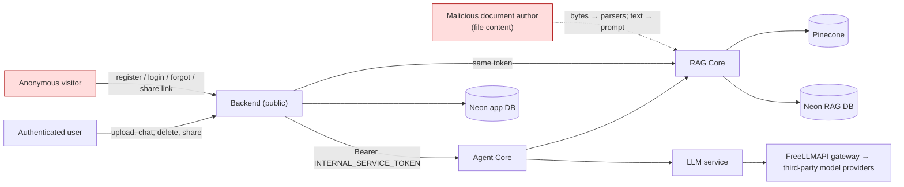

# Module 6: Security and Reliability

> Part of [ADVANCED_RAG_2026_MASTER_COURSE.md](../../ADVANCED_RAG_2026_MASTER_COURSE.md). Builds on all earlier modules.
> Labels: **[Code-read]** I read the source; **[Ran]** I executed it in this session; **[Documented]** a repo doc says so; **[Missing]**; **[Unknown]**.
> **Read this first.** This is a code-and-documentation review, not a penetration test. I did not attack a running system, did not test production, and did not verify any deployment. "Verified" below means: *an automated test in the repository exercises it and that test passed when I ran the suite* (backend 218 passed, rag-core 87, agent-core 199, llm 92, contract 52; some tests skipped). Passing tests show specified behaviour. They do **not** show the system is secure.

> **Update after the implementation pass (2026-10-23, working tree on top of `31bad7e`, uncommitted).** Statements below were first written against `31bad7e`; where the code changed they are corrected in place or listed here. All new evidence is hermetic (local vector store, mock gateway, throw-away PostgreSQL); nothing ran against Pinecone, the real LLM gateway or a deployment. Traceability: [FEATURE_MATRIX](../verification/FEATURE_MATRIX.md). Old line numbers have shifted; search by name.
>
> **What changed for this module (risk register deltas):** **R2** (parser/zip bombs): DOCX uncompressed-size/ratio/entry-count checks, image pixel limits and OCR page/time budgets now exist and are tested; there is still no sandboxed parser process. **R13** (retention/deletion): file bytes no longer live in job payloads, delete removes the stored object from whichever backend holds it and scrubs legacy payloads. **R14** (backup/recovery): a `pg_dump`/`pg_restore` round trip was verified on a local database, and `reindex` can rebuild vectors from stored chunks; managed-database backups are still unverified. **R17** (supply chain): `pip-audit` found Pillow, pypdf and certifi advisories in the dev environment; they were upgraded and the re-audit is clean, but requirements remain unpinned ranges. **DoS**: a per-user concurrent-stream cap exists. Full notes: [SECURITY_AUDIT](../verification/SECURITY_AUDIT.md). This is still not a penetration test.

---

## 1. Learning objectives

1. Threat-model a RAG application: assets, actors, trust boundaries, attack surfaces.
2. Explain the main risks (uploads, authentication/authorization, tenant isolation, injection of all kinds, secrets, logs, DoS, CORS, data lifecycle) and the controls in AdvancedRAG.
3. Distinguish **verified protections** from **unverified** and **unresolved gaps**, for each risk.
4. Describe safe ways to test each risk and write a regression test.
5. Answer incident-response and multi-tenant isolation interview questions.

## 2. Prerequisites

Modules 1, 3 and 5 (architecture, ingestion, prompt layout). HTTP, cookies, JWT basics (re-explained below).

---

## 3. Fundamentals

### 3.1 Security vocabulary

- **Asset**: what you must protect (users' documents, chunks, conversations, credentials, provider keys, availability).
- **Threat actor**: unauthenticated visitor; authenticated user attacking another user; malicious document author; compromised dependency or internal service; insider.
- **Trust boundary**: a line where data/control crosses from a less-trusted to a more-trusted side. In AdvancedRAG: browser→backend; backend→internal services; document text→prompt; internal services→third parties (Pinecone, gateway).
- **Authentication (AuthN)**: who are you. **Authorization (AuthZ)**: what may you access. **IDOR**: accessing another user's object by guessing/changing its id.
- **Defence in depth**: multiple independent layers so one failure is not fatal.
- **STRIDE** (a threat-model checklist): Spoofing, Tampering, Repudiation, Information disclosure, Denial of service, Elevation of privilege.

### 3.2 Why RAG adds risks

Normal web apps worry about code and data. RAG adds: **untrusted text enters a model's instructions** (indirect prompt injection), **retrieval can cross tenants** if filters are wrong, **embeddings and chunk text are copies of private data** in more places, **parsers** process attacker-controlled binary formats, and **third-party model/vector providers** receive content.

### 3.3 Authentication concepts used here

- **Argon2id** password hashing: slow and memory-hard, resistant to GPU cracking.
- **JWT access token**: signed (HS256) claims, short-lived (15 min here). A JWT alone cannot be revoked; this project also checks a server-side **session row** on each request so logout takes effect immediately [Code-read: `deps.py::get_auth_context`].
- **Refresh token**: long-lived (7 days), in an `HttpOnly` cookie; **rotation** (each use issues a new one) with **reuse detection** (presenting an old one revokes the session), plus a 30-second grace window for concurrent tabs [Code-read: `config.py`; `security.py`].

---

## 4. Technical deep dive: threat model

### 4.1 Assets, boundaries and attack surface



Attack surface list: public backend API (auth, documents, conversations, messages SSE, search, shares, profile, settings, health/ready), the multipart upload parser, the static frontend (CSP), the internal services' public URLs on free Render (bearer-protected), the admin dashboards of Render/Vercel/Neon/Pinecone (outside code), the LLM gateway.

### 4.2 Risk register (evidence-based)

Legend: **Mitigation status** = **Implemented** (code exists), **Partial**, **Missing**. **Verification** = **Test passed** (a repo test exercises it and passed in my run), **Read only** (I read the code; no test I could identify), **Unknown**.

#### R1. Malicious or disguised file upload

| | |
|---|---|
| **Threat** | Attacker uploads an executable/script renamed `.pdf`, a path-traversal filename, a polyglot file, or HTML that would be served inline. |
| **Impact** | Stored XSS or code execution if served/parsed unsafely; storage abuse; overwrite of other files. |
| **Existing mitigation** | Extension allowlist (`pdf,txt,md,csv,docx`); browser MIME ignored, server-side MIME by extension; magic-byte check (`%PDF-`; `PK\x03\x04` + `word/document.xml` for DOCX; no NUL bytes in first 8 KB for text); filename sanitised (NFKC, last path component, control chars removed, 200-char cap); storage key is `documents/<user_id>/<doc_id>` with no client component; local storage path confined to root (`_path` resolve check); downloads forced `attachment` + `nosniff`; 25 MB limit enforced in middleware before buffering and again while scanning. [Code-read: `document_service.py`, `storage.py`, `body_limit.py`, `documents.py`] |
| **Verification** | **Test passed**: `test_rejects_unsupported_extension`, `test_rejects_content_that_does_not_match_extension`, `test_browser_mime_type_is_ignored`, `test_rejects_oversized_and_empty_files`, `test_path_traversal_filename_is_neutralised`, `test_download_is_attachment_with_nosniff` (backend suite). |
| **Gaps** | No malware scanning or content disarm (OWASP recommends AV/CDR where feasible, source 1) [Missing]. Magic-byte checks are shallow (a text file with `%PDF-` header and garbage passes the check, then fails parsing). |
| **Safe test** | In a local stack only: upload `evil.exe` renamed `.pdf`, `../../x.pdf`, a 26 MB file, a zero-byte file, a `.docx` that is a plain zip; expect 415/413/422 and no file outside the storage root. Never test on shared/production environments with real malware. |
| **Fix** | Optional AV scan (ClamAV) in the worker before RAG Core; quarantine bucket; deeper structure validation. |
| **Regression test** | Keep the listed tests; add a fixture for polyglot (valid `%PDF-` header + executable payload) expecting `PARSE_FAILED` and no leakage of parser internals. |

#### R2. Parser vulnerabilities and decompression/CPU bombs

| | |
|---|---|
| **Threat** | A crafted PDF/DOCX/CSV makes the parser consume huge memory/CPU or exploits a parser bug (DOCX is a ZIP; PDFs may contain compressed streams). |
| **Impact** | RAG Core (512 MB on the free plan) is OOM-killed; ingestion stuck; all users' indexing and retrieval affected because **parsing runs in the same process that serves retrieval**. |
| **Existing mitigation** | Compressed file size ≤ 25 MB; parser exceptions are mapped to `PARSE_FAILED` (non-retryable) with no internals leaked; chunk cap (5,000); ingestion timeout (1 h of active polling); `INGEST_CONCURRENCY=1` on Render; parse in a worker thread so the event loop is not blocked. [Code-read: `parsing.py::parse`, `pipeline.py::ingest`, `render.yaml`] |
| **Verification** | **Read only** for the bomb scenarios. Tests cover malformed/empty files, not adversarial ones. |
| **Gaps** | **Now covered:** DOCX zip checks (entries, uncompressed bytes, ratio), image pixel limit, OCR page/pixel/time budgets (`test_hostile_inputs.py`). **Still missing:** a parse timeout for pypdf (a thread cannot be killed) and any sandbox/subprocess with a memory limit; polyglot files are not specifically tested. Dependencies are still unpinned ranges; `pip-audit` on the dev venv found Pillow 12.3.0, pypdf 6.19.0 and certifi advisories, all upgraded (floors raised in `rag-core/requirements.txt`) and the re-audit is clean; the production image versions remain [Unknown]. |
| **Safe test** | Locally, in a container with a memory cap (e.g., 512 MB), ingest a generated ZIP whose XML expands to hundreds of MB; observe whether RAG Core survives. Do it on a disposable stack. |
| **Fix** | Pre-scan `ZipInfo.file_size` sums/ratios for DOCX; run parsing in a subprocess with `resource` limits and a wall-clock timeout; pin dependencies with hashes and run `pip-audit` in CI; separate "parser worker" from the retrieval service. |
| **Regression test** | A generated bomb must produce `PARSE_FAILED` within N seconds and leave the service ready. |

#### R3. Authentication weaknesses

| | |
|---|---|
| **Threat** | Credential stuffing, brute force, token theft/replay, session fixation, forged tokens, user enumeration. |
| **Existing mitigation** | Argon2id; equal-time login for unknown email (`burn_password_check`); rate limits: login 10 / 5 min per IP and 10 / 15 min per email, register 10 / h per IP and 5 / h per email, refresh 60 / min, forgot-password 5 / h per IP and 3 / h per email; JWT requires `sub, sid, typ, exp, iat` and `typ` must match (refresh token cannot be used as access token); session row checked on every request; refresh rotation with reuse detection; cookies `HttpOnly`, `Secure` (default outside dev), `SameSite=Lax`, path scoped to the auth routes (README); short access-token life; production config refuses weak/duplicate secrets (`check_safety`). [Code-read: `security.py`, `deps.py`, `routes/auth.py`, `config.py`] |
| **Verification** | **Test passed**: `test_forged_tokens_rejected` (garbage, wrong-secret token, `alg: none`, wrong scheme), `test_refresh_token_cannot_be_used_as_access_token`, `test_rate_limiting_login` (10×401, then 429 with `Retry-After`), refresh-rotation and password-reset suites, security primitive unit tests. |
| **Gaps** | **Registration reveals whether an email exists** (`EMAIL_ALREADY_REGISTERED` 409, `auth_service.register`), though login does not; the per-email limit lets an attacker lock a victim out of login attempts (a deliberate trade-off); no MFA; HS256 symmetric signing means any service with the secret could mint tokens (only the backend has it); no password-breach check [Missing]. Production rate-limit correctness depends on `TRUSTED_PROXY_HOPS` matching the real proxy chain; `render.yaml` sets 1 and says "verify after deploy" → [Unknown]. |
| **Safe test** | Local: script 12 wrong logins and expect 429; replay an old refresh cookie and expect revocation; send each forged token variant; set `X-Forwarded-For` spoofed values and confirm the limiter key is the N-th from the right. |
| **Fix** | Uniform registration response (always "check your email") if email delivery exists; MFA for sensitive deployments; verify proxy hop count in the deployed environment; consider asymmetric JWT. |
| **Regression test** | Existing tests plus a spoofed-`X-Forwarded-For` limiter test for each `TRUSTED_PROXY_HOPS` value. |

#### R4. Authorization / IDOR across users

| | |
|---|---|
| **Threat** | User B reads, modifies, deletes or attaches user A's conversations/documents/shares by id. |
| **Existing mitigation** | Every service function takes `user_id` and filters on it (`get_owned` patterns); other users' objects return **404, not 403** (no existence leak); attaching foreign documents is rejected; messages cannot be created in foreign conversations. [Code-read] |
| **Verification** | **Test passed**: `test_cannot_read_or_modify_other_users_conversations` (10 method/path pairs), `test_cannot_access_or_attach_other_users_documents`, `test_cannot_attach_own_document_to_other_users_conversation`, `test_profile_is_always_the_callers_own`. |
| **Gaps** | The test enumerates a hand-written list of endpoints; a *new* endpoint can forget the filter and no test would fail [Partial]. |
| **Safe test** | Two test accounts on a local stack: for every route in the OpenAPI schema containing an id parameter, call it as user B with user A's id and expect 404. |
| **Fix** | Generate the IDOR test from `app.openapi()` so new routes are covered automatically. |
| **Regression test** | The generated test above (fails if any id-bearing route returns 200/403 for the wrong user). |

#### R5. Tenant isolation in retrieval (cross-user leakage)

| | |
|---|---|
| **Threat** | A query returns another user's chunks (wrong filter, namespace bug, caller supplies someone else's `user_id`, shared cache). |
| **Existing mitigation** | Four layers: backend scopes documents by owner and sends only the caller's ready documents; RAG Core checks `rag_documents.user_id`, queries Pinecone **namespace `user-<id>`** with a `document_id $in` filter, and filters chunk rows by `user_id`; ingestion refuses a `document_id` owned by another user (`DOCUMENT_OWNERSHIP_MISMATCH`). No result cache exists. [Code-read] |
| **Verification** | **Test passed**: `test_cross_user_document_id_retrieves_nothing` (contract: another user asking with the owner's document id gets 0 chunks, and the owner's text never reaches the LLM), `test_user_isolation_in_retrieval` (rag-core). The benchmark's isolation check is [Documented] only. |
| **Gaps** | **RAG Core and Agent Core trust the `user_id` supplied by any caller holding the shared `INTERNAL_SERVICE_TOKEN`**. Anyone with that token can pass any user id and read any tenant's data [Code-read: `RetrieveRequest.user_id`]. One token is shared across all four services (render.yaml). Services are exposed on public URLs on the free plan. Pinecone namespace-per-user scales only to the plan's namespace limit (I could not retrieve the number from Pinecone's docs in this session, so it is [Unknown]). |
| **Safe test** | Local stack: ingest as user A, query as user B with A's document ids via the backend, then directly against RAG Core with B's `user_id`; both must return nothing. Separately, confirm that calling RAG Core with A's `user_id` and *no* token returns 401. |
| **Fix** | Per-service tokens with least privilege; signed short-lived "user context" assertions from the backend instead of raw `user_id` parameters; private networking/mTLS; rotate the token regularly. |
| **Regression test** | Contract tests above; add a test that an internal call with a wrong token returns 401 for every route (exists for Agent Core: `test_agent_rejects_calls_without_the_service_token`). |

#### R6. SQL injection and input validation

| | |
|---|---|
| **Threat** | User input reaches SQL text; malformed ids/lengths break assumptions. |
| **Existing mitigation** | SQLAlchemy ORM/Core with bound parameters throughout what I read; `escape_like` for search (`conversation_service.py::escape_like`); the full-text query is built from the *database-side* output of `plainto_tsquery` (user text is a bound parameter; the `&`→`|` replacement runs on the generated tsquery, not on raw input); CSV analysis is declarative (fixed operation names, column names validated against the stored table, ≤ 5 filters), "no SQL and no code execution" [Documented, `tables.py` read in outline]; Pydantic models bound lengths (`query` ≤ 8,000, `document_ids` ≤ 500, message ≤ 32,000 chars, JSON body ≤ 1 MB); UUID path parameters (non-UUID → 422). |
| **Verification** | **Test passed**: `test_malformed_ids_and_unknown_routes`, `test_message_length_limit`, `test_oversized_json_body_rejected`. The most relevant test, `test_postgres_full_text_keyword_search` (`rag-core/tests/test_rag_core.py::test_postgres_full_text_keyword_search`), includes a hostile input (`'; DROP TABLE rag_chunks; --` must return no hits) but is marked `skipif(not IS_PG)`. My run used the default test database (SQLite), so that test was **skipped, not passed**, and the real PostgreSQL keyword path was **not exercised by me** [Ran: rag-core suite "87 passed, 4 skipped"; the skip reason is in the test source]. To run it, start the Docker Postgres from the README and set `TEST_DATABASE_URL`. |
| **Gaps** | Only one hostile string is tested, and only on PostgreSQL; the unusual `to_tsquery(replace(cast(...)))` construction deserves a broader fuzz test (tsquery operators, very long input, Unicode). `plainto_tsquery` is documented to ignore operators (source 4), but the repo test is thin. |
| **Safe test** | Local DB: send `' OR 1=1 --`, `"); DROP TABLE x;--`, tsquery operators (`a & ! (b`), 10,000-character queries, Unicode edge cases to chat search and retrieve; expect normal results/422 and an unchanged schema. |
| **Fix** | Add a parametrised fuzz test; keep forbidding string-built SQL (lint rule, e.g., ban `text(f"...")`). |
| **Regression test** | The payload list above as a parametrised test across search and retrieve. |

#### R7. Secrets and configuration

| | |
|---|---|
| **Threat** | Keys committed to git or logged; weak/default secrets; frontend bundle containing secrets. |
| **Existing mitigation** | Pydantic `SecretStr`; production `check_safety()` fails fast for weak/equal JWT secrets, missing/short internal token, localhost URLs, wildcard CORS, SQLite, missing Redis limiter, dev email/vector providers, non-TLS database; errors raised outside pydantic so values never appear in messages; each secret lives in one service; `.env` files are git-ignored. Only `.env.example` files are tracked [Ran: `git ls-files`], and a regex scan of tracked files for common key shapes (Pinecone `pcsk_`, `sk-`, AWS `AKIA`, GitHub `ghp_`, private-key headers, Slack tokens) found nothing; the only credential-like strings are obvious fake passwords in tests [Ran]. |
| **Verification** | **Test passed**: `test_production_config_validation` (rag-core), backend security primitives/config tests, llm `test_production_freellmapi.py` (33 tests). The git-history scan was **not** done (only tracked files at HEAD; history has 15 commits). |
| **Gaps** | Single shared internal token; secrets live in hosting dashboards (outside code review); no rotation procedure documented that I found; log redaction is regex-based best effort. |
| **Safe test** | Run a secret scanner (e.g., gitleaks/trufflehog) over full history; start each service in `production` with weak values and confirm refusal. |
| **Fix** | Per-service tokens; rotation runbook; CI secret scanning. |
| **Regression test** | Existing config tests; CI job that fails on secret patterns. |

#### R8. Prompt injection and malicious documents

See Module 5 §4.6. Status: **Partial**. Implemented: role separation, fenced and delimiter-neutralised evidence, explicit rules, no tools, UI image blocking and CSP. **Verification:** the contract test passed but uses a mock LLM (structure only). **Unresolved:** behaviour of the real model under injection is [Unknown]. **Safe test:** an adversarial corpus (instruction override, prompt exfiltration, "output this markdown image", fake citations, role-play) ingested into a *test* namespace and queried against the real route, scoring for obeyed instructions, leaked system prompt, fabricated citations. **Fix/regression:** keep the corpus as a regression suite; add output filters for system-prompt leakage; keep tools off.

#### R9. Sensitive data in logs

| | |
|---|---|
| **Threat** | Tokens, passwords, document text or questions end up in logs; share tokens leak through URLs. |
| **Existing mitigation** | JSON logs with regex redaction of bearer tokens, JWTs, `api_key/token/secret/password/authorization` values, `sk-` keys, `?key=` params; access logs use **route templates** (`/api/v1/shares/{share_token}`), never raw paths; uvicorn access log disabled; httpx logger set to WARNING; `retrieve_done` and `turn_finished` log ids and counts only, "never document text or the question". [Code-read: `observability.py`, `rag-core/main.py`, `orchestrator.py::Orchestrator.stream`] |
| **Verification** | **Test passed**: `test_unhandled_error_logs_route_template_not_the_share_token`, `test_unhandled_exceptions_are_generic`, `test_errors_carry_request_id_and_no_internals`. |
| **Gaps** | Regex redaction is pattern-based (an unlabeled raw secret in a message would not match); exception tracebacks (`logger.exception`) may include values in local variables only if the formatter prints them (it prints the traceback text, not locals); log retention/access at the hosting provider is outside the repo. `message` content is stored in the DB by design (it is the product). |
| **Safe test** | Run the stack with `LOG_LEVEL=DEBUG`; execute a login, upload and chat; grep logs for the password, token, a unique sentence from a document, and the question text. |
| **Fix** | Add a canary-string test: put a unique marker in password/question/document and assert it never appears in captured logs. |
| **Regression test** | The canary test over a full ingest+chat flow. |

#### R10. Resource exhaustion and denial of service

| | |
|---|---|
| **Threat** | Large/many uploads, expensive questions, many concurrent SSE streams, zip/PDF bombs, slow clients, queue flooding, LLM quota exhaustion. |
| **Existing mitigation** | Request body limits before buffering (25 MB + 64 KB for upload, 1 MB JSON); per-user quotas (500 documents, 2 GB); rate limits (upload 60 / 10 min, messages 30 / min, share creation 30 / h, share view 120 / min per IP); Redis limiter fails **closed** in production (503); chunk cap (5,000); ingestion concurrency and timeouts; bounded retries with backoff; per-turn deadline (`AGENT_TURN_TIMEOUT_SECONDS`); query length ≤ 8,000 characters; top-k ≤ 50; reranker input ≤ 20 chunks. [Code-read] |
| **Verification** | **Test passed**: body-limit tests, rate-limit login test, document quota test (`test_document_quota`), reliability suite for retries. No load or abuse test exists [Missing]. |
| **Gaps** | **No cap on concurrent streams per user** (30 messages/min × up to 10-minute turns means hundreds of simultaneous long-lived streams from one account); each stream holds a connection and can trigger up to 8 LLM calls, which burns the shared gateway quota. A 25 MB upload × 60 per 10 minutes is heavy for a 512 MB instance, and in local-storage mode each upload is additionally copied into the DB (Module 3 §4.10). The fixed-window limiter allows up to 2× the limit at a window boundary. [Code-read] |
| **Safe test** | Local, with a mock LLM: open N concurrent streams from one user; watch memory, DB connections (pool 5+10 per backend), and event-loop latency. Use the load generator in Module 4 against the fake LLM only. |
| **Fix** | Per-user concurrent-stream cap (semaphore/Redis counter); sliding-window or token-bucket limiting; global LLM concurrency limit with queueing; cost budgets per user. |
| **Regression test** | "31st concurrent stream from one user returns 429" once implemented. |

#### R11. CORS, cookies, CSRF and browser hardening

| | |
|---|---|
| **Existing mitigation** | CORS allows only the configured origin(s) (`FRONTEND_ORIGIN`), explicit methods/headers, credentials allowed; wildcard refused in production; refresh cookie `HttpOnly`, `Secure`, `SameSite=Lax`, path-scoped; access token only in memory (the frontend stores only a non-secret "session hint" in `localStorage`); Vercel headers: strict CSP (`default-src 'self'`, `script-src 'self'`, `frame-ancestors 'none'`, `object-src 'none'`), HSTS, `X-Frame-Options: DENY`, `nosniff`, no referrer; Markdown renderer blocks images and sets `rel="noopener noreferrer nofollow"` on links. [Code-read: `main.py`, `config.py`, `vercel.json`, `Markdown.tsx`, `api.ts`] |
| **Verification** | **Test passed**: `test_cors_allows_only_configured_origin`. CSP/headers not tested by me (the repo's Playwright e2e exists; I did not run it). |
| **Gaps** | `style-src 'unsafe-inline'` weakens CSP for styles (low risk); CSRF protection relies on `SameSite=Lax` and bearer access tokens rather than anti-CSRF tokens (reasonable for this design, but depends on the front end and API sharing a site: frontend `app.afzaltech.in` and API `api.afzaltech.in` per render.yaml comments) [Documented]. |
| **Safe test** | Browser devtools / `curl -H "Origin: https://evil.example"` against local; confirm no `Access-Control-Allow-Origin`; try cross-site POST to `/auth/refresh` from another origin page and confirm no cookie is sent. |
| **Fix** | Remove `unsafe-inline` for styles when feasible; add an explicit CSRF test for the refresh endpoint. |

#### R12. Database transactions, connection handling, idempotency

| | |
|---|---|
| **Existing mitigation** | Document + job inserted in one transaction; claim = `FOR UPDATE SKIP LOCKED` + compare-and-set; job outcomes are CAS on `(id, running, attempt)`; per-document attempt lock in RAG Core; deterministic vector ids; row locks for conversation turns; pooled connections (`pool_size 5`, `max_overflow 10`, `pool_pre_ping`) and `expire_on_commit=False`; shielded persistence so a disconnect cannot leave a message half-written. [Code-read] |
| **Verification** | **Test passed**: `test_concurrent_workers_never_run_the_same_job_twice` (backend), reliability suites, contract suite. **Not exercised by me (skipped on SQLite)**: three rag-core ingestion-lifecycle tests that need concurrent PostgreSQL writers (`test_ingestion_lifecycle.py`: delete during a paused ingestion and concurrent claims), the PostgreSQL full-text test, and the backend Redis/S3 integration tests (`TEST_REDIS_URL`/`TEST_S3_*` unset). So the cross-process locking guarantees (the heart of R12) and the real Redis limiter were **not verified in my run**; the repo documents that they run with `TEST_DATABASE_URL` pointing at PostgreSQL. |
| **Gaps** | Whether the request-scoped DB session is held open for the whole duration of a long SSE stream (which would pin one pool connection per stream, with a pool of at most 15) depends on FastAPI's dependency-lifecycle for `StreamingResponse` and the installed version; I did not verify it [Unknown]. No test for pool exhaustion. |
| **Safe test** | Local: open 20 streams against a mock agent that never finishes; watch `pg_stat_activity` and whether new requests hang. |
| **Fix** | If connections are held, release the dependency session before streaming (use `session_scope()` inside the generator, which the code already does for persistence). |

#### R13. Data retention and deletion

| | |
|---|---|
| **Existing mitigation** | Delete is soft first (hidden immediately, detached from conversations), then a job removes vectors, chunk rows (via RAG delete), and the stored file, then hard-deletes the row; reconciler re-drives failed deletes (≤ 5); account/session records purged after 30 days. [Code-read] |
| **Verification** | **Test passed**: delete/attach/detach test (`test_attach_detach_and_delete`), reconcile tests in the reliability suite. |
| **Gaps** | **Fixed:** new uploads put no bytes in `background_jobs`; legacy `file_data` payloads are scrubbed after use and on delete (`document_jobs.py`; tested). Delete now covers every version and the stored object in the backend recorded on the row. **Still open:** no documented retention policy, no export, assistant messages keep snippets/citations of deleted documents, finished job rows (without bytes) still live 30 days, and Neon/Pinecone backup retention is outside the repo [Unknown]. |
| **Safe test** | Local stack: upload, delete, wait for the delete job, then `SELECT length(payload::text) FROM background_jobs WHERE resource_id = :doc` and expect it to be tiny (it is; the regression test is in `test_durability_versions.py`). |
| **Fix** | Done for payloads. Remaining: document retention; purge message citations on document deletion if required. |
| **Regression test** | After delete+reconcile, no job row for that document contains `file_data`. |

#### R14. Backups and recovery

| | |
|---|---|
| **Status** | Partial. A local `pg_dump -Fc` / `pg_restore` round trip was verified (identical counts and a text checksum; `docs/verification/PERFORMANCE_AND_BACKUP.md`). Not tested on the managed production database; no automated schedule, RPO/RTO or object-store backup exists. Neon and Pinecone provider features are [Unknown] here. |
| **Recoverability insight** | Pinecone vectors are derived data. They can be rebuilt from **chunk text in the RAG Postgres DB** (re-embed `rag_chunks.text`) even if original files are gone; they can be rebuilt from stored chunks with the new reindex endpoint (tested), and from originals only if they sit in durable (`db`/`s3`) storage, which production does not yet select. If the RAG DB is lost but Pinecone survives, chunk text is lost (Pinecone stores no text) and answers cannot cite. Back up the **RAG DB** and the **original files** (object storage), not Pinecone. |
| **Safe test** | Restore a Neon branch/backup into a scratch database, run migrations check, run the benchmark gate against it. |
| **Fix** | Document RPO/RTO; automate logical dumps or rely on provider PITR with a tested restore; move originals to S3/R2 with versioning. |

#### R15. External provider failures and graceful degradation

| | |
|---|---|
| **Existing mitigation** | Pinecone down → keyword-only retrieval; reranker down → RRF order; grader/verifier/rewrite failure → documented fallbacks; LLM errors → safe codes, partial text kept, message `failed` and retryable; RAG Core down → no fabricated answer; Redis limiter down → fail closed; readiness endpoints show dependency state (`/ready` chain). [Code-read] |
| **Verification** | **Test passed** across agent-core (199), llm (92), contract (52), backend reliability suites. All use mocks; real-provider outages were not simulated by me. |
| **Gaps** | The LLM gateway is a single dependency and the LLM service has a single provider implementation; a gateway outage disables answers (by design: no fabrication). The free-tier gateway/provider keys behind it have their own rate limits. |

#### R16. Internal service exposure

| | |
|---|---|
| **Threat** | Agent Core / RAG Core / LLM service reachable from the internet. |
| **Existing mitigation** | Bearer token (constant-time compare `hmac.compare_digest`), required ≥ 32 chars in production, `/docs` disabled in production, `/metrics` token-protected. [Code-read] |
| **Gaps** | On Render free, services call each other over public HTTPS (render.yaml comment); `/health` is unauthenticated by design; no rate limiting on internal endpoints; token compromise = full cross-tenant access (R5). If no token is configured (development), auth is skipped — production config refuses that. |
| **Safe test** | `curl` each internal route without a token (expect 401); confirm `/docs` returns 404 in a production-mode local run. |

#### R17. Supply chain

Python requirements use lower bounds (`>=`) without hashes/lockfile; the frontend has `package-lock.json`. Status: **Partial**; impact: unreviewed upgrades change behaviour or introduce vulnerabilities; **Fix**: pinned lockfile (`pip-compile --generate-hashes`), Dependabot/`pip-audit`/`npm audit` in CI, minimal base images. **Verification**: [Unknown] (I did not run an audit).

#### R18. Shared conversation links

Tokens are 32-byte random values stored only as SHA-256 hashes; one live link per conversation; optional expiry (1–365 days); revocation; snapshot semantics (messages after the share time are not visible); view limited to `role`, `content`, `created_at` (no ids, citations, documents, emails); revoked/expired/unknown tokens indistinguishable; 120 views/min/IP. [Code-read; tests in `test_search_shares_settings.py` passed]. Residual risk: whoever holds the link can read the content, which may include text derived from private documents; the owner must understand that. [Policy gap, not a code defect]

### 4.3 Summary matrix

| # | Risk | Mitigation | Verification | Residual |
|---|---|---|---|---|
| R1 | Upload spoofing / traversal | Implemented | Test passed | No AV scan |
| R2 | Parser/zip bombs | Partial | Hostile-input tests pass | No sandbox or pypdf timeout; unpinned deps |
| R3 | Authentication | Implemented | Test passed | Email enumeration at register; proxy hops unverified |
| R4 | IDOR | Implemented | Test passed (listed endpoints) | New routes may skip it |
| R5 | Tenant isolation | Implemented (4 layers) | Test passed | Shared token trusts any `user_id` |
| R6 | SQL injection | Implemented (parameterised) | Partial | No payload tests |
| R7 | Secrets | Implemented | Test passed + HEAD scan | History not scanned; shared token |
| R8 | Prompt injection | Partial | Mock-only | Real-model behaviour unknown |
| R9 | Logs | Implemented | Test passed | Pattern-based redaction |
| R10 | DoS/resource | Partial | Partial | Unlimited concurrent streams; no load test |
| R11 | CORS/CSRF/browser | Implemented | CORS test passed | Headers untested by me |
| R12 | Transactions/pools | Implemented | Test passed | Stream-held connections unknown |
| R13 | Retention/deletion | Partial | Delete/purge/payload-scrub tests pass | No retention policy; citation snippets persist |
| R14 | Backup/recovery | Partial | Local restore round trip ran | No managed-DB test, no schedule, no RPO/RTO |
| R15 | Provider failure | Implemented | Test passed (mocks) | Single gateway |
| R16 | Internal exposure | Partial | Test passed | Public URLs, shared token |
| R17 | Supply chain | Partial | Unknown | Unpinned |
| R18 | Share links | Implemented | Test passed | By-design exposure |

**Do not say "the system is secure."** Say: "Here are the controls, here is what automated tests cover, here are the known gaps and how I would test and close them."

---

## 5. AdvancedRAG implementation: where to look

| Topic | File |
|---|---|
| JWT, hashing | `backend/app/core/security.py` |
| Auth dependency | `backend/app/api/deps.py` |
| Rate limiter | `backend/app/middleware/rate_limit.py` |
| Body limits | `backend/app/middleware/body_limit.py` |
| Upload validation | `backend/app/services/document_service.py` |
| Storage confinement | `backend/app/integrations/storage.py` |
| Config fail-fast | `backend/app/core/config.py`, `rag-core/rag_core/config.py`, `llm/llm_service/config.py`, `agent-core/agent_core/config.py` |
| Internal auth | `shared/advancerag_common/service.py` (`internal_auth`) |
| Log redaction | `shared/advancerag_common/observability.py` |
| Isolation | `rag-core/rag_core/pipeline.py`, `vectorstore.py` |
| Prompt fencing | `agent-core/agent_core/context.py`, `prompts.py` |
| Security tests | `backend/tests/security/test_isolation_and_hardening.py`, `tests/contract/test_agent_core_contracts.py`, `tests/contract/test_service_auth.py` |

---

## 6. Worked examples

### 6.1 Safe filename and storage-key confinement (educational copies)

```python
# runnable
import re, unicodedata
from pathlib import Path

FORBIDDEN = re.compile(r'[\x00-\x1f\x7f<>:"/\\|?*]')

def sanitize_filename(raw):
    name = unicodedata.normalize("NFKC", raw or "")
    name = re.split(r"[\\/]", name)[-1]
    name = FORBIDDEN.sub("_", name).strip(" .")
    if len(name) > 200:
        stem, dot, ext = name.rpartition(".")
        name = (stem[: 200 - len(ext) - 1] + "." + ext) if dot and len(ext) <= 10 else name[:200]
    return name

def storage_path(root: Path, key: str) -> Path:
    path = (root / key).resolve()
    if root != path and root not in path.parents:
        raise ValueError("Invalid storage key")
    return path

assert sanitize_filename("../../etc/passwd") == "passwd"
assert sanitize_filename("C:\\Windows\\evil.pdf") == "evil.pdf"
assert sanitize_filename("a\x00b<c>.pdf") == "a_b_c_.pdf"
assert len(sanitize_filename("x" * 300 + ".pdf")) <= 200
root = Path("/tmp/storage").resolve()
assert storage_path(root, "documents/u/d").is_relative_to(root)
try:
    storage_path(root, "../outside")
except ValueError:
    pass
else:
    raise AssertionError("traversal must be rejected")
print("ok")
```

### 6.2 Fixed-window rate limiter and why it allows a 2× burst

```python
# runnable
class FixedWindow:
    def __init__(self, times, seconds): self.times, self.seconds, self.state = times, seconds, {}
    def hit(self, key, now):
        count, reset = self.state.get(key, (0, now + self.seconds))
        if now >= reset: count, reset = 0, now + self.seconds
        count += 1
        self.state[key] = (count, reset)
        return count <= self.times

lim = FixedWindow(times=10, seconds=60)
allowed = [lim.hit("ip", 0.0)]                               # the first hit starts the window [0, 60)
allowed += [lim.hit("ip", 59.9) for _ in range(9)]           # 9 more just before the window ends: 10 in total
allowed += [lim.hit("ip", 60.1) for _ in range(10)]          # a new window starts: 10 more are allowed
assert all(allowed)                                          # 20 requests within ~0.2 s all pass (2x the limit)
assert lim.hit("ip", 60.2) is False                          # the 11th in the new window is blocked
print("ok")
```

### 6.3 Client IP behind trusted proxies (the N-th from the right rule)

```python
# runnable
def client_ip(xff: str, hops: int, peer: str) -> str:
    chain = [p.strip() for p in xff.split(",") if p.strip()]
    if hops and len(chain) >= hops:
        return chain[-hops]
    return peer

# attacker forges the left-most entry; our one trusted proxy appended the real peer on the right
assert client_ip("6.6.6.6, 203.0.113.9", 1, "10.0.0.1") == "203.0.113.9"
assert client_ip("6.6.6.6", 0, "10.0.0.1") == "10.0.0.1"          # no proxy configured: use the TCP peer
assert client_ip("", 1, "10.0.0.1") == "10.0.0.1"                 # header missing: fall back
print("ok")
```

### 6.4 Canary test for secrets in logs

```python
# runnable
import io, logging, re

REDACT = [(re.compile(r"(?i)bearer\s+[A-Za-z0-9._~+/=-]+"), "Bearer [REDACTED]"),
          (re.compile(r"(?i)(api[_-]?key|token|secret|password|authorization)(\"?\s*[:=]\s*\"?)[^\s\",&]+"), r"\1\2[REDACTED]")]

def redact(s):
    for p, r in REDACT: s = p.sub(r, s)
    return s

class RedactingFormatter(logging.Formatter):
    def format(self, record): return redact(super().format(record))

buf = io.StringIO(); h = logging.StreamHandler(buf); h.setFormatter(RedactingFormatter("%(message)s"))
log = logging.getLogger("t"); log.addHandler(h); log.setLevel(logging.INFO)
CANARY = "S3cr3tCanary99"
log.info("login password=%s", CANARY)
log.info("Authorization: Bearer abc.def.ghi-%s", CANARY)
assert CANARY not in buf.getvalue()
log.info("free text with raw %s", CANARY)         # a raw secret without a label is NOT caught
assert CANARY in buf.getvalue()                   # demonstrates the limit of pattern-based redaction
print("ok")
```

---

## 7. Common mistakes

1. "All tests pass, so it's secure."
2. "JWTs are stateless so logout can't work" (here sessions are checked server-side).
3. Returning 403 for other users' objects (leaks existence); this project uses 404.
4. Trusting `Content-Type` or file extension alone.
5. Relying on one layer of tenant isolation.
6. Believing prompt injection is "solved by the system prompt".
7. Logging request bodies "for debugging".
8. Treating a shared internal token as strong isolation between services.
9. Forgetting that deletion must reach derived data (vectors, chunks, job payloads, caches, backups).
10. Testing destructive attacks on production.

## 8. Interview questions

### Beginner

**B1. How are passwords stored?** Argon2id hashes; unknown-email logins burn equal time.

**B2. What stops one user reading another's documents?** Owner-scoped queries (404 on foreign ids) in the backend; in RAG Core an owner check, a Pinecone namespace per user, document-id filter, and user filter on chunk rows.

**B3. What file checks happen on upload?** Allowlisted extension, magic bytes, size, non-empty, quotas, sanitised filename, server-generated storage key.

**B4. Where are secrets kept?** Environment variables per service; only `.env.example` files are in git; the frontend has none.

**B5. What is CORS?** Browser rule restricting which origins may call an API; here only the configured frontend origin with credentials.

### Intermediate

**I1. Explain refresh-token rotation and reuse detection.** Each refresh issues a new token and invalidates the old; presenting an old one signals theft and revokes the session; a 30-second grace avoids false positives from concurrent tabs.

**I2. How is indirect prompt injection handled?** Layered: separate roles, fence and neutralise delimiters, explicit rules, no tools, UI image blocking; plus verification. Not a guarantee; test the real model.

**I3. How do you rate-limit safely behind proxies?** Take the client IP as the N-th entry from the right of `X-Forwarded-For`, with N = trusted proxy hops; fail closed if the limiter backend is down in production.

**I4. How is duplicate ingestion prevented from corrupting data?** Idempotent claim (CAS on `attempt_id`), "join if running", deterministic ids, extent tracking, commit-time ownership check.

**I5. What can go wrong with deletion?** Orphan vectors/files if a step fails (reconciler re-drives with a bounded budget). The old base64-in-job-row leak is fixed; message citations of deleted documents are still kept.

**I6. What does `/ready` check and why separate from `/health`?** Health = process alive (cheap, for restarts); ready = dependencies work (database, storage, downstream services); mixing them causes restart loops during dependency outages.

### Advanced

**A1. Threat-model the system in five minutes.** Assets, actors, boundaries (Figure 4.1), top risks R2, R5, R8, R10, R13 with evidence and status; propose fixes in priority order.

**A2. A user reports seeing another user's snippet in a citation. Respond.** Contain (disable affected feature or rotate tokens), collect request ids from logs (`X-Request-ID` propagates across services), determine whether it's retrieval (namespace/filter) or persistence (message metadata) leakage, check recent deploys/config (`PINECONE_INDEX`, namespace code), query Pinecone by `document_id` to find mislabelled vectors, notify per policy, add a regression test, write a post-mortem.

**A3. Design per-tenant isolation that survives a compromised internal token.** Signed request context (JWT with `sub`, short expiry, audience) issued by the backend and verified by RAG Core; per-service credentials; network policies; row-level security in Postgres keyed by the context; per-tenant encryption keys for chunk text; audit logs.

**A4. How would you defend against a zip-bomb DOCX?** Check central directory sizes/ratios before parsing, cap total uncompressed bytes and member count, parse in a subprocess with memory/time limits, fail with `PARSE_FAILED`, monitor.

**A5. What are the security implications of sending content to Pinecone and an LLM gateway?** Data processors: text of chunks (to the model providers via the gateway), vectors (to Pinecone). Need DPAs, region choices, retention settings, no training on data, and user disclosure. For this project the gateway fans out to third-party free providers whose retention terms are [Unknown].

## 9. Follow-up questions

- Why hash share tokens? (DB leak does not reveal usable links.)
- Why SHA-256 for tokens but Argon2 for passwords? (High-entropy random tokens can't be brute-forced; low-entropy passwords can.)
- What if `TRUSTED_PROXY_HOPS` is wrong (too high or low)? (Too low: attacker rotates a forged header to evade limits; too high: all clients behind one proxy share a bucket.)
- How would you test RLS or tenant filters automatically? (Property-based tests with random tenants.)
- Why disable `/docs` in production? (Reduces schema disclosure.)
- What would you monitor? (401/403/429 rates, internal-auth rejections metric `internal_auth_rejected`, ingestion failures, abstention rate, LLM 429s.)

## 10. Practical exercises

### E6.1 Build a generated IDOR test (design + code skeleton)

```python
# runnable
def idor_cases(openapi: dict):
    """Yield (method, path) for every route whose path has an id parameter."""
    for path, ops in openapi["paths"].items():
        if "{" not in path: continue
        for method in ops:
            if method.lower() in {"get", "patch", "put", "delete", "post"}:
                yield method.upper(), path

schema = {"paths": {"/conversations": {"get": {}}, "/conversations/{conversation_id}": {"get": {}, "delete": {}},
                    "/documents/{document_id}/content": {"get": {}}}}
cases = sorted(idor_cases(schema))
assert cases == [("DELETE", "/conversations/{conversation_id}"), ("GET", "/conversations/{conversation_id}"),
                 ("GET", "/documents/{document_id}/content")]
print("ok")
```
Next step in a real test: create user A's objects, substitute ids, call as user B, assert 404 (or 422 for an unrelated body) and never 200/403.

### E6.2 Check that deleted documents leave no payload (regression test idea)

```python
# runnable
def leftover_payloads(job_rows, deleted_doc_ids):
    return [j["id"] for j in job_rows
            if j["resource_id"] in deleted_doc_ids and j.get("payload", {}).get("file_data")]

jobs = [{"id": 1, "resource_id": "d1", "payload": {"file_data": "AAAA"}},
        {"id": 2, "resource_id": "d1", "payload": {}},
        {"id": 3, "resource_id": "d2", "payload": {"file_data": "BBBB"}}]
assert leftover_payloads(jobs, {"d1"}) == [1]        # this is what the current code would leave behind
print("ok")
```

### E6.3 Write a prompt-injection regression corpus

Create 10 documents with different injections (override, exfiltrate, fake citation `[99]`, role-play, markdown image, delimiter break `</source>`, language switch, instruction in table cell, white-on-white PDF text, very long repetition). For each, define the *expected safe behaviour* and an automatic check (no system-prompt text in the answer, citations ⊆ valid ids, no image markdown in output, abstain when appropriate). Run against the mock LLM for structure and against the real route in a sandboxed namespace for behaviour.

### E6.4 Incident drill: "token leaked in a log"

Steps: rotate the credential at its provider (Pinecone/gateway/JWT/internal token), redeploy, search logs for the value, purge/limit access to logs, check provider usage logs for abuse, invalidate sessions if JWT secrets rotated (all users must sign in again), root-cause (which code path logged it), add a canary regression test (§6.4), write the post-mortem.

### E6.5 Safe local SQL-injection fuzz

Parametrise payload strings through `GET /search/chats?q=` and `POST /rag/retrieve` on a local stack with disposable data; assert HTTP status in {200, 422}, no 500, and the row counts of key tables unchanged.

## 11. Revision notes

- Controls: Argon2id, 15-min JWT + session check, refresh rotation/reuse, rate limits (Redis, fail-closed), body limits, quotas, magic-byte + allowlist, sanitised names, server keys, 404-on-foreign, 4-layer RAG isolation, fenced evidence, no tools, UI image blocking, strict CSP/CORS, redacted structured logs, fail-fast prod config.
- Top gaps (updated): shared internal token trusting any `user_id`; no parser sandbox; per-process (not global) stream cap; email enumeration at register; no managed-DB backup test; injection untested on the real model; unpinned dependencies; production storage still `local`.
- Say "verified by tests X" or "not verified", never "secure".

## 12. Assessment (attempt before reading the answer key)

1. List the four layers of tenant isolation in retrieval and the one scenario that bypasses all of them.
2. Why 404 instead of 403 for a foreign document?
3. What does the session check on every request give you that a pure JWT does not?
4. What happens, step by step, if an old refresh token is presented?
5. Name three confirmed gaps in deletion/retention and a fix for each.
6. Why does the prompt-injection contract test not prove safety against a real LLM?
7. How would you test the rate limiter's proxy handling safely?
8. A 25 MB DOCX with a 2 GB uncompressed XML is uploaded. Walk through what the current code does and what you would change.
9. Classify each as Implemented / Partial / Missing: AV scanning, magic-byte check, parser sandbox, backup procedure, CORS allowlist, concurrent-stream cap.
10. Write the incident-response outline for "a user sees another user's data".
11. Why is a shared `INTERNAL_SERVICE_TOKEN` a risk even though it is ≥ 32 characters?
12. What would you say if asked "is AdvancedRAG secure?"

---

## 13. ANSWER KEY (do not read until you have attempted the assessment)

**A1.** (1) Backend scopes documents and sends only the caller's; (2) RAG Core checks `rag_documents.user_id`; (3) Pinecone namespace `user-<id>` + `document_id` filter; (4) chunk rows filtered by `user_id`. Bypass: a caller with the internal token passes someone else's `user_id` (layers 2–4 all key off the supplied value), or a bug in the backend selecting documents.

**A2.** To avoid disclosing existence of resources the caller may not know about (enumeration).

**A3.** Immediate revocation (logout, password change, session expiry) and per-session control, because the token's `sid` must match an active row.

**A4.** Rotation issues a new token each refresh; presenting a previously used token (outside the 30-second grace window) is treated as reuse: the session is revoked so both the thief and the user must re-authenticate. Within grace, the second tab gets a fresh access token without a new cookie.

**A5.** (a) *(fixed since `31bad7e`: the job no longer carries the file, and legacy payloads are scrubbed)* the old job payload kept the base64 file ≥ 30 days; (b) message citation snippets persist after document deletion → delete or redact on document delete if policy requires; (c) no documented retention/backup policy → write and test one. Also: reprocess/reconcile jobs lack payloads (reliability, not retention).

**A6.** It uses a mock LLM, so it validates how the prompt is built (malicious text only inside the evidence block; delimiters cannot be closed), not what a real model does with it.

**A7.** In a local stack set `TRUSTED_PROXY_HOPS=1`, send requests with forged `X-Forwarded-For` prefixes and a real value appended by a local proxy (or the test client), and confirm limits count per real IP; never run this against production.

**A8.** Upload passes (compressed 25 MB ok; magic bytes ok; `word/document.xml` in namelist). Stored; worker sends it; RAG Core reads it fully; `python-docx` decompresses and parses the XML into memory → likely OOM on a 512 MB instance (not tested); the process dies, heartbeat stales, retries run the same bomb up to the attempt limit. Change: inspect `ZipInfo.file_size` and ratio at upload (reject > e.g. 200 MB uncompressed), parse in a subprocess with rlimits/timeouts, treat as non-retryable.

**A9.** AV scanning: Missing. Magic-byte check: Implemented (shallow). Parser sandbox: Missing (but zip/pixel/OCR budgets exist). Backup procedure: Partial (local round trip only). CORS allowlist: Implemented (tested). Concurrent-stream cap: Implemented (per user, per process; `test_stream_limits.py`).

**A10.** Detect/triage → contain → preserve evidence (request ids, logs) → identify scope (which users/documents) → find root cause (filter, namespace, caching, persistence) → remediate and deploy → notify per policy/legal → add regression test → post-mortem and monitoring.

**A11.** If any one service or its logs/environment leak the token, an attacker can call all internal APIs and supply arbitrary `user_id`s, reading any tenant's data. Length doesn't limit blast radius; scoping and rotation do.

**A12.** "I can describe the controls, the tests that exercise them, and the known gaps with a plan. I wouldn't claim 'secure': I haven't done a penetration test, and I have specific open items such as the shared internal token, parser limits, and payload retention."

---

## 14. Completion criteria (self-check)

- [ ] You can recite the top five gaps and the evidence for each.
- [ ] You can explain each control with its file.
- [ ] You can write a regression test idea for any risk.
- [ ] You never use the word "secure" without qualification.
- [ ] You ran the runnable blocks; they printed `ok`.

## Sources (accessed 2026-10-23)

1. OWASP, File Upload Cheat Sheet: https://cheatsheetseries.owasp.org/cheatsheets/File_Upload_Cheat_Sheet.html
2. OWASP GenAI, LLM01 Prompt Injection: https://genai.owasp.org/llmrisk/llm01-prompt-injection/
3. FastAPI, "Request Files": https://fastapi.tiangolo.com/tutorial/request-files/
4. PostgreSQL docs, text search controls: https://www.postgresql.org/docs/current/textsearch-controls.html
5. Repository files cited inline; test results are from my run on 2026-10-23.
