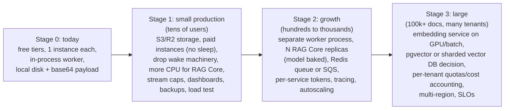

# Module 7: Performance and Scaling

> Part of [ADVANCED_RAG_2026_MASTER_COURSE.md](../../ADVANCED_RAG_2026_MASTER_COURSE.md). Builds on [Module 1](MODULE_1_SYSTEM_ARCHITECTURE.md) (architecture), [Module 3](MODULE_3_CHUNKING_AND_DOCUMENT_PARSING.md) (ingestion) and [Module 4](MODULE_4_EVALUATION_AND_BENCHMARKING.md) (how to measure).
> Labels: **[Code-read]**, **[Ran]**, **[Documented]** (a repo doc states a measurement; I did not reproduce it), **[Illustrative]** (arithmetic from stated assumptions, **not** a measurement), **[Unknown]**.
> **I have measured no AdvancedRAG performance myself.** No load test, memory profile or latency run was executed for this course. Every number tagged [Documented] was measured by the repository's author on their hardware; every number tagged [Illustrative] is a worked calculation you must replace with your own measurements.

> **Update after the implementation pass (2026-10-23, working tree on top of `31bad7e`, uncommitted).** Statements below were first written against `31bad7e`; where the code changed they are corrected in place or listed here. All new evidence is hermetic (local vector store, mock gateway, throw-away PostgreSQL); nothing ran against Pinecone, the real LLM gateway or a deployment. Traceability: [FEATURE_MATRIX](../verification/FEATURE_MATRIX.md). Old line numbers have shifted; search by name.
>
> **What changed for this module:** the upload path streams (stored object → temp file → RAG Core spool); jobs carry references, not bytes; upload dedup exists; queue depth, oldest pending age and stuck-job gauges plus job duration/outcome metrics are exported and a `traceparent` id follows a request across services. Measured on one laptop (see `docs/verification/PERFORMANCE_AND_BACKUP.md`): an ingestion size ladder (text up to 1 MB indexed, 5 MB and larger refused at the 5,000-chunk limit), real embedding throughput **34.8 chunks/s** (an earlier 3.7 figure was a measurement error), and **bounded concurrent load tests** on an isolated stack (6-12 documents ingesting at once; 8 and 24 users chatting; chat while ingesting; scanned-PDF OCR) with zero errors after one real bug was fixed. Findings worth remembering: ingestion is CPU-bound in RAG Core and a concurrency of 2 gave no throughput gain over 1 (7.3 docs/min either way); OCR pushed RAG Core to 526 MB, above the free instance's 512 MB. Everything not in that file is still **Illustrative**: no soak test, no Pinecone/Neon latency, no real model latency, no repeated runs, nothing from a deployment, and **no capacity or scalability claim**.

---

## 1. Learning objectives

1. Locate the bottlenecks in ingestion and in question answering, with evidence from the docs and code.
2. Explain CPU vs memory vs I/O limits, async vs threads vs processes, queues, pools, caches, backpressure, and horizontal scaling.
3. Do capacity planning with Little's Law and explicit assumptions.
4. Work through the 25 MB document and 100-concurrent-request scenarios, stating exactly which measurements are required.
5. Explain which changes a small app needs and which only a large one needs.
6. Propose and defend a staged scaling plan for AdvancedRAG.

## 2. Prerequisites

Modules 1, 3, 4. Basic arithmetic with rates (items per second), averages and percentiles.

---

## 3. Fundamentals

### 3.1 Performance vocabulary

| Term | Meaning |
|---|---|
| **Latency** | time for one request (or stage) |
| **Throughput** | requests (or chunks) completed per second |
| **Concurrency** | requests in flight at once |
| **Utilisation** | busy fraction of a resource (CPU, DB connections) |
| **Bottleneck** | the resource that saturates first and caps throughput |
| **Backpressure** | slowing or rejecting input when downstream cannot keep up |
| **Saturation** | queues grow without bound as utilisation → 100% |
| **p50/p95/p99** | latency percentiles (Module 4 §3.6) |

**Little's Law:** L = λ · W. Average number in the system (L) = arrival rate (λ) × average time in system (W). Example: 100 requests in flight at an average of 20 s each means the system is completing about 100 / 20 = 5 requests per second. [Illustrative arithmetic]

**Utilisation and queueing:** as a single server approaches 100% busy, waiting time rises sharply (roughly ∝ ρ/(1−ρ) for a simple queue). That is why "CPU is at 90%" already hurts p99.

### 3.2 CPU-bound vs I/O-bound; async vs threads vs processes

- **I/O-bound** work waits on networks/disks (calling Pinecone, the LLM, PostgreSQL). `async/await` lets one thread interleave thousands of waits cheaply. FastAPI + httpx + asyncpg in this project are async.
- **CPU-bound** work (PDF parsing, ONNX embedding inference, tokenization) keeps a core busy. In CPython the **GIL** lets only one thread run Python bytecode at a time, so threads don't speed up pure-Python CPU work; native libraries such as ONNX Runtime release the GIL and use their own thread pool (`EMBEDDING_THREADS`). Real parallelism for Python CPU work needs **processes** or more machines.
- `anyio.to_thread.run_sync` moves blocking calls off the event loop so *other requests keep being served*; it does not make the blocking call itself faster. The project does this for parsing, token counting, embedding and storage I/O. [Code-read]

### 3.3 Streaming vs loading whole files

Loading a 25 MB file into memory once is fine; loading it **several times** (raw bytes, base64 string, JSON copy, decoded bytes, multipart body) multiplies it. Streaming processes data in chunks so memory stays roughly constant regardless of size. FastAPI's `UploadFile` spools large uploads to disk (source 1). The project now streams end to end for the upload path (1 MiB scan reads, storage → temp file → RAG Core disk spool); the extracted text and chunk objects are still held in memory during parsing (measured peak 221 MB for a 25 MB text file that was then refused; Module 3 §4.9).

### 3.4 Queues, pools, caches

- **Background queue**: decouples accepting work from doing it; absorbs bursts; enables retries. Here: Postgres `background_jobs` + in-process worker.
- **Connection pool**: a bounded set of reusable DB connections. Pool exhaustion = requests wait or fail. Here: `pool_size=5`, `max_overflow=10` (so ≤ 15 per process) in backend (`DATABASE_POOL_SIZE`, `DATABASE_MAX_OVERFLOW`) and RAG Core (`db.py`), with `pool_pre_ping`. Neon's pooled endpoint (PgBouncer) is supported with prepared-statement caches disabled (`shared/advancerag_common/db.py`).
- **Cache**: stores results to skip work. Needs an invalidation story (when does a cached answer become wrong?). AdvancedRAG has **no** retrieval/answer/embedding-result cache [Code-read]. The only caches are the dependency "recently healthy" memo in `wake.py` and the loaded model.

### 3.5 Horizontal vs vertical scaling; stateless services

Vertical = bigger machine. Horizontal = more copies behind a load balancer. Horizontal scaling requires **statelessness** (no important state in process memory or local disk) and shared stores. State inventory in AdvancedRAG:

| State | Where | Scalable? |
|---|---|---|
| Users, chats, documents, jobs | Postgres | yes (shared) |
| Rate-limit counters | Redis in production | yes (memory backend is per process) |
| Original files | local disk **or** S3 | local disk: **no**; S3: yes |
| Vectors | Pinecone | yes (managed) |
| Chunks / FTS / ingestion locks | Postgres | yes; locks are DB-based (CAS), "works across processes/replicas" [Documented] |
| In-flight ingestion tasks and heartbeats | RAG Core process memory + DB rows | tasks are per process, `_local` dict of attempts; other replicas rely on heartbeats [Code-read: `ingestion.py`] |
| Embedding model | each RAG Core process loads its own copy | yes, costs RAM per replica |
| Agent Core | stateless by design | yes |
| Worker | in the backend process (`WORKER_ENABLED`) | multiple replicas OK (`SKIP LOCKED`); but the Dockerfile migrates on start, "only safe for a single replica" (README) |

---

## 4. Technical deep dive

### 4.1 Where the time goes: ingestion [Documented, author's measurements]

From `docs/rag-architecture.md` ("Ingestion speed", measured 2026-10-10 by the repo author; I did not reproduce):

| Stage | Share | Evidence quoted by the doc |
|---|---|---|
| Embedding (quantized bge-small ONNX on CPU) | ≈ 99% on Render free; 74–95% on a laptop | 74.3 s of ≈ 75 s for 40 chunks (Render free); 885 s of ≈ 1,100 s for the 812-page case |
| PDF parse (pypdf, single-threaded) | up to 16% | ≈ 175 s for 812 pages |
| Pinecone upserts | 3–4% | 0.3–0.4 s per 100-vector request; 39 s for 4,824 chunks |
| Chunking, token count, DB writes, verify | < 1% | 0.3 ms/chunk token count, chunking 10–20 ms |

Optimisations already applied (documented as measured, vectors bit-identical): length-sorted embedding batches (−22–24% embedding time), `EMBEDDING_BATCH_SIZE` default 32 → 4 (−26% on 12 cores, up to 4× on one thread), concurrent Pinecone upserts (410-chunk PDF upsert 1.96 s → 0.53 s), bounded retries for upsert/fetch/delete, stronger verification. End-to-end examples: 100-page PDF (410 chunks) 35.6 s → 22.4 s on a 12-core laptop. [Documented]

Documented unmet limit: Render free (0.1 CPU) needs about 1–2 s per chunk, so the 5,000-chunk cap would take about two hours, longer than the one-hour ceiling [Documented].

**What this means:** ingestion throughput is set by **embedding CPU**. Everything else is a rounding error until the CPU is fixed. Scaling options, in order of leverage: more/faster CPU per embedding worker; more embedding workers (each loads the model); GPU or an embedding API (changes the model/space unless identical); smaller/quantized models (re-embed everything).

### 4.2 Where the time goes: answering

A turn is a **sequential chain** (Module 1 §5.3, Module 5 §4.4): [rewrite] → embed query → (Pinecone ‖ Postgres FTS) → RRF → rerank → grade → [correct → retrieve → grade] → generate (streamed) → verify.

Documented measurement: retrieval (embed + Pinecone + FTS + RRF + rerank) p50 ≈ 1.1 s, max 2.3 s over 20 requests [Documented; Module 4 explains the limits]. Not measured anywhere in the repo: end-to-end latency, time to first token, grading/verification times (they are recorded per turn in metadata: `rag_call_ms`, `grading_ms`, `generation_latency_ms`, `verification_ms`, `total_latency_ms`, so production data can answer this once collected).

Structural latency facts (from code): the user-visible time to first token includes rewrite + retrieval + grading (+ correction); verification happens after streaming; each LLM call carries gateway queueing and model time; gateway rate limits create retries with backoff up to 8 s (Module 5 §4.7).

### 4.3 Free-tier architecture trade-offs (confirmed in the repo)

On Render free: 0.1 CPU, 512 MB RAM, sleep after 15 minutes idle, 750 shared instance-hours per month (README, render.yaml comments). Consequences already handled in code:

| Problem | Mechanism in code |
|---|---|
| Cold start 15–35 s, RAG Core model load up to minutes | `wake.py`: `ensure_awake` polls `/health` with exponential backoff; `WAKE_DEPENDENCIES_ON_START`; budgets `CHAT_WAKE_SECONDS=150`, `RAG_WAKE_SECONDS=300` |
| Render won't wake a service from another Render service | Vercel `/wake/<service>` rewrites relay to each service's `/health` (`frontend/vercel.json`) |
| Mid-job sleep | `KEEP_AWAKE_URL` loop pings the backend's own `/health` while jobs are queued/running |
| Long ingestion vs HTTP timeouts | async ingestion + polling + heartbeat/lease; ceiling counts active polling time only so sleep isn't a timeout |
| Silent browser stream during wake | `agent.waking` SSE events every 8 s |
| Nested timeouts | RAG 420 s, LLM 180 s, agent turn 600 s, backend→agent 660 s: each outer > inner |
| Ephemeral disk | durable per-document storage (`db`/`s3`); production config still `local` (Module 3 §4.10) |
| Low RAM | `EMBEDDING_BATCH_SIZE=4`, `EMBEDDING_THREADS=1`, `INGEST_CONCURRENCY=1`, `INGEST_EMBED_SLICE=32`, `MALLOC_ARENA_MAX=2`; documented peak 324 MiB for a 1,000-row CSV and a 30-page PDF |

The honest framing: a large share of the system's operational complexity is **the price of free hosting**, and the same code runs on a single VM (`infrastructure/production-vm/`) or paid instances "without changes" [Documented].

### 4.4 Vector index tuning

Pinecone serverless hides ANN parameters. What you control: dimension (fixed by the model), metric, namespace layout (one per user), batch sizes (100 per upsert request, 5 concurrent), `topK` (20), metadata filter selectivity, and the number of namespaces (plan limits [Unknown]). With pgvector you would tune HNSW `m`, `ef_construction`, `ef_search` and IVFFlat `lists`/`probes`, trading recall, latency and memory (source 3).

Memory arithmetic [Illustrative, exact for float32 storage]: 384 floats × 4 bytes = 1,536 bytes per vector. 69 vectors ≈ 106 KB; 5,000 vectors ≈ 7.7 MB; 1,000,000 vectors ≈ 1.5 GB raw (an HNSW graph adds overhead). This is why vector size matters at scale and why 384-d models are attractive.

### 4.5 Caching and invalidation: where it could help

| Candidate | Key | Invalidate when | Risk |
|---|---|---|---|
| Query embedding | hash(normalised query, model) | model change | tiny; cheap win for repeated queries |
| Retrieval result | (user, doc set, query, index version) | any document add/delete in scope | stale or cross-user leak if key omits `user_id` |
| Final answer | + prompt/model version | same + prompt change | stale answers, privacy |
| Rewrite/grade results | hash of inputs | prompt version | low value |
| Embedding of identical chunk text | hash(text, model) | model change | saves re-embedding duplicates (whole-file duplicates are now deduplicated at upload; repeated chunks across different files are not) |

Rule: include `user_id` in every key; version the key with the embedding model/prompt; set a TTL; measure hit rate before building.

### 4.6 Rate limits, retries and backpressure

Existing: per-user/IP rate limits (Redis), body limits, quotas, bounded retries, per-document ingestion lock, `INGEST_CONCURRENCY` semaphore (RAG Core) and `WORKER_CONCURRENCY` (backend; Render sets 1), job `max_attempts` (3) with exponential backoff, and fail-fast on downstream rate limit in the rewrite step. Missing: a **global** LLM concurrency limit, per-user concurrent-stream cap, queue depth alarms, load shedding (return 503 early when overloaded). Without these, overload degrades by timeouts rather than by controlled rejection.

### 4.7 Monitoring and tracing

Present: request id propagated across hops; JSON logs; Prometheus-format `/metrics` per service (counters + latency histograms with buckets 5 ms … 60 s) protected by the internal token; `timed()` around dependency calls; per-turn metadata and `turn_finished` logs; `/health` vs `/ready` chain. **Added:** W3C `traceparent` propagation with the trace id in JSON logs, queue gauges (`queue_jobs`, `queue_oldest_pending_age_seconds`, `queue_stuck_jobs`), job outcome/duration/error-code metrics, ingestion and OCR metrics [Ran: `test_observability.py`]. Still missing: tracing spans/exporter, dashboards/alerts, SLOs, synthetic probes, cost metrics. [Code-read]

### 4.8 Load, soak and failure testing

- **Load test**: ramp traffic to expected peak; find the knee where p95 explodes. Use the harness in Module 4 against a *staging* stack with a mock LLM first (so you don't burn provider quota), then with the real route at low volume.
- **Soak test**: moderate steady load for hours; looks for leaks (memory growth, connection leaks, growing queues, job table bloat from base64 payloads).
- **Failure testing (chaos)**: kill RAG Core mid-ingestion, throttle Pinecone, return 429s from the gateway, drop Redis, restart the backend during a stream; verify the documented recovery behaviours. The repo's reliability tests do this with mocks; real-infrastructure runs are [Missing].

---

## 5. Scenarios with explicit assumptions

### 5.1 Scenario A: a 25 MB document

**What is actually knowable from the repo** (Module 3): upload limit 25 MiB, chunk cap 5,000, RAG file limit 30 MiB, ingestion ceiling 1 h of active polling, no base64 copy any more (jobs hold references), and a measured text ladder: 1 MB ≈ 1,456 chunks indexed, 5 MB+ refused at 5,000 chunks.

**Three different "25 MB" documents give three different outcomes:**

| Case | Text extracted | Expected path (from code) |
|---|---|---|
| 25 MB scanned PDF | ≈ 0 | passes upload; fails `NO_EXTRACTABLE_TEXT` (non-retryable) quickly after parse |
| 25 MB text-rich PDF/CSV/TXT, > ~5 M characters | large | fails `DOCUMENT_TOO_LARGE` after parse+chunk (no embedding done yet), because chunk count > 5,000 |
| 25 MB PDF with images and ~4 M characters of text | ≈ 4,000 chunks | indexes if resources allow; embedding dominates |

**Time model for the third case [Illustrative; replace c with your measurement].** Let N = number of chunks, c = embedding seconds per chunk on your hardware.

- Embedding time = N · c.
- Using the *documented* per-chunk figures only as scenario inputs: laptop-class 885 s / 4,824 chunks ≈ 0.18 s per chunk → N = 4,000 gives ≈ 730 s (≈ 12 min); the documented Render-free estimate of 1–2 s per chunk gives 4,000–8,000 s (≈ 1.1–2.2 h), which exceeds the 3,600 s ceiling at the high end.
- Add parse time (documented ≈ 0.2 s/page: 175 s / 812 pages; pages for this case unknown), upsert (≈ 0.3–0.4 s per 100 vectors → ≈ 16 s for 4,000), verification (≤ 20 s wait window).

**Memory model [Illustrative; measure with `tracemalloc` / container metrics].** Peak ≈ raw bytes (25 MiB) + extracted text (~4 MB) + chunk objects (~5 MB) + vectors (4,000 × ~12 KB as Python floats ≈ 48 MB) + model (~70 MB on disk, more in RAM) + framework baseline. Plus, in the backend during upload with local storage: raw (25 MiB) + base64 (33.3 MiB) + JSON copy; in the worker: payload (33.3 MiB) + decoded (25 MiB) + multipart body (25 MiB). Against a 512 MB instance, the *backend* upload path alone could consume ~100+ MiB transiently and several simultaneous uploads could not fit [reasoning; not measured].

**Measurements you must take before claiming anything:** (1) peak RSS of backend during upload and worker during dispatch; (2) peak RSS of RAG Core through the full ingestion; (3) seconds per stage (`timings` are already returned in the ingestion record: `parse_s`, `embed_s`, `upsert_s`); (4) chunk count; (5) behaviour when the process is OOM-killed (does recovery work as documented?); (6) DB size growth from payload.

**Improvements ordered by value (items 1–2 are done in code):** (1) durable storage and no payload; (2) stream the file to RAG Core; still open: parse page-by-page; checkpoint embeddings so a failed attempt can resume (the doc names this "the largest remaining win"); move embedding to a dedicated worker with more CPU; reject early using a text-size estimate; surface progress (the stage/`done`/`total` already exist in the attempt record).

### 5.2 Scenario B: 100 concurrent requests

First define "request": 100 concurrent **chat turns** is very different from 100 concurrent GETs. Assume chat turns with documents attached, streaming, up to 4 LLM calls each, following Module 5.

**Walk the path and name each limiter:**

| Hop | Limiter | Evidence |
|---|---|---|
| Browser → Vercel proxy → backend | Vercel/Render connection limits; uvicorn single process (`serve.py` starts one server; no `--workers`) | [Code-read] |
| Backend DB | pool ≤ 15 connections/process; each turn does a locked `prepare_turn` transaction, then short writes every 2 s | `config.py`, `message_service.py`, `agent_service.py` |
| Backend → Agent Core | httpx client defaults; streaming connection per turn | `integrations/agent_core.py` |
| Agent Core | async, stateless; per-turn memory small; deadline 300–600 s | `orchestrator.py` |
| RAG Core retrieve | query embedding CPU (ONNX; `EMBEDDING_THREADS=1` on Render), threadpool, Pinecone query, rerank call, Postgres FTS (pool ≤ 15) | `pipeline.py` |
| LLM service → gateway | `max_connections=100` in the httpx client (`freellmapi.py::FreeLLMAPIProvider.__init__`); the gateway/provider quotas are the real cap | [Code-read]; quotas [Unknown] |
| Pinecone | per-plan rate limits [Unknown] | – |

**Illustrative capacity arithmetic** (assume unknowns; replace with measured values):

- Let W = average end-to-end time of a turn (say 20 s: 3 s before first token, 14 s generation, 3 s verification). By Little's Law, 100 turns in flight means ≈ 100/20 = 5 completed turns per second sustained.
- LLM calls in flight ≈ 100 turns × (up to 1 call at a time) = up to ~100 concurrent upstream streams plus short bursts for grade/verify; with 4 calls per turn that is ≈ 20 calls/second to the gateway. Whether free providers behind FreeLLMAPI tolerate that is the key unknown; 429s would trigger backoff (≤ 2 retries, ≤ 8 s) and then `LLM_RATE_LIMITED` for many users.
- Query embedding at 5 turns/second: if one embedding takes e (seconds of CPU), RAG Core needs 5·e cores just for queries. With `e` unknown (it is inside the documented 1.1 s retrieval p50), at 0.1 CPU (Render free) this will saturate quickly; this is the likely first CPU bottleneck. Measure `e`.
- DB: 100 streams each flush every 2 s → ≈ 50 small commits/s plus message inserts. Fine for Postgres, but each flush opens `session_scope()` (a pooled connection briefly); pool of 15 and Neon pooler limits matter. Measure `pg_stat_activity` under load.

**Expected failure order without changes (hypothesis to test, not a result):** (1) LLM gateway/provider 429s or latency, (2) RAG Core CPU for query embedding/rerank latency on small instances, (3) DB pool waits, (4) single uvicorn process event-loop delay if any blocking call slips in, (5) memory growth from many open SSE connections.

**Controls to add by value:** per-user concurrent-stream cap and global LLM semaphore with queueing and clear "busy" responses (backpressure); cache query embeddings; skip grading for confident retrieval; run grade+verify with a cheaper/faster model route; horizontal replicas of RAG Core with the model baked in; connection pool sizing per replica × replicas ≤ DB max connections; autoscaling on queue depth/latency; timeouts that fail early when downstream is saturated.

**How to test:** staged load: 10 → 25 → 50 → 100 concurrent virtual users, 10 minutes each, mock LLM first (isolates your code), then real route at lower scale; record p50/p95/p99 per hop, error rate by code, CPU/RSS per service, DB connections, gateway 429 rate; define pass criteria beforehand (for example p95 time-to-first-token ≤ X, error rate ≤ Y%).

### 5.3 Capacity-planning calculator (educational; plug in your measurements)

```python
# runnable
import math

def ingestion_time_s(chunks, sec_per_chunk, parse_s=0.0, upsert_per_100_s=0.4, verify_s=20.0):
    return parse_s + chunks * sec_per_chunk + math.ceil(chunks / 100) * upsert_per_100_s + verify_s

def workers_needed(docs_per_hour, chunks_per_doc, sec_per_chunk, utilisation=0.7):
    busy_seconds_per_hour = docs_per_hour * chunks_per_doc * sec_per_chunk
    return math.ceil(busy_seconds_per_hour / (3600 * utilisation))

def littles_law_rate(concurrency, avg_seconds):
    return concurrency / avg_seconds           # completed per second at steady state

def vectors_bytes(n, dim=384, bytes_per=4):
    return n * dim * bytes_per

def base64_len(n_bytes): return 4 * math.ceil(n_bytes / 3)

# All inputs below are ILLUSTRATIVE assumptions, not measurements of AdvancedRAG.
assert round(ingestion_time_s(4000, 0.18) / 60, 1) == 12.6              # ~12.6 min at 0.18 s/chunk
assert ingestion_time_s(4000, 1.5) > 3600                              # 1.5 s/chunk blows the 1 h ceiling
assert workers_needed(docs_per_hour=60, chunks_per_doc=400, sec_per_chunk=0.18) == 2
assert littles_law_rate(100, 20) == 5.0
assert vectors_bytes(5000) == 7_680_000 and vectors_bytes(1_000_000) == 1_536_000_000
assert base64_len(25 * 1024 * 1024) == 34_952_536
print("ok")
```

---

## 6. Scaling plan: from prototype to production (what is justified when)



| Change | Needed at | Reason |
|---|---|---|
| S3-compatible storage; remove base64 payload | **Code done; production selection pending** | durability, DB bloat, retention (Module 6 R13) |
| Paid always-on instances; more CPU for RAG Core | Stage 1 | removes cold starts, ingestion 10–20× faster (docs: laptop is "about 20 times faster") |
| Per-user concurrent-stream cap, global LLM limiter | Stage 1 | prevents one user exhausting shared quota |
| Backups and a tested restore | Stage 1 (local restore verified; managed DB not) | Module 6 R14 |
| Load/soak tests with SLOs | Stage 1 | you cannot plan capacity without them |
| Dedup on upload | **Done** (per user, content hash) | cost and quality |
| Dedicated worker process | Stage 2 | CPU isolation from API; independent scaling |
| Multiple RAG Core replicas | Stage 2 | embedding throughput; remember each replica loads the model |
| Queue service (Redis/SQS) instead of Postgres polling | Stage 2 (maybe never) | Postgres `SKIP LOCKED` queue handles a lot; switch when polling load or latency demands it |
| Per-service credentials / mTLS | Stage 2 | blast radius (Module 6 R5) |
| Distributed tracing | Stage 2 | multi-service latency debugging |
| GPU/batch embedding service | Stage 3 | cost per chunk |
| Re-evaluating Pinecone vs pgvector | Stage 3 (or earlier for cost) | at some scale managed ANN wins; at small scale pgvector in existing Postgres is simpler |
| Multi-region | Stage 3 | latency/compliance |

**What is over-engineering for a small app:** Kubernetes, a message broker, microservice meshes, multi-region, GPU embedding, sharded vector DBs. The correct small-app answer is: persistent storage, enough CPU, limits, backups, and measurements.

**Reliability/cost trade-offs to be able to discuss:** four calls per answer improve groundedness but multiply cost and latency; verification could be sampled or enabled only for high-risk questions; a cheaper "fast" model for checks only helps if `AGENT_FAST_MODEL` is actually set; keyword fallback preserves availability at lower quality; free hosting trades cost for cold starts and complexity.

---

## 7. Common mistakes

1. Scaling the wrong tier: adding API replicas when embedding CPU is the bottleneck.
2. Quoting laptop numbers for production hardware (the docs say 20× difference).
3. Averages instead of percentiles; p99 from tiny samples.
4. Load-testing against the real LLM and then blaming your code for provider 429s.
5. Replicating services that keep state in memory or local disk.
6. Raising pool sizes without checking DB max connections × replicas.
7. Adding a cache without `user_id` in the key.
8. Treating the 25 MB upload limit as the processing limit.
9. Retrying aggressively on overload (retry storms).
10. Optimising before measuring.

## 8. Interview questions

### Beginner

**B1. What is a bottleneck?** The resource that saturates first and caps throughput. In ingestion here: embedding CPU.

**B2. Why is ingestion asynchronous?** It takes seconds to hours; blocking an HTTP request is fragile.

**B3. What is a connection pool?** Reused DB connections to avoid connect cost and cap concurrency.

**B4. What is p95?** 95% of requests are at least that fast.

**B5. Why stream LLM output?** Lower perceived latency.

### Intermediate

**I1. Use Little's Law: 100 requests in flight at 20 s each. Throughput?** 5 req/s.

**I2. Why does `anyio.to_thread` not make parsing faster?** It frees the event loop; the work still takes the same CPU time (and the GIL limits Python threads).

**I3. Which parts of AdvancedRAG are stateless?** Agent Core; the backend is stateless apart from the in-process worker and local disk; RAG Core holds in-flight task state and a per-process model.

**I4. What caching would you add first?** Query embeddings (cheap, safe) and measure; retrieval result caching only with versioned, user-scoped keys.

**I5. How does the system handle a downstream rate limit?** Bounded retries with backoff in the LLM service, fail fast for rewrite on 429, user-facing `LLM_RATE_LIMITED`, partial output retained.

**I6. What changes are justified for a 20-user deployment?** Persistent storage, adequate CPU, limits, backups, monitoring. Not Kubernetes.

### Advanced

**A1. Design a scaling plan.** (Section 6.) State assumptions and measurements first.

**A2. How would you cut p95 time-to-first-token in half?** Measure stages; skip grading when retrieval is confident or run it in parallel with generation start (and only cancel if insufficient), cache query embeddings, use a faster route for checks, warm services, reduce evidence size, parallelise rewrite with retrieval for first-turn questions.

**A3. Estimate capacity for 1,000 active users.** Define the usage model (messages per user per hour, documents per user, chunks per document), compute ingestion CPU seconds and LLM calls/sec, apply utilisation ≤ 70%, compare with provider quotas; present as a spreadsheet of assumptions. (Use the calculator in §5.3.)

**A4. How would you make ingestion resumable?** Persist embeddings per slice (e.g., to a staging table or the vector store with a `pending` flag), track `done` slices in `rag_ingestions`, skip completed slices on retry, finalise (verify, flip visibility) at the end; keep the "failed attempt leaves nothing visible" guarantee by hiding unfinished vectors from queries (status filter in metadata or separate namespace).

**A5. pgvector vs Pinecone for 5 M vectors?** 5 M × 1,536 B ≈ 7.7 GB raw plus index overhead; pgvector HNSW needs RAM; Pinecone managed. Decide on cost, ops skill, filter patterns, hybrid needs; benchmark recall/latency on your own data.

## 9. Follow-up questions

- How would you autoscale RAG Core? (CPU or queue-depth metric; model baked in image to avoid cold download; readiness gating on model loaded: `/ready` already reports it.)
- What breaks if two backend replicas both run workers? (Claim uses SKIP LOCKED+CAS, so jobs aren't duplicated; migrations on start are single-replica only; the stale sweeps both run (idempotent CAS).)
- How do you roll out a new embedding model with zero downtime? (New index, dual-write/backfill from stored chunk text, shadow-evaluate, switch reads, delete old.)
- What is head-of-line blocking in the job queue here? (`WORKER_CONCURRENCY=1`: a 1-hour ingestion blocks other users' jobs.)
- How do you find a memory leak? (Soak test, RSS over time, `tracemalloc`, object growth, connection counts.)

## 10. Practical exercises

### E7.1 Capacity planning (use §5.3)

*Problem.* 60 documents/hour, 400 chunks each, 0.18 s/chunk (assumed). How many embedding workers at 70% utilisation? What if the hardware is 8× slower?
*Answer.* busy = 60·400·0.18 = 4,320 s/h; capacity per worker = 2,520 s/h → 1.71 → 2 workers. At 8× slower: 34,560 s/h → 13.7 → 14 workers (or buy faster CPUs).

### E7.2 Little's Law drill

100 concurrent, W = 20 s → 5/s. If W doubles under load while concurrency is fixed → 2.5/s: throughput halves, so tail latency growth directly cuts capacity.

### E7.3 Implement a bounded-concurrency queue with backpressure

```python
# runnable
import asyncio

class Overloaded(Exception): ...

class Limiter:
    """At most `max_running` calls run; at most `max_waiting` wait; beyond that fail fast."""
    def __init__(self, max_running, max_waiting):
        self.sem, self.max_waiting, self.waiting = asyncio.Semaphore(max_running), max_waiting, 0
    async def run(self, coro_fn):
        if self.sem.locked() and self.waiting >= self.max_waiting:
            raise Overloaded()                 # shed load instead of queueing without bound
        self.waiting += 1
        try:
            await self.sem.acquire()
        finally:
            self.waiting -= 1
        try:
            return await coro_fn()
        finally:
            self.sem.release()

async def main():
    lim = Limiter(max_running=2, max_waiting=1)
    gate = asyncio.Event()
    async def slow():
        await gate.wait(); return "done"
    tasks = [asyncio.create_task(lim.run(slow)) for _ in range(3)]      # 2 running + 1 waiting
    await asyncio.sleep(0.01)
    try:
        await lim.run(slow)                                             # 4th: rejected immediately
    except Overloaded:
        rejected = True
    else:
        rejected = False
    gate.set()
    results = await asyncio.gather(*tasks)
    assert rejected and results == ["done"] * 3

asyncio.run(main())
print("ok")
```
*Discussion.* This is the behaviour the project lacks for LLM calls; return HTTP 429/503 with `Retry-After` when `Overloaded`.

### E7.4 Compute the cost of base64 payloads at scale

```python
# runnable
import math

def payload_mib(file_mib, files): return files * 4 * math.ceil(file_mib * 2**20 / 3) / 2**20
assert round(payload_mib(25, 1), 2) == 33.33
assert round(payload_mib(25, 15)) == 500          # 15 x 25 MiB uploads ~ 500 MiB of payloads kept for 30 days
print("ok")
```

### E7.5 Design a load test (write the plan)

Fields: objective, workload model (users, think time, question mix), environment (staging; mock LLM vs real), ramp profile, duration, metrics and thresholds, data (corpus, namespaces), cleanup, risks (quota burn), reporting format. Example thresholds are yours to set.

### E7.6 Troubleshooting scenarios

1. *Ingestion of a 400-page PDF never finishes on Render.* Compare chunk count × seconds/chunk to the 1 h ceiling; check `rag_ingestions.stage/timings`; check OOM kills; consider paying for CPU.
2. *Chat replies hang for 30 s after idle.* Cold start; check `agent.waking` events and wake logs; keep-alive or paid plan.
3. *DB "too many connections" after adding a second backend replica.* 2 × (5+10) per service plus RAG Core; use the pooler and lower pool sizes or raise limits.
4. *p99 spikes every 15 minutes.* Cron-like background loops (`RECONCILE_INTERVAL_SECONDS=600`, stale sweep 60 s), GC, Neon autosuspend; correlate with logs.

## 11. Revision notes

- Bottleneck in ingestion: embedding CPU (≈ 99% on Render free; documented). Parse ≤ 16%, upsert 3–4%.
- Retrieval p50 ≈ 1.1 s, max 2.3 s [Documented, 20 requests]; end-to-end unmeasured.
- 25 MB: three limits (bytes, 5,000 chunks, 1 h). Base64 copy 33.3 MiB. Whole-file reads.
- 100 concurrent turns: Little's Law; first suspects LLM quotas, RAG CPU, DB pool; need stream cap and global limiter.
- Free-tier machinery = wake relay, keep-alive, long timeouts; paid VM removes most.
- No cache, no tracing, no load test; metrics + logs + request ids exist.
- Scale in stages; small apps need storage, CPU, limits, backups, measurements.

## 12. Assessment (attempt before reading the answer key)

1. 4,800 chunks; 0.2 s/chunk; 0.4 s per 100-vector upsert request; 20 s verification; parse 100 s. Total ingestion time?
2. At 1.5 s/chunk, what is the maximum number of chunks that finishes within the 3,600 s ceiling (ignore other stages)?
3. 200 documents/hour, 300 chunks each, 0.18 s/chunk, 70% target utilisation: how many workers?
4. A chat turn averages 25 s. How many concurrent turns correspond to 4 completed turns/second?
5. Name five pieces of state that block horizontal scaling if kept in memory/local disk, and say which the project has.
6. Explain why raising `EMBEDDING_BATCH_SIZE` from 4 to 32 can *slow* ingestion on Render (documented).
7. Why does a 25 MB scanned PDF fail faster than a 25 MB text file? What does each cost before failing?
8. List four metrics you would alert on in production and thresholds you would choose after measuring.
9. What does `INGEST_CONCURRENCY=1` imply for fairness among users?
10. Propose a plan to make p95 time-to-first-token better without changing models.
11. When would you move from Postgres-polling jobs to a dedicated queue?
12. List the measurements required before you claim "the system handles 100 concurrent users".

---

## 13. ANSWER KEY (do not read until you have attempted the assessment)

**A1.** Embedding 4,800 × 0.2 = 960 s; upserts ⌈4800/100⌉ = 48 × 0.4 = 19.2 s; parse 100 s; verify 20 s → 1,099.2 s ≈ 18.3 min (illustrative arithmetic).

**A2.** 3,600 / 1.5 = 2,400 chunks.

**A3.** busy = 200 × 300 × 0.18 = 10,800 s/h; per worker 3,600 × 0.7 = 2,520 s/h → 4.29 → 5 workers.

**A4.** L = λW → L = 4 × 25 = 100 concurrent turns.

**A5.** Sessions/tokens, rate-limit counters (memory backend), uploaded files on local disk, in-process job state/tasks, caches, loaded models (RAM duplication). The project has: local disk files (Render), in-process ingestion tasks/`_local` attempts (mitigated by DB heartbeats), in-memory limiter in dev, per-process model; sessions and counters are in DB/Redis.

**A6.** Padding: each batch is padded to its longest text and attention cost grows with batch×length; on a single thread / small CPU, large batches mean more memory pressure and cache misses; measured 4 is up to 4× faster on one thread and 26% faster on 12 cores (documented). Always measure on target hardware.

**A7.** The scanned PDF parses (cheap) and finds no text → fails right after parse, with no embedding. The text file is parsed and chunked (more CPU), then rejected at the 5,000-chunk check, also before embedding. Both fail before embedding cost, but the text-rich file does more parse/chunk work; in local-storage mode both also consumed ~33 MiB of DB payload.

**A8.** E.g., p95 time-to-first-token, error rate by code (`LLM_RATE_LIMITED`, `RAG_SERVICE_UNAVAILABLE`), ingestion queue depth / oldest pending job age, DB pool waits/connections, RSS per service vs limit, abstention rate. Thresholds come from baseline measurements and SLOs.

**A9.** Documents are processed one at a time per RAG Core process, so a very large document delays everyone else (head-of-line blocking); solve with per-user/size-based queues, priority, or more workers.

**A10.** Run grading concurrently with starting generation (cancel if insufficient), cache query embeddings, skip rewrite when not a follow-up (already), reduce evidence length, keep services warm, parallelise independent calls, pre-warm on page load.

**A11.** When polling load or latency becomes material (many workers, high job rate), when you need delayed/priority queues or fan-out, or when the DB becomes a contention point. Until then `SKIP LOCKED` is a legitimate, transactional queue.

**A12.** A defined workload model; load-test results at that concurrency with p50/p95/p99 and error rates per stage; resource utilisation (CPU, RSS, DB connections); provider quota behaviour; a soak test; failure injection results; and pass criteria set in advance.

---

## 14. Completion criteria (self-check)

- [ ] You can state the documented stage shares and where they come from, and their limits.
- [ ] You can do the §5.3 calculations by hand.
- [ ] You can describe both scenarios with explicit assumptions and the measurements still needed.
- [ ] You can present the staged scaling plan and say what not to build yet.
- [ ] You ran the runnable blocks; they printed `ok`.

## Sources (accessed 2026-10-23)

1. FastAPI, "Request Files" (`UploadFile`, spooling): https://fastapi.tiangolo.com/tutorial/request-files/
2. Pinecone, "Rerank results": https://docs.pinecone.io/guides/search/rerank-results
3. pgvector README (HNSW/IVFFlat): https://github.com/pgvector/pgvector
4. Repository: `docs/rag-architecture.md` ("Ingestion speed"), `docs/render-free.md`, `render.yaml`, `shared/advancerag_common/wake.py`, `shared/advancerag_common/db.py`, `backend/app/core/config.py`.
5. Little's Law and queueing intuition: standard operations-research results, stated from general knowledge.
